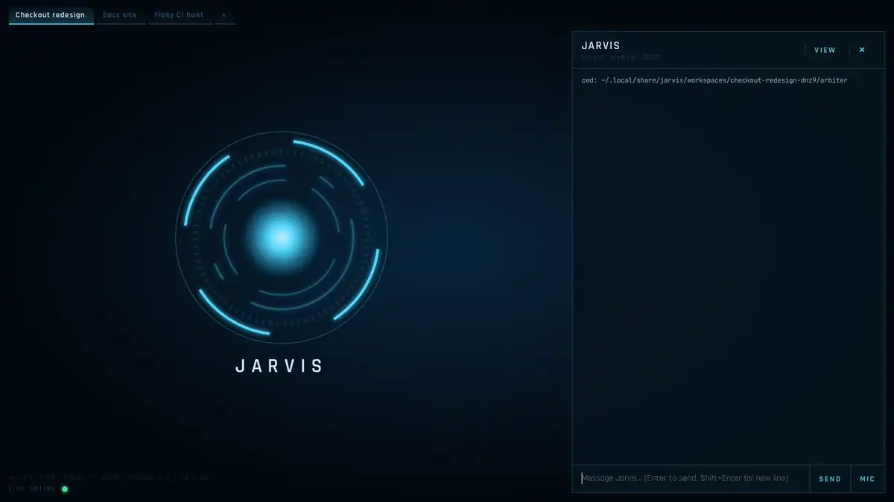
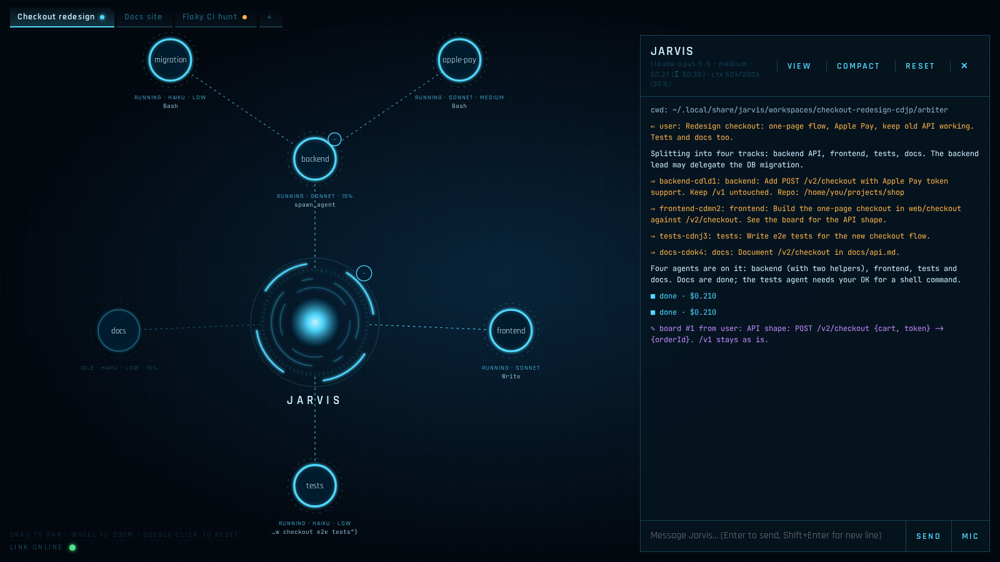
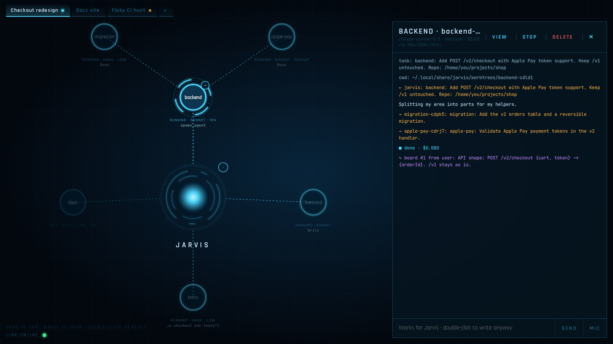
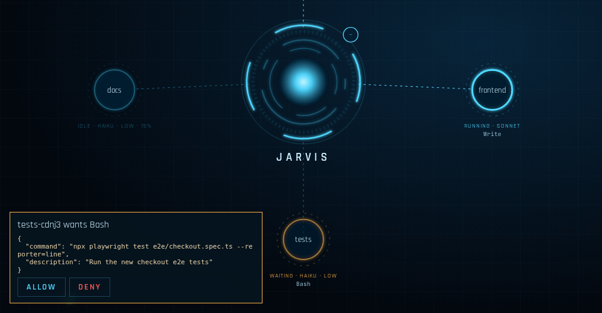
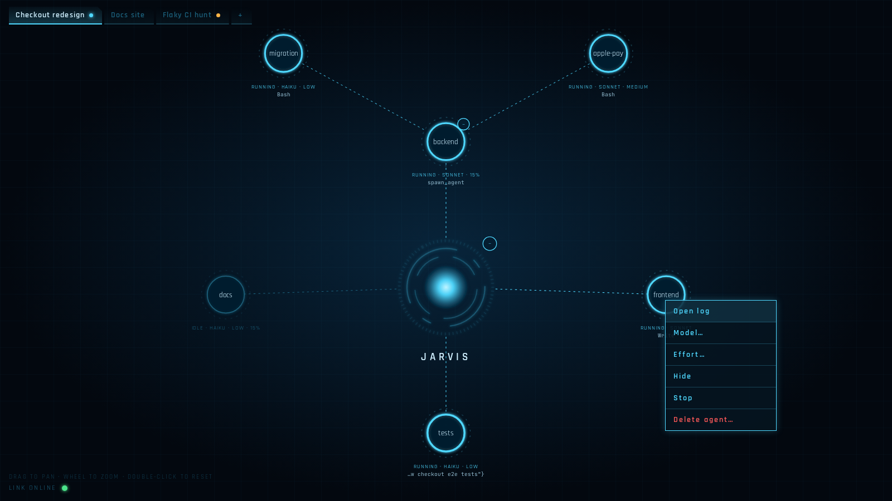
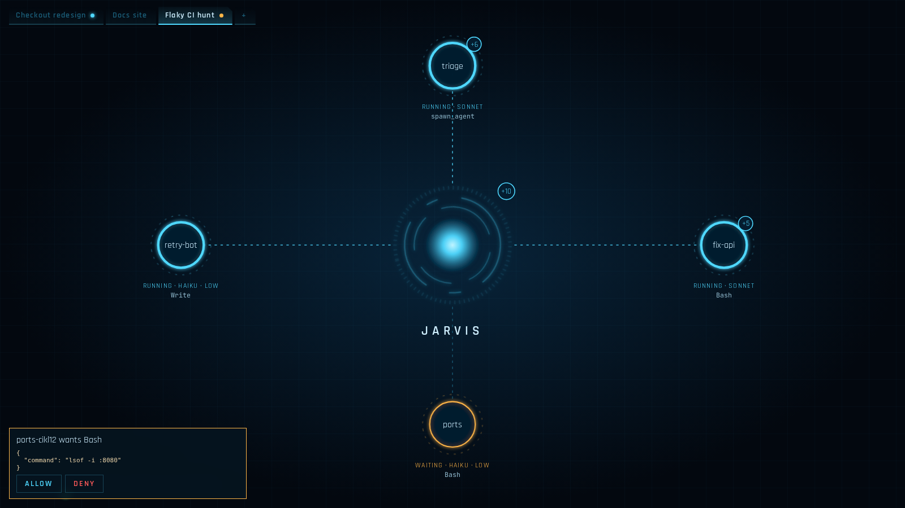

[](https://github.com/ARostovsky/jarvis/actions/workflows/ci.yml)

# Jarvis

**One AI manager that runs a team of AI coding agents, and a live map where you watch them work.**

You describe a goal in plain words. Jarvis splits it into tasks, hands each task to its own [Claude Code](https://claude.com/claude-code) agent, and shows the whole team on screen: who is working, on what, how much it costs, and when someone needs your OK. Jarvis never edits code. Before it hands a hard decision to you, it asks an independent, quick, read-only Opus advisor agent for a second opinion, then decides and tells you both; scope, taste, money, publishing and deleting your work stay yours. Each agent works on its own git branch.



## Quick start

You need Linux or macOS, **Node.js 24+**, **git**, and **Claude Code** set up so that `claude` works in your terminal. Agents use the same login, API key or proxy settings.

```bash
git clone https://github.com/ARostovsky/jarvis.git
cd jarvis
npm install
ln -s "$PWD/bin/jarvis.mjs" ~/.local/bin/jarvis   # once; any folder in your PATH works

jarvis            # starts the server in the background and opens http://127.0.0.1:7777
```

Also: `jarvis stop|restart|status|logs`. Foreground: `npm start`.

Browser tests: `npm run e2e` (Playwright, starts its own server on port 7798, or `E2E_PORT` to run several at once, e.g. `E2E_PORT=7810 npm run e2e`, with a throwaway data dir and a scripted fake of the Agent SDK, so no API calls; needs chromium, `npx playwright install chromium`).

First goal:

1. A fresh install has no workspace and shows an empty screen: click **NEW WORKSPACE** (or **+** in the tab bar). Name the workspace and, optionally, give the path to your git project. Project and notes folders you used before are offered in a list, most recent first.
2. In the Jarvis chat, describe a goal, for example: *"Add a /health endpoint with a test."*
3. Watch Jarvis hire agents. Answer approval cards.
4. Work lands on `jarvis/<agent-id>` branches in your repo. Review and merge.

## What you see

### The map

Jarvis is in the center, agents around it. Each tab is a separate workspace: its own Jarvis, team and history.



| Color | Meaning |
|-------|---------|
| Cyan, bright | Working right now |
| Dim | Idle, waiting for the next message |
| Amber | Waiting for your approval |
| Red | Something went wrong |
| Gray | Stopped |

### Log and chat

- Click a circle to open its log: task, messages, tool calls, cost per step.
- Give goals in Jarvis's chat. Other agents' inputs are locked; double-click one to write anyway.



### Approvals

- Agents run in Claude Code's `auto` mode. Only actions its classifier cannot decide show up as a card.
- Read the command, press ALLOW or DENY. The agent waits.



### Controls

- Drag a tab left or right to reorder workspaces; the order is kept across restarts.
- Jarvis in one workspace can message Jarvis in another (`tell_workspace`, e.g. a heads-up about a shared branch). Messages are urgent by default and wake an idle target; a reply to an urgent message is always urgent. With `urgent: false` an idle one is not woken: its tab shows a count of unread messages, and they arrive with its next turn. A wake happens only if the target is idle (a stopped one stays stopped; the reply says which targets were not woken).
- A workspace's Jarvis can start another workspace with a task (`create_workspace`). Use it when you ask a workspace to hand a separate task to a new one. The new workspace gets the same project (unless another is given), notes folder and Jarvis setup, and sees only the task text, so the task must be self-contained. The creating workspace keeps running. Refused while working on a message from another workspace, and after 3 creations until you write to it again.
- Right-click an agent, Jarvis or a tab: model, effort, stop, delete, hide, rename, archive.



### Big teams

- Every agent ends its report with a `VERDICT: verified`, `partial` or `failed` line; Jarvis routes on it. A small task goes straight to one agent, a large or unclear goal gets a planner agent first.
- A lead folds its helpers into a `+N` badge while none of them works.
- Only agents Jarvis starts as leads (for a large multi-part area) can hire helpers; other agents work alone. A lead shows as running until its helpers are done, then reports to Jarvis once (a restart in between loses that report).
- Jarvis hides agents that were idle over 10 minutes once it has more than 8. Right-click Jarvis for **Hide idle agents** or **Show all agents**.



### Voice input (optional)

Off by default. A mic button next to SEND turns speech into text with a local Whisper model (faster-whisper in a Python sidecar). Jarvis itself records the microphone through PipeWire, so the browser asks for no permission. Audio stays on your machine and is never stored (unless you set `JARVIS_VOICE_DEBUG_WAV`, see the env table); on release the transcript is sent at once to the agent that was selected when you started, like a voice message, and your draft stays as it was. With `JARVIS_VOICE_AUTOSEND=0` it lands in the input box at the caret instead and is never sent by itself. A failed send puts the text into that agent's draft.

To enable it:

1. Linux with PipeWire and `pw-record` (package `pipewire`, or `pipewire-bin` / `pipewire-utils`). Jarvis records the default input of your sound server: the one `wpctl status` marks with `*` under Sources.
2. Set up Python with `faster-whisper` (`voice/setup.sh` creates `voice/.venv` and fetches the models; Jarvis uses that venv by default), or point `JARVIS_VOICE_PYTHON` at a Python that already has it.
3. Start Jarvis with `JARVIS_VOICE=1` (`cpu` forces CPU).

If `pw-record`, Python or `faster-whisper` is missing, Jarvis starts as usual, logs one `voice disabled: ...` line (for example `voice disabled: pw-record not found`) to `server.log` and shows no mic button. The check runs after the server starts, so the mic button appears a moment later (reload the page if it is missing right after a start).

Push-to-talk: hold the mic button, or hold `Ctrl+Space` in the input box or `Alt+V` anywhere, and release to transcribe and send the text to the agent that was selected when you started (`JARVIS_VOICE_AUTOSEND=0` puts it into the input box instead). Voice follows the same guard as typing: for an agent that works for a lead the input is read-only, so recording does not start until you double-click the input to unlock it. While recording, a red strip replaces SEND: `● 0:07 · release to send · Esc / drag away to cancel`. To cancel, release within 0.4 s of the press (a tap), press `Esc`, or, with the mouse, drag the pointer more than about 60 px away from the button (it turns grey and struck through; move back to keep recording) and release there. A cancel sends and transcribes nothing; with autosend, switching to another window cancels too. While it transcribes the strip says `transcribing… Esc to discard` and the button ignores presses; `Esc` then drops the text when it arrives (it is not inserted or sent; the transcription itself still runs to the end). The mic button is greyed out like SEND while the input is read-only. Recording stops by itself after 60 s (`JARVIS_VOICE_MAX_S`). If the server ends a recording on its own (it lost track of the page, or restarted), the button goes back to idle and a toast says `Recording stopped`. The button turns red and shows a level meter while it records. Recording starts when Jarvis has the first audio from `pw-record`, about a tenth of a second after the press, so wait for the red button before the first word. If `pw-record` cannot start, a toast says why. A muted microphone records silence and gives `No speech recognized`: check `wpctl status`.

The recorder never outlives its use: it stops on release, on `Esc`, after 60 s, when the page stops reporting for 4 s (tab closed, crash), and when Jarvis exits. Only the tab that started a recording can stop or cancel it.

The default model is `large-v3` (float16, beam 5): about 4 GB of VRAM at peak, loaded on the first recording and unloaded after 10 idle minutes. On CPU it falls back to `large-v3-turbo` (int8), which is slower than real time on a short clip. English and Russian are detected per recording. `JARVIS_VOICE_MODEL` picks another model.

### Anthropic status

The dot at the bottom left, next to the link indicator, shows whether Anthropic's API is up: green all good, amber degraded, red outage, dark red critical, grey unknown (status page unreachable). Hover for the description and open incidents; click to open status.claude.com. It is global, not per workspace, so you can tell "Anthropic is down" from an agent error.

### Notes folder

- A workspace can point at a persistent markdown folder, shareable between workspaces. Set it in the **+** dialog or the tab's right-click menu.
- Jarvis reads it at the start of a goal and keeps it up to date. Other agents are only *told* to read it, and to edit it only when their task asks for it. This is a prompt rule, not enforced.
- Each workspace keeps its log in `journal/<date>-<name slug>-<id suffix>.md`. When you rename the workspace, its journal files are renamed too: Jarvis learns the new name from a note in its next message, and anything it still writes under the old name is merged into the new file at the next commit.
- Jarvis commits the folder to git after each turn. Each workspace commits only the files its own agents changed (Jarvis and helpers); your own edits there stay uncommitted. Each commit has a short description of the change written by Jarvis, and ends with `Workspace: <name>`. Details: [docs/ARCHITECTURE.md](docs/ARCHITECTURE.md).

### Code blocks

- Every fenced code block in the chat has a **Copy** button at its top right (shown on hover or keyboard focus, always on touch screens). One click copies the whole block.

## Safety

- **Your project folder is never edited directly** when it is a git repo. Each agent works in its own git worktree on branch `jarvis/<agent-id>`. You review and merge. When an agent is stopped or its workspace is archived, its worktree and branch are removed if the branch is merged into `main` (or has no commits) and the worktree has no uncommitted changes; anything else is kept and listed.
- **Nothing is lost silently.** Deleting an agent with unsaved changes asks you to commit or discard them. It also names the files no commit keeps, which can only be discarded: files your `.gitignore` ignores (`.env`, `node_modules`), and all files of an agent that works outside git. Archiving refuses while agents work, and commits unsaved work first. Ignored files move into the archive with the workspace and come back on restore; one the restored branch now has a file for stays parked, and deleting the agent names it. Jarvis never deletes agent branches.
- **Agents cannot run code through Jarvis's own git.** Jarvis takes the git dir from your repo, not from the worktree's `.git` file, which an agent could replace. Repos nested in a worktree are not looked into.
- **Archive, not delete.** Closing a workspace archives it (also the last one: zero workspaces is fine and shows the empty screen), and you can restore it with all conversations. Agents whose branch you have since merged and deleted come back without a workdir; delete them. If a branch is checked out somewhere else, the restore fails with that error and the workspace stays in the archive. Permanent delete works only in the archive and asks you to type the workspace name.
- **Local only.** The web UI listens on `127.0.0.1` and rejects requests from other websites.
- **Restarts are safe.** Every event is written to disk. After a restart the map, logs and costs return, and agents continue on the next message.

## Costs

- Every agent is a separate Claude session. Each panel shows its cost and **Σ**, the total with its helpers.
- The workspace tab shows the full spend of the workspace, including stopped agents and agents you deleted.
- Jarvis picks the cheapest fitting model (`haiku`, `sonnet`, `opus`). You can change it.
- Long context costs more. Press **COMPACT** to summarize. When a helper's context passes 200k tokens or its cost passes $10, its lead (or Jarvis) is told, and can restart it with a summary. Nothing is stopped automatically.
- Jarvis's own context is reset automatically. Past 150k tokens, at a calm moment (no agent of the workspace runs or waits), or past 200k tokens regardless, always after a quiet second following one of its results, the server first asks it to update `status.md` and its journal in the notes folder (one save-notes turn; skipped without a notes folder), then ends the session and starts a fresh one in the same workspace. The fresh session gets a seed: the agent list, its last message and the messages it may not have handled. Both bounds are capped at 0.6 × the model's context window once that is known (so on a 200k window both act at 120k). A fresh session that starts large cannot reset again until it has grown 50k beyond its first turn. Workspace, agents, board and log are untouched; the log shows a compaction marked `reset`. The RESET button next to COMPACT in Jarvis's panel is a direct order: it resets whatever the size, and the save turn cannot stop it (Jarvis is told you ordered the reset and must not argue; if that turn fails or runs past 2 minutes, the session is replaced anyway). The confirmation depends on the notes folder: with one, Jarvis saves its state there first (editing shared files carefully, as other workspaces may use the same folder); without one nothing is saved, only a short summary (agents, last message, pending messages) survives and the decisions of the chat are lost, so use COMPACT instead. The button is hidden while Jarvis works; a running turn is never interrupted. COMPACT is unchanged.

## Settings

All optional. Set as environment variables before `jarvis` or `npm start`:

| Variable | Default | What it does |
|----------|---------|--------------|
| `PORT` | `7777` | Web UI port |
| `JARVIS_AGENT_MODEL` | `sonnet` | Default model for new agents |
| `JARVIS_AGENT_EFFORT` | `medium` | Default agent effort (`low` ... `max`) |
| `JARVIS_LEAD_MAX_EFFORT` | `medium` | Top effort a lead may give its sub-agents; a lead also cannot give them a higher model than its own |
| `JARVIS_ARBITER_MODEL` | `sonnet` | Jarvis model |
| `JARVIS_ARBITER_EFFORT` | `medium` | Jarvis effort |
| `JARVIS_PERMISSION_MODE` | `auto` | `auto`, `acceptEdits`, `default`, ... |
| `JARVIS_PLUGINS` | `caveman@caveman,ponytail@ponytail,frontend-design@claude-plugins-official,code-simplifier@claude-plugins-official,code-review@claude-plugins-official,claude-md-management@claude-plugins-official` | Claude Code plugins agents load (comma-separated; empty = none; missing ones are skipped) |
| `JARVIS_STATUS_URL` | `https://status.claude.com/api/v2/summary.json` | Statuspage JSON behind the status dot (override only for tests) |
| `JARVIS_RESET_SOFT_TOKENS` | `150000` | Jarvis context size that triggers a reset at a calm moment; `0` turns off the soft bound |
| `JARVIS_RESET_HARD_TOKENS` | `200000` | Jarvis context size that triggers a reset at its next result; `0` turns off automatic reset entirely |
| `JARVIS_RESET_SAVE_TIMEOUT_MS` | `120000` | Longest the RESET button waits for Jarvis to save its notes before it resets anyway |
| `JARVIS_CLAUDE_PATH` | `claude` on `PATH` | Claude Code binary sessions run. Default is the first executable `claude` on `PATH` (the auto-updating install), picked up again at each session start. It falls back to the build bundled in the SDK package when none is found, when `claude --version` fails, or when it is older than the bundled one. `bundled` forces the bundled build (escape hatch); the choice is logged at startup |
| `JARVIS_PLAYWRIGHT` | `1` | Headless browser for each agent; `headed` shows windows; `0` turns it off |
| `JARVIS_VOICE` | unset (off) | `1` turns voice input on, `cpu` forces CPU. See Voice input |
| `JARVIS_VOICE_AUTOSEND` | `1` | On release the transcript is sent at once to the agent that was selected when recording started (like a Telegram voice message); your draft stays untouched. `0` inserts it into the input box instead, without sending |
| `JARVIS_VOICE_MAX_S` | `60` | Seconds after which the server stops a recording by itself (the audio so far is still transcribed on release) |
| `JARVIS_VOICE_LEASE_S` | `4` | Seconds without a level poll from the page after which the server discards a recording and closes the microphone |
| `JARVIS_VOICE_PYTHON` | `voice/.venv/bin/python` if it exists, else `python3` | Python with `faster-whisper` for the voice sidecar |
| `JARVIS_VOICE_MODEL` | `large-v3` | Whisper model of the sidecar |
| `JARVIS_VOICE_LANGS` | `en,ru` | Languages the sidecar picks from |
| `JARVIS_VOICE_IDLE_S` | `600` | Idle seconds before the sidecar exits and frees VRAM |
| `JARVIS_VOICE_TIMEOUT_S` | `120` | Seconds one recording may take to transcribe; then the sidecar is killed, the request fails and the next one restarts it |
| `JARVIS_VOICE_PROMPT` | unset | Extra Whisper initial-prompt terms, appended to the built-in list (comma-separated names and terms). The built-in list biases recognition toward English dev terms said in Russian speech: Jarvis, workspace, worktree, arbiter, agent, spawn, board, notes, Claude, Opus, Sonnet, git, commit, branch, rebase, merge, push, pull request, PR, main, diff, review, test, e2e, npm, TypeScript, Python, Docker, Kafka, API, CI, bug, fix, refactor, deploy (full text: `DEFAULT_PROMPT` in `voice/stt.py`). Keep it a plain list of terms, not a sentence: a result that equals or nearly equals the prompt, repeats its start, or repeats a run of two or more of its terms is dropped as an echo (a prompt under 4 words only when repeated whole) |
| `JARVIS_VOICE_PROMPT_DEFAULT` | `1` | `0` leaves the built-in term list out, so only `JARVIS_VOICE_PROMPT` is used; with both, no prompt at all |
| `JARVIS_VOICE_DEBUG_WAV` | unset (off) | Directory. **Deliberately writes your audio and its transcript to disk**: every recording overwrites `<dir>/last.wav` (16 kHz mono s16) and `<dir>/last.txt`. For diagnosing recognition quality; leave unset otherwise |

Data lives in `~/.local/share/jarvis/` (or `$XDG_DATA_HOME/jarvis`), never in this repo.

## Customize it

See [docs/ARCHITECTURE.md](docs/ARCHITECTURE.md) for the internals, the HTTP API and recipes for common changes.

## License

[MIT](LICENSE)
