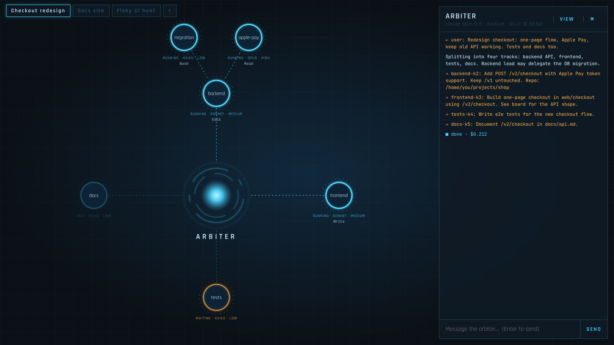
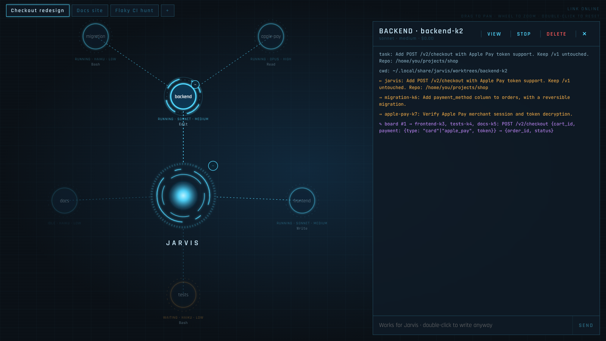
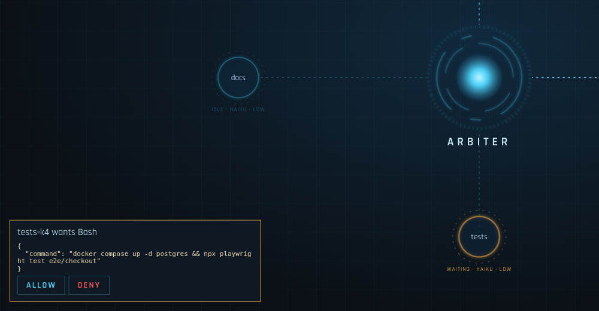
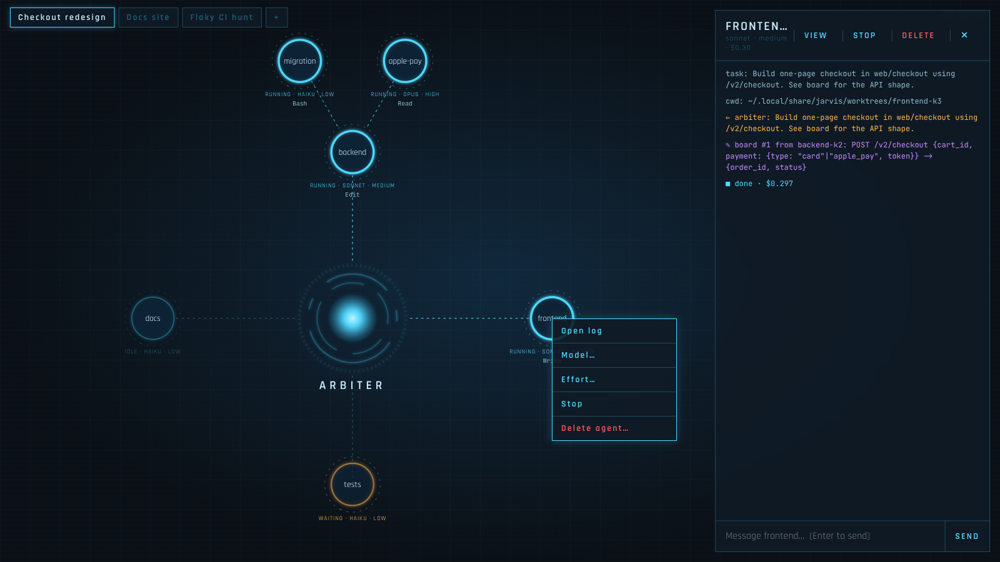

# Jarvis

**One AI manager that runs a team of AI coding agents, and a live map where you watch them work.**

You describe a goal in plain words. Jarvis splits it into tasks, hands each task to its own [Claude Code](https://claude.com/claude-code) agent, and shows the whole team on screen: who is working, on what, how much it costs, and when someone needs your OK.



## Why

One AI coding assistant is great at one task at a time. Real work is usually several tasks at once: backend, frontend, tests, docs. Doing them one after another in one chat is slow, and the context gets mixed up.

Jarvis works like a small team with a lead:

- **Jarvis** (the glowing core) is the team lead. It does not write code. It plans, hires agents, passes information between them, and reports back to you.
- **Agents** (the circles) do the actual work. Each one has its own copy of the code (a separate git branch), so they never overwrite each other.
- **Lead agents** can hire their own helpers for big sub-tasks, like `backend` above with `migration` and `apple-pay`.
- **You** watch, chat with anyone, and approve actions that the safety check is not sure about.

## Who it is for

- **Developers** who want to run several coding tasks in parallel and review the results as git branches.
- **Team leads and architects** who want to try "AI team" workflows: split work, compare approaches, see what it costs.
- **QA, DevOps, analysts** and other IT folks who want to see what AI agents actually do step by step, with full logs and a clear approval point before anything risky runs.

You do not need to read the code to use Jarvis. You need to be comfortable with a terminal and git.

## What you see

### The map

Jarvis sits in the center, agents sit around it, and helpers fan out from their lead.

| Color | Meaning |
|-------|---------|
| Cyan, bright | Working right now |
| Dim | Idle: finished its turn, waiting for the next message |
| Amber | Waiting for your approval |
| Red | Something went wrong |
| Gray | Stopped; its line to the parent turns gray and stops flowing |

Under each circle: model, effort level, and the tool the agent is using right now (`Edit`, `Bash`, `Read`, ...) or the text it is writing. A light pulse runs along a line whenever two agents exchange a message. Violet pulses are notes on the shared board.

Each tab at the top is a separate **workspace**: its own Jarvis, team and history. Use one per project or per goal.

### The log and chat

Click any circle to open its log on the right. The selected agent gets a lock-on ring, its path to Jarvis lights up, and unrelated agents fade. The log shows the task it got, what it said, which tools it used, notes from other agents, and the cost of each finished step. Tables, code blocks, `code` and **bold** in agent messages are rendered. Type at the bottom to message that agent directly: Enter sends, Shift+Enter starts a new line. Only Jarvis's chat is open by default: every other agent takes orders from Jarvis or its lead, and a stray message derails it, so its input is locked; double-click the input to write to it anyway. Jarvis's chat is where you give new goals.



The **VIEW** button picks what the log shows (your messages, reports, tool calls, board notes, costs), per agent.

### Approvals

Agents run in Claude Code's `auto` permission mode: a built-in classifier approves safe actions on its own. Only what it cannot decide shows up as a card in the bottom-left corner. You read the exact command and press ALLOW or DENY. The agent waits (amber) until you answer. When an agent asks you a question, the card shows its options instead: pick one (or several), or type your own answer under "Other", add notes for the agent if you want, then press ANSWER. SKIP tells the agent you did not answer.



### Controls

Right-click an agent to open its log, change its model or effort, stop it, or delete it. Right-click a tab to rename it, stop all its agents, or archive it.



Drag the background to pan, scroll to zoom, drag circles to rearrange them, double-click the background to reset the view. The agent panel: drag any edge to resize, drag its header to move it; double-click either to reset.

## Safety: what Jarvis will and will not do

- **Your project folder is never edited directly** when it is a git repo. Every agent works in its own git worktree on branch `jarvis/<agent-id>`. You review and merge those branches yourself, like any other branch.
- **Nothing is lost silently.** Deleting an agent with unsaved changes asks you to commit them to its branch or discard them. Archiving a workspace refuses while agents are working, and commits any unsaved work first. Agent branches are never deleted by Jarvis.
- **Archive, not delete.** Closing a workspace moves it to the archive (button `ARCHIVE n`). You can restore it later with all conversations. Permanent delete is only available in the archive, and asks you to type the workspace name.
- **Local only.** The web UI listens on `127.0.0.1` and rejects requests from other websites. Nothing is exposed to your network.
- **Restarts are safe.** Every event is written to disk. After a restart the map, logs and costs come back, and agents continue their conversations on the next message.

## Costs

Every agent is a separate Claude session, and every turn costs tokens. Jarvis helps you keep it under control:

- Each agent's cost is shown in its panel, plus **Σ**: the total including all the helpers it hired. The tab tooltip shows the workspace total.
- Jarvis is told to pick the cheapest model that can do each job well: `haiku` for mechanical work, `sonnet` for normal coding, `opus` only for hard problems. You can change any agent's model or effort at any time.
- The panel shows how full each agent's context is (`ctx 92k/200k (46%)`, amber from 80%), and the node shows the percentage. A long conversation makes every turn more expensive: press **COMPACT** to have the agent summarize it and continue with a short context. Claude Code also compacts on its own when the context is nearly full.
- Agents load only the minimum from your Claude Code settings (auth, proxy, model and commit attribution, so `"attribution": {"commit": ""}` keeps the Co-Authored-By line out of their commits). Loading all your plugins and hooks into every agent would make each turn cost about 5x more.

## Quick start

### You need

- **Node.js 24 or newer** (`node --version`)
- **git**
- **Claude Code** set up on this machine, so that `claude` works in your terminal. Agents use the same login, API key or proxy settings.
- Linux or macOS

### Install and run

```bash
git clone https://github.com/ARostovsky/jarvis.git
cd jarvis
npm install
ln -s "$PWD/bin/jarvis.mjs" ~/.local/bin/jarvis   # once; any folder in your PATH works

jarvis            # starts the server in the background and opens http://127.0.0.1:7777
```

Other commands: `jarvis stop`, `jarvis restart`, `jarvis status`, `jarvis logs`. To run in the foreground instead: `npm start`.

### First goal

1. Click **+** to create a workspace. Give it a name and, optionally, the path to your project (a git repo). Pick Jarvis's model and effort, or keep the defaults.
2. In Jarvis chat on the right, describe what you want, for example: *"Add a /health endpoint with a test and a line in the README."*
3. Watch Jarvis hire agents. Click any of them to follow along. Approve cards when they appear.
4. When agents finish, their work is on `jarvis/<agent-id>` branches in your repo. Review with `git log` / `git diff`, merge what you like.

## Settings

All optional, set as environment variables before `jarvis` or `npm start`:

| Variable | Default | What it does |
|----------|---------|--------------|
| `PORT` | `7777` | Port of the web UI |
| `JARVIS_AGENT_MODEL` | `sonnet` | Default model for new agents |
| `JARVIS_AGENT_EFFORT` | `medium` | Default effort for new agents (`low` ... `max`) |
| `JARVIS_ARBITER_MODEL` | your Claude Code model | Jarvis model when the workspace does not set one |
| `JARVIS_ARBITER_EFFORT` | `medium` | Jarvis effort |
| `JARVIS_PERMISSION_MODE` | `auto` | How agents ask for permission: `auto`, `acceptEdits`, `default`, ... |
| `JARVIS_PLUGINS` | `caveman@caveman,ponytail@ponytail,frontend-design@claude-plugins-official,code-simplifier@claude-plugins-official,code-review@claude-plugins-official` | Which of your Claude Code plugins agents load (comma-separated; empty = none; missing ones are skipped) |
| `JARVIS_PLAYWRIGHT` | `1` | Give every agent a headless browser (Playwright MCP, its own isolated profile); `headed` shows the browser windows on screen; `0` turns it off |

Data (workspaces, logs, agent workdirs, archive) lives in `~/.local/share/jarvis/` (or `$XDG_DATA_HOME/jarvis`), never inside this repo.

## Glossary

- **Agent**: one Claude Code session with its own task and its own folder.
- **Jarvis**: the agent that plans and delegates; it never edits code itself.
- **Workspace**: a tab with its own Jarvis, team and history.
- **Git branch / worktree**: a separate, named copy of the code. Jarvis gives each agent one, so their changes stay apart until you merge them.
- **Model**: which Claude model an agent uses. `haiku` is fast and cheap, `sonnet` is the everyday choice, `opus` is the strongest and most expensive.
- **Effort**: how long the model thinks before answering. Higher effort is slower and costs more, but helps on hard problems.
- **Board**: shared notes between agents, for facts several of them need (an API shape, a decision).
- **Token**: the unit Claude usage is billed in. More text read and written means more tokens.

## Customize it

Jarvis is small on purpose: about 750 lines of TypeScript, one HTML file, no build step, two runtime dependencies. It is easy to change, by hand or with your own coding agent.

Start with **[docs/ARCHITECTURE.md](docs/ARCHITECTURE.md)**: how it works inside, the event model, the HTTP API, the rules it must keep (never lose work, local only), and step-by-step recipes for common changes such as adding a tool for agents, a new UI action, or another model. The repo's `CLAUDE.md` points Claude Code there automatically.

Built on the [Claude Agent SDK](https://docs.claude.com/en/docs/agent-sdk/overview).

## License

[MIT](LICENSE)
