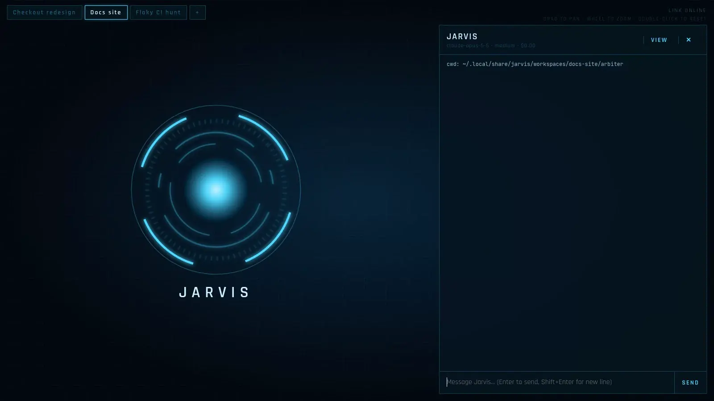
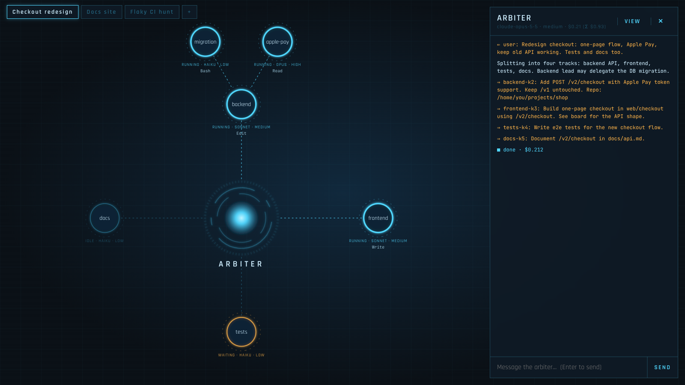
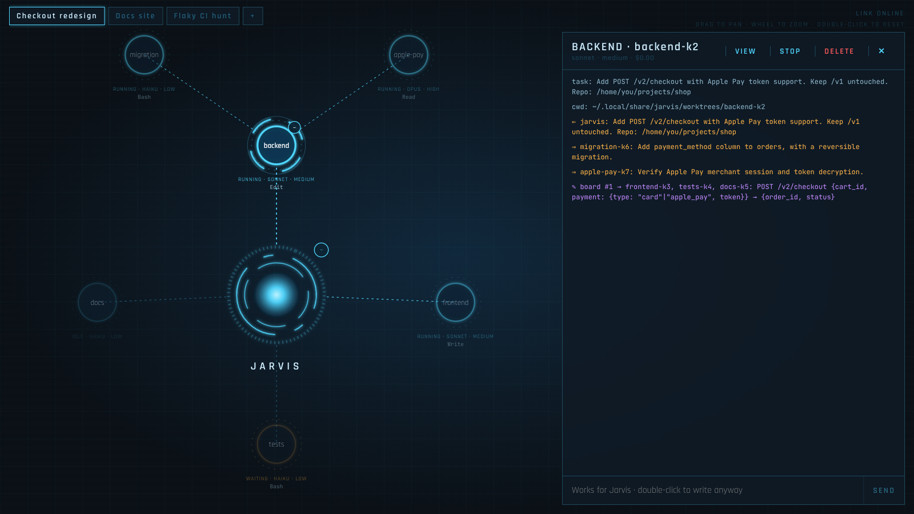
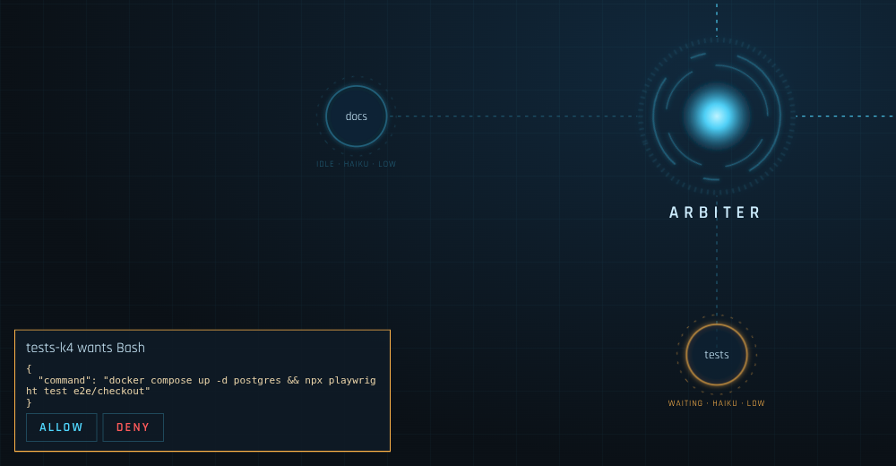
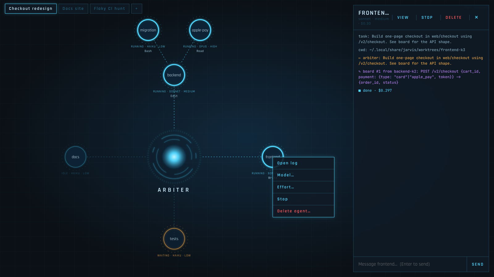
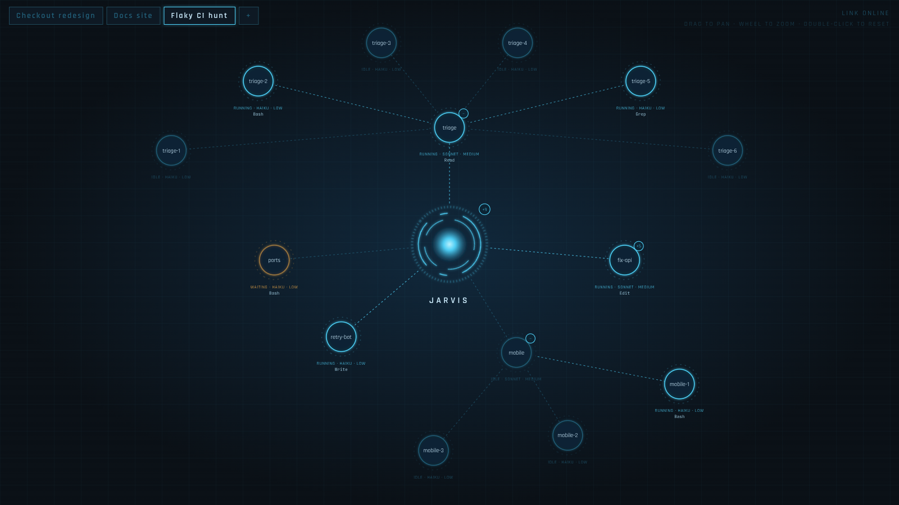

[](https://github.com/ARostovsky/jarvis/actions/workflows/ci.yml)

# Jarvis

**One AI manager that runs a team of AI coding agents, and a live map where you watch them work.**

You describe a goal in plain words. Jarvis splits it into tasks, hands each task to its own [Claude Code](https://claude.com/claude-code) agent, and shows the whole team on screen: who is working, on what, how much it costs, and when someone needs your OK. Jarvis never edits code. Each agent works on its own git branch.



## Quick start

You need Linux or macOS, **Node.js 24+**, **git**, and **Claude Code** set up so that `claude` works in your terminal. Agents use the same login, API key or proxy settings.

```bash
git clone https://github.com/ARostovsky/jarvis.git
cd jarvis
npm install
ln -s "$PWD/bin/jarvis.mjs" ~/.local/bin/jarvis   # once; any folder in your PATH works

jarvis            # starts the server in the background and opens http://127.0.0.1:7777
```

Also: `jarvis stop|restart|status|logs`. Foreground: `npm start`.

Browser tests: `npm run e2e` (Playwright, starts its own server on port 7798 with a throwaway data dir and a scripted fake of the Agent SDK, so no API calls; needs chromium, `npx playwright install chromium`).

First goal:

1. Click **+**. Name the workspace and, optionally, give the path to your git project. Project and notes folders you used before are offered in a list, most recent first.
2. In the Jarvis chat, describe a goal, for example: *"Add a /health endpoint with a test."*
3. Watch Jarvis hire agents. Answer approval cards.
4. Work lands on `jarvis/<agent-id>` branches in your repo. Review and merge.

## What you see

### The map

Jarvis is in the center, agents around it. Each tab is a separate workspace: its own Jarvis, team and history.



| Color | Meaning |
|-------|---------|
| Cyan, bright | Working right now |
| Dim | Idle, waiting for the next message |
| Amber | Waiting for your approval |
| Red | Something went wrong |
| Gray | Stopped |

### Log and chat

- Click a circle to open its log: task, messages, tool calls, cost per step.
- Give goals in Jarvis's chat. Other agents' inputs are locked; double-click one to write anyway.



### Approvals

- Agents run in Claude Code's `auto` mode. Only actions its classifier cannot decide show up as a card.
- Read the command, press ALLOW or DENY. The agent waits.



### Controls

- Right-click an agent, Jarvis or a tab: model, effort, stop, delete, hide, rename, archive.



### Big teams

- A lead folds its helpers into a `+N` badge while none of them works.
- Jarvis hides agents that were idle over 10 minutes once it has more than 8. Right-click Jarvis for **Hide idle agents** or **Show all agents**.



### Notes folder

- A workspace can point at a persistent markdown folder, shareable between workspaces. Set it in the **+** dialog or the tab's right-click menu.
- Jarvis reads it at the start of a goal and keeps it up to date. Other agents are only *told* to read it. This is a prompt rule, not enforced, so they can still write there.
- Jarvis commits the folder to git after each turn. Each workspace commits only the files its own Jarvis changed; your own edits there stay uncommitted. Each commit has a short description of the change written by Jarvis, and ends with `Workspace: <name>`. Details: [docs/ARCHITECTURE.md](docs/ARCHITECTURE.md).

## Safety

- **Your project folder is never edited directly** when it is a git repo. Each agent works in its own git worktree on branch `jarvis/<agent-id>`. You review and merge.
- **Nothing is lost silently.** Deleting an agent with unsaved changes asks you to commit or discard them. It also names the files no commit keeps, which can only be discarded: files your `.gitignore` ignores (`.env`, `node_modules`), and all files of an agent that works outside git. Archiving refuses while agents work, and commits unsaved work first. Ignored files move into the archive with the workspace and come back on restore; one the restored branch now has a file for stays parked, and deleting the agent names it. Jarvis never deletes agent branches.
- **Agents cannot run code through Jarvis's own git.** Jarvis takes the git dir from your repo, not from the worktree's `.git` file, which an agent could replace. Repos nested in a worktree are not looked into.
- **Archive, not delete.** Closing a workspace archives it, and you can restore it with all conversations. Agents whose branch you have since merged and deleted come back without a workdir; delete them. If a branch is checked out somewhere else, the restore fails with that error and the workspace stays in the archive. Permanent delete works only in the archive and asks you to type the workspace name.
- **Local only.** The web UI listens on `127.0.0.1` and rejects requests from other websites.
- **Restarts are safe.** Every event is written to disk. After a restart the map, logs and costs return, and agents continue on the next message.

## Costs

- Every agent is a separate Claude session. Each panel shows its cost and **Σ**, the total with its helpers.
- Jarvis picks the cheapest fitting model (`haiku`, `sonnet`, `opus`). You can change it.
- Long context costs more. Press **COMPACT** to summarize.

## Settings

All optional. Set as environment variables before `jarvis` or `npm start`:

| Variable | Default | What it does |
|----------|---------|--------------|
| `PORT` | `7777` | Web UI port |
| `JARVIS_AGENT_MODEL` | `sonnet` | Default model for new agents |
| `JARVIS_AGENT_EFFORT` | `medium` | Default agent effort (`low` ... `max`) |
| `JARVIS_ARBITER_MODEL` | your Claude Code model | Jarvis model |
| `JARVIS_ARBITER_EFFORT` | `medium` | Jarvis effort |
| `JARVIS_PERMISSION_MODE` | `auto` | `auto`, `acceptEdits`, `default`, ... |
| `JARVIS_PLUGINS` | `caveman@caveman,ponytail@ponytail,frontend-design@claude-plugins-official,code-simplifier@claude-plugins-official,code-review@claude-plugins-official,claude-md-management@claude-plugins-official` | Claude Code plugins agents load (comma-separated; empty = none; missing ones are skipped) |
| `JARVIS_PLAYWRIGHT` | `1` | Headless browser for each agent; `headed` shows windows; `0` turns it off |

Data lives in `~/.local/share/jarvis/` (or `$XDG_DATA_HOME/jarvis`), never in this repo.

## Customize it

See [docs/ARCHITECTURE.md](docs/ARCHITECTURE.md) for the internals, the HTTP API and recipes for common changes.

## License

[MIT](LICENSE)
