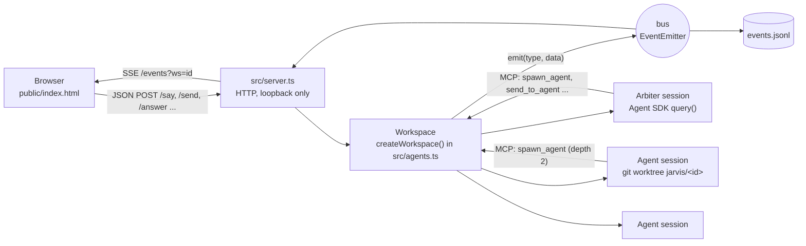

# Jarvis: technical documentation

This file is for people (and their coding agents) who want to change Jarvis. The [README](../README.md) explains what Jarvis is and how to use it. Here you find how it is built, where each thing lives, and how to extend it without breaking the guarantees it makes.

## Contents

- [Design in one paragraph](#design-in-one-paragraph)
- [Repository map](#repository-map)
- [Running and checking](#running-and-checking)
- [Runtime model](#runtime-model)
- [Events](#events)
- [Persistence and restart](#persistence-and-restart)
- [Workdirs, git worktrees, deleting and archiving](#workdirs-git-worktrees-deleting-and-archiving)
- [HTTP API](#http-api)
- [Web UI](#web-ui)
- [Configuration](#configuration)
- [Invariants you must keep](#invariants-you-must-keep)
- [Recipes: common changes](#recipes-common-changes)
- [Conventions](#conventions)
- [Known shortcuts](#known-shortcuts)

## Design in one paragraph

A Node process (`src/server.ts`) hosts one or more **workspaces**. Each workspace has an **arbiter** (shown to the user as **Jarvis**; the id stays `arbiter` in events, `parentId` and the `workspaces/<ws>/arbiter` folder, so old logs keep working): a Claude Agent SDK session whose only job is to plan and delegate. It gets MCP tools to spawn other SDK sessions (**agents**), message them, read their output and stop them. Agents can spawn their own **sub-agents** (max depth 2). Every agent runs in its own git worktree on branch `jarvis/<id>`. Every change of state becomes an **event** on an in-process `EventEmitter`. Events are appended to `events.jsonl` and streamed to the browser over SSE. The browser (`public/index.html`, one file, no build) draws the agents as a graph and sends commands back as JSON POSTs. On restart the server replays `events.jsonl` to rebuild everything, and SDK sessions resume by session id.



## Repository map

| Path | What it is |
|------|------------|
| `src/agents.ts` | All domain logic: agents, SDK sessions, MCP tools, board, events, persistence, worktrees, workspaces, archive. About 650 lines. |
| `src/server.ts` | HTTP server: serves the page, SSE stream, JSON command table. About 80 lines. |
| `public/index.html` | The whole UI: HTML, CSS and plain JS in one file. No framework, no build. |
| `bin/jarvis.mjs` | CLI launcher: `jarvis [start\|stop\|restart\|status\|logs]`. Runs the server detached and opens the browser. |
| `docs/` | This file and the README screenshots. |
| `tsconfig.json` | Type check only (`noEmit`). Node runs `.ts` directly. |

Inside `src/agents.ts`, top to bottom:

1. Types `Status`, `Agent`, `WorkspaceMeta`.
2. Constants and env config (`DATA`, `MODELS`, `EFFORTS`, defaults, `MAX_DEPTH`, `REPORT_CAP`).
3. `userSettings()` and `userPlugins()`: what agents take from `~/.claude`.
4. `inbox()`: an async iterable queue that feeds user messages into a long-lived SDK `query()`.
5. `makeWorkdir()`: creates a git worktree or a plain dir.
6. System prompts: `ARBITER_PROMPT`, `LEAD_PROMPT`, `BOARD_PROMPT`.
7. `createWorkspace(meta)`: a closure with all per-workspace state and functions (`emit`, `restore`, `session`, `pump`, `deliver`, `spawnAgent`, `deleteAgent`, `configure`, `stopAgent`, MCP tools, archive support).
8. Workspace registry: `addWorkspace`, `renameWorkspace`, `archiveWorkspace`, `restoreWorkspace`, `listArchived`, `archivedInfo`, `deleteArchived`, `loadWorkspaces`.

## Running and checking

```bash
npm install
npm start          # server in the foreground on http://127.0.0.1:7777
npm run check      # tsc type check; the only automated check today
```

Requirements: Node 24+ (runs TypeScript by type stripping, so only erasable syntax is allowed: no `enum`, no `namespace`, no parameter properties; `tsconfig.json` enforces this with `erasableSyntaxOnly`). Git is needed for worktrees.

To try changes without touching your real data, point the data dir and port elsewhere:

```bash
XDG_DATA_HOME=/tmp/jarvis-dev PORT=7799 npm start
```

## Runtime model

### Agent

```ts
type Agent = {
  id: string;            // 'arbiter' or '<name>-<time><seq>', also the worktree dir and branch suffix
  name: string;
  task: string;          // first message it was given
  cwd: string;
  status: 'running' | 'idle' | 'waiting' | 'error' | 'stopped';
  lastText: string;      // last assistant text block, used by read_agent
  costUsd: number;       // cumulative across sessions and restarts
  parentId?: string;     // undefined only for the arbiter
  model?: string;        // haiku | sonnet | opus; unset = model from settings
  effort?: EffortLevel;  // low..max; unset = role default
  runtimeModel?: string; // what the SDK session reports, e.g. claude-opus-5-5
  repo?: string;         // set when cwd is a git worktree of this repo
  sessionId?: string;    // SDK session id, used for resume
};
```

`status` meanings: `running` = a turn is in progress; `idle` = finished its turn, session may be alive; `waiting` = blocked on a permission prompt in the UI; `error` = the turn or session failed; `stopped` = aborted by the user or the session ended.

### Sessions

`session(a)` lazily starts one SDK `query()` per agent with an `inbox()` as its prompt stream, so the session lives across many turns. `deliver(a, text)` pushes a message into that inbox, first prepending any unseen board notes. `pump(a, q)` consumes SDK messages and turns them into events:

| SDK message | Event(s) |
|-------------|----------|
| `stream_event` text delta (top level only) | `delta` |
| `system/init` | `session` (new session id), `runtime` (actual model) |
| `assistant` text block | `text` |
| `assistant` tool_use block | `tool` |
| `system/compact_boundary` | `compacted` |
| `result` | `status`, `result` (with cumulative cost), then a capped report `routed` to the parent (skipped for a `/compact` turn), then `context` from `q.getContextUsage()` |

SDK options per session: `cwd`, `settingSources: ['project', 'local']`, `settings` (only `apiKeyHelper`, `env`, `model`, `attribution`, `includeCoAuthoredBy` from `~/.claude/settings.json`), `plugins` (only `JARVIS_PLUGINS`), `permissionMode` (default `auto`), `canUseTool` (turns undecided calls into UI `ask` cards), `resume: sessionId`, plus `agentOptions(a)` for MCP servers, allowed tools and the system prompt append. MCP servers: `jarvis` (below) and, unless `JARVIS_PLAYWRIGHT=0`, `playwright` (`npx @playwright/mcp@latest --isolated --headless`, without `--headless` when `JARVIS_PLAYWRIGHT=headed`, one browser per session, all its tools allowed, output in `workspaces/<ws>/playwright/<agent>/`).

Why so little from user settings: loading all user plugins and hooks into every agent made a trivial turn cost about 5x more tokens.

### Roles and tools

All tools live in one in-process MCP server named `jarvis`, built per agent by `jarvisTools(owner, team)`.

| Role | Depth | Tools | System prompt append |
|------|-------|-------|----------------------|
| Arbiter | 0 | board + team, over all agents | `ARBITER_PROMPT` (+ project hint) |
| Lead agent | 1 | board + team, only over its own children | `LEAD_PROMPT` + `BOARD_PROMPT` |
| Sub-agent | 2 | board only | `BOARD_PROMPT` |

Team tools: `spawn_agent {name, task, repo?, model?, effort?}`, `send_to_agent {id, message}`, `list_agents`, `read_agent {id}`, `stop_agent {id}`. Board tools: `board_post {to, text}`, `board_read`.

Roles with team tools (arbiter and leads) get `disallowedTools: ['Agent', 'Task']`: the built-in Claude Code subagent would bypass `spawn_agent` and stay invisible in the graph. Sub-agents keep it, as their only way to fan out.

When an agent finishes a turn, its result goes to its parent as `[agent <id> finished, status <s>]\n<text>`, capped at `REPORT_CAP` (1000) characters, so reports do not fill the parent's context. The parent can call `read_agent` for the full text.

### Board

A per-workspace list of notes `{n, from, to[], text}`. `to` holds agent ids, names, or `"all"`. `boardSeen` tracks the last note number delivered to each agent. Notes are delivered by prepending them to the agent's next incoming message, so they never interrupt a running turn. The user can post too (`/board`).

### Model and effort

Defaults: agents `sonnet` + `medium`; arbiter = model from settings + `medium`. The arbiter's setup is picked in the New workspace dialog. `configure(id, {model, effort})` changes it at any time and applies to a live session immediately through `q.setModel()` and `q.applyFlagSettings({effortLevel})`.

## Events

Everything visible goes through `emit(type, data)` in `createWorkspace`. The UI is a pure function of this stream. Every event also carries `at` (ms since epoch); events written before it existed have none, and the UI treats them as long ago.

| Type | Payload | Persisted |
|------|---------|-----------|
| `spawned` | `{agent}` | yes |
| `removed` | `{agentId}` | yes |
| `status` | `{agentId, status}` | yes |
| `text` | `{agentId, text}` | yes |
| `delta` | `{agentId, text}` streamed text | no |
| `tool` | `{agentId, name, input}` | yes |
| `routed` | `{from, to, text}` a message between sessions, or from `user` | yes |
| `board` | `{n, from, to, text}` | yes |
| `board_seen` | `{agentId, n}` | yes |
| `result` | `{agentId, text, costUsd}` | yes |
| `session` | `{agentId, sessionId}` | yes |
| `runtime` | `{agentId, model}` | yes |
| `config` | `{agentId, model, effort}` | yes |
| `context` | `{agentId, tokens, max}` context window use after a turn | yes |
| `compacted` | `{agentId, trigger, pre, post}` the session was compacted (`manual` or `auto`) | yes |
| `ask` | `{reqId, agentId, tool, input}` permission prompt | no |
| `answered` | `{reqId}` | no |
| `ready` | `{}` sent by the server after the snapshot | no (SSE only) |

Non-persisted types are in `TRANSIENT`: replaying them would show stale typing or dead permission prompts.

## Persistence and restart

All runtime data lives outside the repo in `$XDG_DATA_HOME/jarvis` (default `~/.local/share/jarvis`):

```
jarvis/
  workspaces.json              # list of active workspaces (WorkspaceMeta[])
  server.pid, server.log       # written by bin/jarvis.mjs
  workspaces/<ws-id>/
    events.jsonl               # the event log, the single source of truth
    arbiter/                   # the arbiter's empty cwd
    parked-workdirs/           # only inside archive: plain workdirs
  worktrees/<agent-id>/        # agent workdirs (git worktrees or plain dirs)
  archive/<ws-id>/             # archived workspaces, same layout + meta.json
```

`restore()` replays `events.jsonl` into the `agents` map, board and `boardSeen`. A line that does not parse (torn by a crash or a full disk mid-append) is skipped with a warning, and a torn tail gets a newline so the next event starts clean. Agents that were not `stopped` become `idle`, because their processes died with the old server. The next message to an agent resumes its SDK session with `resume: sessionId`, so the conversation continues. Pending asks are lost on restart. The SDK stores sessions per folder, so the arbiter's `cwd` must stay stable; if it moved, a fresh arbiter is created.

`history` keeps the whole log in memory; each new SSE client gets it as a snapshot, then `ready`, then live events.

## Workdirs, git worktrees, deleting and archiving

`makeWorkdir(id, repo)`:

- `repo` is a git repo: `git worktree add -b jarvis/<id> worktrees/<id>`.
- `repo` is a plain folder: used in place (no isolation).
- no `repo`: an empty `worktrees/<id>`.

Repo choice: the arbiter's agents default to the workspace project folder; sub-agents default to their parent's repo, each on its own branch. A sub-agent in its parent's repo branches from `jarvis/<parent>`, so it sees the parent's commits (not its uncommitted changes).

**Delete agent** (`deleteAgent`): refused if it has children. If the worktree has uncommitted changes, it throws `DirtyWorktree` (HTTP 409) and the UI asks: `commit` (to `jarvis/<id>`) or `discard`. The branch is always kept.

**Archive workspace** (`archiveWorkspace`): designed to lose nothing.

1. Refused while any agent is `running` or `waiting`.
2. Dirty worktrees: refused unless `commit: true`, then each is committed to its own branch.
3. Clean worktrees are removed (branches stay). Plain workdirs move into `parked-workdirs/`.
4. If git fails midway, `reattach()` puts back what was removed and the workspace stays active.
5. The folder moves to `archive/<id>/` with `meta.json`.

**Restore** moves it back and re-creates worktrees from their branches. **Permanent delete** works only on archived workspaces, needs the exact workspace name, and never touches branches in your repos.

## HTTP API

The server binds to `127.0.0.1` only (`PORT`, default 7777).

| Method and path | Body | Returns |
|-----------------|------|---------|
| `GET /` | | the UI |
| `GET /workspaces` | | `{workspaces: [{id, name, project?, running, waiting, costUsd}], archived, settingsModel}` |
| `GET /events?ws=<id>` | | SSE: snapshot, `ready`, live events |
| `POST /workspaces` | `{name, project?, model?, effort?}` | new workspace meta |
| `POST /workspaces/rename` | `{ws, name}` | 204 |
| `POST /workspaces/archive` | `{ws, commit?}` | 204, 409 if dirty |
| `POST /workspaces/restore` | `{id}` | meta |
| `POST /workspaces/archived/info` | `{id}` | `{name, agents, parked, branches, ...}` |
| `POST /workspaces/archived/delete` | `{id, name}` | 204 |
| `POST /say` | `{ws, text}` | message to the arbiter |
| `POST /send` | `{ws, id, text}` | message to any agent |
| `POST /answer` | `{ws, reqId, allow, answers?, annotations?}` | answer a permission prompt; for `AskUserQuestion`, `answers` (question text -> chosen labels, comma-joined) and `annotations` (question text -> `{preview?, notes?}`) are merged into its input |
| `POST /stop` | `{ws, id}` | |
| `POST /compact` | `{ws, id}` sends `/compact` straight into the idle session, bypassing board notes | |
| `POST /stopall` | `{ws}` | |
| `POST /config` | `{ws, id, model?, effort?}` | |
| `POST /delete` | `{ws, id, dirty?: 'commit' \| 'discard'}` | 409 if dirty and no choice |
| `POST /board` | `{ws, to?, text}` | note from `user` |

Every POST must have `Content-Type: application/json` and an `Origin` of the page itself (`http://127.0.0.1:<port>` or `http://localhost:<port>`), otherwise 403. Errors are 400 with the message as plain text. Example:

```bash
curl -X POST http://127.0.0.1:7777/say \
  -H 'content-type: application/json' -H 'origin: http://127.0.0.1:7777' \
  -d '{"ws":"main-ab12","text":"Add a health check endpoint"}'
```

## Web UI

`public/index.html` is one file: CSS in `<style>`, markup, then one `<script>`. Main parts of the script, in order:

- Graph state: the `agents` map (`id -> {agent, g, link, act, live}`), `layout()`, `fit()`, `place()`, positions in `localStorage` (`jarvis.positions.<ws>`).
- `addAgent`, `removeAgent`, `setStatus`, `pulse` (animation along a link), `log`, `renderTitle`, `select` (side panel), `showAsk` (ALLOW/DENY card), `showQuestions` (option picker for `AskUserQuestion`).
- `renderMd`: the Markdown subset shown in the log (``` fences, pipe tables, `code`, `**bold**`). It builds DOM nodes with `textContent` and never uses `innerHTML`: agent text is untrusted, and the page can answer permission requests. Tool and meta lines stay plain text.
- `handlers`: one function per event type. To show a new event, add a handler here.
- Workspaces: `refreshTabs`, `menu` (right-click menus), archive dialogs, `switchTo`, `connect` (SSE).
- `post()` for commands, `choose()` for modal choices, model/effort pickers, delete flow.
- Layout: `layout()` gives each of Jarvis's agents an angular sector sized for itself on the inner ring or its visible sub-agents on the outer ring (`RING_GAP` further out), growing the inner radius until every neighbour is `GAP` apart.
- Pan, zoom, drag; folding a lead's sub-agents (automatic while none is `running` or `waiting`; a click stores an override in `jarvis.collapsed.<ws>` as `{ id: folded }`, dropped once the automatic state matches it; Jarvis's own badge, `#coreBadge`, hides only top agents whose whole group has been idle for `IDLE_HIDE_MS` (10 min, from each node's `since`, re-checked every 30 s), automatically above `JARVIS_FOLD_AT` agents, under the `arbiter` key; agents hidden by hand from the context menu live in `jarvis.hidden.<ws>` until they or a sub-agent turn busy, or the badge shows all; folded nodes get `.folded` and `hidden`, are skipped by `fit()`, and pulses use their lead instead); panel geometry (all four edges resize, header moves, `jarvis.panel` in `localStorage`, double-click resets); the VIEW filter (`jarvis.view.<ws>` in `localStorage`, inherited from parent to child).

During the snapshot replay `replaying` is true, so pulses are not animated. `ready` ends the replay.

## Configuration

| Variable | Default | Effect |
|----------|---------|--------|
| `PORT` | `7777` | HTTP port (server and launcher) |
| `XDG_DATA_HOME` | `~/.local/share` | Data dir is `$XDG_DATA_HOME/jarvis` |
| `JARVIS_AGENT_MODEL` | `sonnet` | Default model for spawned agents |
| `JARVIS_AGENT_EFFORT` | `medium` | Default effort for spawned agents |
| `JARVIS_ARBITER_MODEL` | model from settings | Arbiter model when the workspace does not set one |
| `JARVIS_ARBITER_EFFORT` | `medium` | Arbiter effort |
| `JARVIS_PERMISSION_MODE` | `auto` | SDK permission mode: `auto`, `acceptEdits`, `default`, ... |
| `JARVIS_PLUGINS` | `caveman@caveman,ponytail@ponytail,frontend-design@claude-plugins-official,code-simplifier@claude-plugins-official,code-review@claude-plugins-official` | Comma-separated user plugin ids (as in `enabledPlugins`) to load into agents. Plugins that are not installed are skipped. Empty = none. |
| `JARVIS_PLAYWRIGHT` | `1` | Playwright MCP for every session; `headed` = visible windows; `0` = off |

## Invariants you must keep

1. **Never lose user work.** Deleting or archiving never removes uncommitted changes silently and never deletes `jarvis/<id>` branches or the project folder. New destructive actions should follow the same pattern: refuse, show what would be lost, offer commit or an explicit confirmation.
2. **The event log is the source of truth.** Any state that must survive a restart must be emitted as a persisted event and handled in `restore()`. Live-only state goes into `TRANSIENT`.
3. **Loopback and origin check.** Agents run tools on your machine. Do not bind to `0.0.0.0` and do not relax the `Origin` check without adding real authentication.
4. **Agents get minimal user config.** Adding more from `~/.claude` multiplies token cost for every turn.
5. **No build step.** Server runs `.ts` directly, UI is one static HTML file. Keep it that way unless there is a strong reason.
6. **Depth limit.** `MAX_DEPTH` stops agent trees from growing without bound.

## Recipes: common changes

### Add an MCP tool for agents

In `jarvisTools()` in `src/agents.ts`, add a `tool(name, description, zodShape, handler)` to the board list (everyone) or the team list (arbiter and leads). Add `mcp__jarvis__<name>` to `BOARD_TOOLS` or `TEAM_TOOLS`, otherwise the SDK asks for permission each time. If the tool changes state the UI shows, `emit()` an event.

### Add a new event type

1. `emit('my_event', {...})` in `src/agents.ts`.
2. If it should not survive a restart, add it to `TRANSIENT`. Otherwise handle it in `restore()` when it changes `Agent` state.
3. Add `handlers.my_event` in `public/index.html`.

### Add an HTTP command

Add one line to the `commands` table in `src/server.ts`. Return a value for a JSON response or `undefined` for 204. Throw for 400, or throw `DirtyWorktree` for 409. Expose the function from the object returned by `createWorkspace()` if it is per-workspace.

### Change how agents behave

Edit `ARBITER_PROMPT`, `LEAD_PROMPT` or `BOARD_PROMPT`. Each repo an agent works in can also have its own `CLAUDE.md` and `.claude/settings.json`, which agents load (`settingSources: ['project', 'local']`).

### Add a model alias

Add it to `MODELS` in `src/agents.ts` and to the `<select id="wsModel">` and model picker in `public/index.html`.

### Use another provider or proxy

Agents take `apiKeyHelper`, `env` (for example `ANTHROPIC_BASE_URL`) and `model` from `~/.claude/settings.json`. Configure the proxy there, as for Claude Code itself.

### Raise the depth limit

Change `MAX_DEPTH`. Agents at `depth < MAX_DEPTH` get team tools. Watch cost: every level multiplies sessions.

### Add a UI action on an agent

Find the agent node `contextmenu` handler that calls `menu(ev, items)` in `public/index.html` and add an item. Call the server with `post('/your-command', {...})`.

## Conventions

- Small and direct: no frameworks, no extra layers. Two runtime dependencies (`@anthropic-ai/claude-agent-sdk`, `zod`).
- Comments explain why, not what.
- Known limits are marked in code as `// shortcut: <limit>, <when to upgrade>`.
- Commits follow Conventional Commits (`feat:`, `fix:`, ...).
- After a change, run `npm run check` and try it in the UI with a throwaway data dir (see [Running and checking](#running-and-checking)).

## Known shortcuts

Search the code for `shortcut:` for the current list. At the time of writing:

- A non-git repo is used in place, without isolation.
- The whole event log of a workspace is kept in memory and replayed to each UI client; it should be rotated once it grows past a few MB.
- No automated tests beyond the type check.
- The launcher opens the browser with `xdg-open` (Linux) or `open` (macOS); on other systems open the URL by hand.
