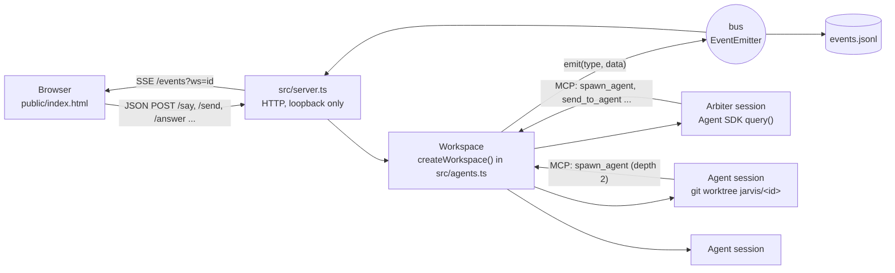

# Jarvis: technical documentation

This file is for people (and their coding agents) who want to change Jarvis. The [README](../README.md) explains what Jarvis is and the [user guide](GUIDE.md) covers using it in detail. The status provider contract is in [STATUS-PROVIDERS.md](STATUS-PROVIDERS.md). Here you find how it is built, where each thing lives, and how to extend it without breaking the guarantees it makes.

## Contents

- [Design in one paragraph](#design-in-one-paragraph)
- [Repository map](#repository-map)
- [Running and checking](#running-and-checking)
- [Runtime model](#runtime-model)
- [Panels, jobs and open items](#panels-jobs-and-open-items)
- [Events](#events)
- [Persistence and restart](#persistence-and-restart)
- [Workdirs, git worktrees, deleting and archiving](#workdirs-git-worktrees-deleting-and-archiving)
- [HTTP API](#http-api)
- [Web UI](#web-ui)
- [Configuration](#configuration)
- [Invariants you must keep](#invariants-you-must-keep)
- [Recipes: common changes](#recipes-common-changes)
- [Conventions](#conventions)
- [Known shortcuts](#known-shortcuts)

## Design in one paragraph

A Node process (`src/server.ts`) hosts one or more **workspaces**. Each workspace has an **arbiter** (shown to the user as **Jarvis**; the id stays `arbiter` in events, `parentId` and the `workspaces/<ws>/arbiter` folder, so old logs keep working): a Claude Agent SDK session whose only job is to plan and delegate. It gets MCP tools to spawn other SDK sessions (**agents**), message them, read their output and stop them. An agent can spawn its own **sub-agents** (max depth 2) only when the arbiter spawned it with `lead: true`. Every agent runs in its own git worktree on branch `jarvis/<id>`. Every change of state becomes an **event** on an in-process `EventEmitter`. Events are appended to `events.jsonl` and streamed to the browser over SSE. The browser (`public/index.html`, one file, no build) draws the agents as a graph and sends commands back as JSON POSTs. On restart the server replays `events.jsonl` to rebuild everything, and SDK sessions resume by session id.



## Repository map

| Path | What it is |
|------|------------|
| `src/tmpguard.ts` | Temp-volume guard: sweep of Jarvis's own `/tmp` leftovers (exact mkdtemp name patterns, `isOwnName`, and age: the newest mtime of the dir and everything in it, lstat walk without following symlinks, stops at the first newer entry, a dir over 200k entries or with a read error is kept) and of stopped agents' claude dirs (own slugs only, `ownSlugs`), removal of an agent's dir when its session has ended (`dropTmp` in agents.ts; only in the default on-disk root, never under plain `/tmp/claude-<uid>` or a user-set `CLAUDE_CODE_TMPDIR`, and never while any running agent of any workspace shares the cwd), the inode/space check with one chat notice per crossing (`Workspace.notice`). `startGuard` runs from server.ts; `JARVIS_TMPGUARD=0` disables it (tests). Sessions get `CLAUDE_CODE_TMPDIR=~/.cache/jarvis/claude-tmp` (`claudeEnv` in agents.ts). |
| `src/agents.ts` | All domain logic: agents, SDK sessions, MCP tools, board, events, persistence, worktrees, workspaces, archive. Over a thousand lines. |
| `src/health.ts` | Dot level from two sources. Local: `recordOutcome()` (called by `pump` in `agents.ts` at each turn result, and by the probe) classifies the error by type (`classify`): auth, network, server (5xx, overloaded) are major; rate limit and a slow first token (over 30 s from a send or tool result to the first top-level stream event, longest of the turn; `duration_api_ms` is cumulative, so it is not used) are minor; anything else (bad prompt, billing, tool error, abort) is ignored and changes nothing. An assistant error `unknown` is classified by its text (`API Error: 503`, `Connection error.`). Status page: polls the Anthropic Statuspage every 60 s (10 s timeout, `If-None-Match`), level only from the components `Claude API` and `Claude Code` (name matched without a `(api.anthropic.com)` suffix; degraded is minor, partial outage major, major outage critical; the worse wins), never from the page-wide indicator, so an unrelated incident (claude.ai, an add-in) stays out of the color; the description and all incident names still go to the tooltip; any failure is `unknown`. A query that yields a typed assistant error (`authentication_failed`) and then throws is recorded with the typed error, in the probe and in `pump`; `classify` also knows `Invalid API key`. `combine()`: with no local outcome the level is `unknown` (the status page still shows in the tooltip); with one, the local outcome decides and the status page can only make it worse (`unknown` status is ignored). Probe (`setProbe`, registered in `agents.ts`): at each poll and when a `/health` client connects, if a client is connected and neither an outcome nor a probe is younger than 10 min, one Haiku call (no tools, `maxTurns` 1, 60 s timeout recorded as a network failure) is recorded; never overlaps itself. |
| `src/notes-layout.ts` | Per-workspace notes layout, pure (no SDK): `workspaceDir()`, `ensureWorkspaceNotes()` (create-only folder and templates), `parseOpenItems()` and `OPEN_ITEMS_FORMAT` (the open-items line format), `writeIndex()` (generated `workspaces/index.md`), and the builders of the arbiter notes paragraph, the save-turn text and the migration notice. Unit-tested in `test/notes-layout.test.ts`. Size rules: files read on every spawn or arbiter start must not grow. `NOTES_SIZE_CAPS` (CLAUDE.md 6 KB, README.md and access.md 10 KB) drives `notesSizeWarnings()`, which `arbiterNotesPrompt()` logs and appends as a one-line note; it only warns, never edits. The prompts tell the arbiter to hand agents section pointers (path and heading), not all notes, and tell agents to keep long text out of these files (it goes to the journal or a file under the notes folder). Tested in `test/prompts.test.ts`. |
| `src/server.ts` | HTTP server: serves the page, SSE stream, JSON command table. Under a hundred and fifty lines. |
| `src/panels.ts` | The panels seam: `createPanels(emit, last)` per workspace. Persists `panel` events only when a panel really changed, routes actions to handlers, holds the transient freshness (`panel_status`). Knows nothing of jobs, providers or open items (a test checks it). |
| `src/jobs.ts` | The `jobs` panel source: the watch list (rebuilt from the panel's last `data.rows`), the poll loop (fast and slow runs, backoff), validation of provider output, `jarvis provider-check` (`providerCheck()`). No SDK: the panel API is injected. |
| `src/providers.ts` | Provider registry and rules: manifest validation, folder hash, location rules, staging, approve and reject (`providers.json`, `provider-staging/`, `provider-old/`), `providersDir()` (`JARVIS_PROVIDERS_DIR`), `limits()` (`JARVIS_JOBS_MIN_POLL_S`). No SDK. |
| `src/provider-admin.ts` | Read side of approval: `providerList()` for `GET /providers` and `providerFiles()` (file texts of an approval card) and `providerDetails()` (manifest with masked env, state and hashes for the DETAILS dialog). |
| `src/jobs-wiring.ts` | Pure jobs wiring: `JOBS_RULES` and the offer text with their gating, the arbiter's tool names, the batched `[jobs]` message (`jobsMessage()`). |
| `src/openitems.ts` | The `open-items` panel source: reads `workspaces/<id>/open-items.md` through `parseOpenItems()`, watches it (read-only; the arbiter edits the file). No SDK. |
| `src/openitems-wiring.ts` | Pure open-items wiring: `JARVIS_OPEN_ITEMS` switch, `OPEN_ITEMS_RULES` with its gating, the reset-seed lines (`openItemsSeed()`). |
| `templates/status-provider/` | `SKILL.md` for the agent that builds a provider (contract, steps, pitfalls), a skeleton program, `manifest.example.json` and `examples/` (runnable `http-up`, `json-file`, `github-prs`; `provider-check` commands in `examples/README.md`). Offered to the arbiter only with a notes folder (see Panels, jobs and open items). |
| `src/voice.ts` | Optional voice input, imported by `server.ts` only when `JARVIS_VOICE` is set. Capture: `createRecorder` spawns `pw-record --raw --rate 16000 --channels 1 --format s16 -` (default source, no `--target`; `--raw` because stdout otherwise starts with an AU header), keeps the samples in memory (trimmed to whole s16 samples at stop) and allows one recording at a time; `start` returns an id that `stop`, `cancel` and `level` must pass, so a stale tab cannot touch another tab's recording. `start` resolves with the first audio (3 s without any: failure) and fails with `pw-record not found` or the command's last stderr line. The child dies on stop, cancel, the `JARVIS_VOICE_MAX_S` cap (samples are kept for stop), a lease that every `level()` call renews (`JARVIS_VOICE_LEASE_S`, a vanished page leaves no open microphone), and when Jarvis exits (`exit` hook, plus `setpriv --pdeathsig TERM` for SIGKILL). Preflight (`pw-record` in PATH, then `<python> -I -c "import faster_whisper"`, once; failure logs one line and turns voice off) and the sidecar manager (lazy spawn of `voice/server.py`, one job at a time, idle kill, a crash or a per-job timeout fails one job and the next restarts it). `withDebugDump` wraps the transcriber when `JARVIS_VOICE_DEBUG_WAV` is set. `server.ts` calls `listen` first and runs the preflight afterwards, so a slow preflight never delays the start. The `/voice` routes and `voice` and `voiceMaxS` in `GET /workspaces` appear once it passes. Protocol: stdin frames of 4-byte big-endian length + PCM, stdout one JSON line per frame (`{text}` or `{error}`), stderr logs. |
| `voice/` | The Python sidecar (faster-whisper, VAD, filters) and `setup.sh` (creates `voice/.venv`, downloads `large-v3` and `large-v3-turbo`). Not touched by `npm ci`. |
| `public/index.html` | The whole UI: HTML, CSS and plain JS in one file. No framework, no build. |
| `bin/jarvis.mjs` | CLI launcher: `jarvis [start\|stop\|restart\|status\|logs]`. Runs the server detached and opens the browser. `jarvis provider-check <folder> <id>...` validates a status provider and runs it as the server would; it needs no server and exits 1 on any failure. |
| `e2e/` | Playwright specs, `helpers.ts`, `fake-provider/` (the deterministic status provider of the jobs specs), `fake-sdk.ts` (the scripted stand-in for the SDK) and `fake-voice.ts` (stand-in for the voice sidecar) and `fake-capture.ts` (stand-in for `pw-record`: raw PCM tone; modes `silent`, `exit`) (see [Running and checking](#running-and-checking)). |
| `docs/` | This file, `GUIDE.md` (the user guide), `STATUS-PROVIDERS.md` (the provider contract) and the README screenshots. `.github/workflows/wiki.yml` publishes `README.md` and `docs/` to the GitHub wiki (generated pages, edit them here). |
| `tsconfig.json` | Type check only (`noEmit`). Node runs `.ts` directly. |

Inside `src/agents.ts`, top to bottom:

1. Types `Status`, `Agent`, `WorkspaceMeta`.
2. Constants and env config (`DATA`, `MODELS`, `EFFORTS`, defaults, `MAX_DEPTH`, `REPORT_CAP`, `MAIL_CAP`, `CONTEXT_ALERT_TOKENS`, `BUDGET_ALERT_USD`).
3. `userSettings()` and `userPlugins()`: what agents take from `~/.claude`.
4. `inbox()`: an async iterable queue that feeds user messages into a long-lived SDK `query()`.
5. `makeWorkdir()`: creates a git worktree or a plain dir.
6. System prompts: `ARBITER_PROMPT`, `LEAD_PROMPT`, `BOARD_PROMPT`.
7. `createWorkspace(meta)`: a closure with all per-workspace state and functions (`emit`, `restore`, `session`, `pump`, `deliver`, `spawnAgent`, `deleteAgent`, `configure`, `stopAgent`, MCP tools, archive support).
8. Workspace registry: `addWorkspace`, `renameWorkspace`, `setWorkspaceNotes`, `archiveWorkspace`, `restoreWorkspace`, `listArchived`, `archivedInfo`, `deleteArchived`, `loadWorkspaces`.

## Running and checking

```bash
npm install
npm start          # server in the foreground on http://127.0.0.1:7777
npm run check      # tsc type check
npm test           # node:test, unit tests in test/ (no SDK, no network)
npm run e2e        # Playwright browser tests in e2e/, in parallel; every worker has its own server on port 7798 + 10 * worker index (override the base: `E2E_PORT=7810 npm run e2e`, so parallel runs and worktrees do not clash) with a throwaway data dir each. Workers: 2 when `CI` is set, else half the CPUs (max 8); `E2E_WORKERS=n` overrides (1-10; a larger `--workers` than the servers started fails with an error, so set `E2E_WORKERS` instead)
```

The e2e server runs with `JARVIS_FAKE_SDK=e2e/fake-sdk.ts`: `src/agents.ts` then imports `query()` from that module instead of the SDK, so agent sessions cost nothing and need no network. The fake treats each incoming message as a script, one command per line; other lines (board notes, reports) are ignored. The fake trims each line, so an indented line of an intercom message still runs as a command: the intercom indentation tests do not show that indented text is inert, the real model just sees it as part of one message:

| Command | What the fake does |
|---------|--------------------|
| `say <text>` | assistant text; when the server sets `includePartialMessages` (it does), first streamed word by word as `stream_event` text deltas |
| `pace <ms>` | pause after each text delta of the later `say` lines, so a spec can watch the stream |
| `sleep <ms>` | keeps the turn running |
| `write <path> <content>` | `Write` tool: really writes the file, relative to the session cwd |
| `bash <command>` | `Bash` tool: really runs the command in the session cwd |
| `tool <mcp tool> <json>` | calls an in-process MCP tool, e.g. `tool mcp__jarvis__spawn_agent {...}` |
| `perm <tool> <json>` | calls `options.canUseTool` as the real SDK does for a call it cannot decide (in any permission mode), waits for the UI's answer, then says `allow <updated input as JSON>` or `deny <message>`; runs nothing |
| `usage <tokens>` | the later assistant messages report this many input tokens (the server sums input, cache creation and cache reads for the context alert) |
| `slowinterrupt <ms>` | the result of an interrupted turn takes this long, so a spec can send a message before it arrives |
| `cost <usd>` | the result reports this `total_cost_usd` (for the budget alert); a session resumed by its id continues from the last total saved for that id, as the real SDK does from its transcript |
| `apierror <code> [text]` | an assistant message with this SDK error code (`authentication_failed`, `unknown`, ...) and text, then an `is_error` result: the failed API call that moves the status dot |
| `apithrow <code>` | an assistant message with this SDK error code, then the query throws an unclassifiable error: the status dot must follow the typed code |
| `subapierror <code>` | an assistant message with this SDK error code from a sub-agent (`parent_tool_use_id` set); the turn goes on, and the status dot must not change |
| `fail <subtype>` | ends the turn with an error result, e.g. `fail error_during_execution`; the session lives on |
| `echo` | says the whole message as received, board notes and intercom prefix included; a message containing `[context reset]` (the seed) is echoed without that line |
| `window <tokens>` | the context window `getContextUsage` reports (default 200000), so the 0.6 cap can be tested |
| `trailing` | a `session_state_changed` idle message follows this turn's result, as the CLI sends with state events on |
| `fold` | the sends that wait now run inside this turn: one result for several sends |
| `later <ms> <script>` | a turn nobody sent starts after `ms` (the real SDK does this for a background task), so a result comes without a push; it opens with a `system/status` `requesting` message and its first stream message follows 1500 ms later |
| `savedelay <ms> [fold]` | later turns that carry the save-notes request last `ms`; with `fold`, sends that arrive meanwhile run inside it |
| `savefail <subtype>` | later turns that carry the save-notes request end with this error result; `off` clears it |
| `resetusage <tokens>` | the turn on a reset seed starts with this many tokens; shared by all sessions of the process, `0` switches it off |
| `result` | says the text of the last `tool` command's result, error text included |
| `option <name>` | says `<name>=<that query option as JSON>`, e.g. `option resume` |
| `/compact` (the whole message) | a `compact_boundary`, then an empty success result. Every other turn adds 30k tokens of context; `getContextUsage` reports the pre-compact size for `summary` (as the real SDK, which reads the last response's usage) and the compacted size for `full` |

Messages come in the real order (system init, per tool an assistant tool_use, the tool runs, a user tool_result, then the result). MCP tools are called on the `jarvis` server from `options.mcpServers` through an `@modelcontextprotocol/sdk` client over an in-memory transport, so their input validation runs as in the real SDK. The fake is typed against the SDK (`typeof query`, `SDKMessage`) and `npm run check` covers `e2e/`, so a change in the SDK's message shapes fails the type check. The fake keeps no conversation: a resumed session only gets `resume` set. A spec that restarts the server (`e2e/resume.spec.ts`) starts its own on port `PORT + 1000` (8798 for worker 0 with the default e2e port; `PORT` is the worker's, so workers never clash) with its own data dir and kills it after the test, so the shared server is never touched.

The jobs specs use a fake status provider, `e2e/fake-provider/` (`manifest.json`, `fake.ts`). `playwright.config.ts` points `JARVIS_PROVIDERS_DIR` at a throwaway folder per server and sets `JARVIS_JOBS_MIN_POLL_S=1`, so polls run every second. A spec installs the provider into that folder and approves it through the real routes (`POST /providers/approve`, or a `propose_provider` call first). The fake prints, for each id, the row stored in `$FAKE_JOBS_DIR/<id>.json` (a spec changes a job by writing that file; an id without a file is `running`); `--fields cost` prints only `id` and `costUsd`. Id prefixes pick a failure: `fail-` exits 1 with a stderr line, `hang-` sleeps past the timeout, `v2-` prints schema 2, `extra-` adds fields Jarvis must ignore. While `$FAKE_JOBS_DIR/.hold` exists a call waits (1.5 s at most), so one poll can see several changes.

Requirements: Node 24+ (runs TypeScript by type stripping, so only erasable syntax is allowed: no `enum`, no `namespace`, no parameter properties; `tsconfig.json` enforces this with `erasableSyntaxOnly`). Git is needed for worktrees.

To try changes without touching your real data, point the data dir and port elsewhere:

```bash
XDG_DATA_HOME=/tmp/jarvis-dev PORT=7799 npm start
```

## Runtime model

### Agent

```ts
type Agent = {
  id: string;            // 'arbiter' or '<name>-<time><seq>', also the worktree dir and branch suffix
  name: string;
  task: string;          // first message it was given
  cwd: string;
  status: 'running' | 'idle' | 'waiting' | 'error' | 'stopped';
  lastText: string;      // last assistant text block, used by read_agent
  costUsd: number;       // cumulative across sessions and restarts
  parentId?: string;     // undefined only for the arbiter
  lead?: boolean;        // the arbiter spawned it with lead=true: it has team tools. Logs without the field count as true
  model?: string;        // haiku | sonnet | opus; unset = agent default (arbiter: JARVIS_ARBITER_MODEL)
  effort?: EffortLevel;  // low..max; unset = role default
  runtimeModel?: string; // what the SDK session reports, e.g. claude-opus-5-5
  repo?: string;         // set when cwd is a git worktree of this repo
  sessionId?: string;    // SDK session id, used for resume
  context?: { tokens: number; max: number }; // context window use after the last turn
};
```

`status` meanings: `running` = a turn is in progress; `idle` = finished its turn, session may be alive; `waiting` = blocked on a permission prompt in the UI; `error` = the turn or session failed; `stopped` = aborted by the user or the session ended.

### Sessions

`session(a)` lazily starts one SDK `query()` per agent with an `inbox()` as its prompt stream, so the session lives across many turns. `deliver(a, text)` pushes a message into that inbox, first prepending any unseen board notes. `pump(a, q)` consumes SDK messages and turns them into events:

| SDK message | Event(s) |
|-------------|----------|
| `stream_event` text delta (top level only) | `delta` |
| `system/init` | `session` (new session id), `runtime` (actual model) |
| `assistant` text block | `text` |
| `assistant` tool_use block | `tool` |
| `system/compact_boundary` | `compacted` |
| `result` | `status`, `result` (with cumulative cost and the turn's token `usage`: input, output, cacheRead, cacheCreate), then a capped report `routed` to the parent (skipped for a `/compact` turn, and deferred while the agent has working sub-agents, see Roles and tools), then `context` from `q.getContextUsage()` (with `categories`, `{tokens, kind}` per category such as `system_prompt`, `memory_files`, `skills`, `mcp_tools_deferred`) |

SDK options per session: `cwd`, `settingSources: ['project', 'local']`, `settings` (only `apiKeyHelper`, `env`, `model`, `attribution`, `includeCoAuthoredBy` from `~/.claude/settings.json`), `plugins` (only `JARVIS_PLUGINS`), `permissionMode` (default `auto`), `canUseTool` (turns undecided calls into UI `ask` cards), `resume: sessionId`, `pathToClaudeCodeExecutable` (installed `claude` so it follows the native auto-updater; see `JARVIS_CLAUDE_PATH`), `mcpServersDelivery` (`initialize`, MCP config over stdin; `argv` when `JARVIS_CLAUDE_PATH` names a binary, which may be older), plus `agentOptions(a)` for MCP servers, allowed tools and the system prompt append. MCP servers: `jarvis` (below) and, unless `JARVIS_PLAYWRIGHT=0`, `playwright` (`npx @playwright/mcp@latest --isolated --headless`, without `--headless` when `JARVIS_PLAYWRIGHT=headed`, one browser per session, all its tools allowed, output in `workspaces/<ws>/playwright/<agent>/`).

Why so little from user settings: loading all user plugins and hooks into every agent made a trivial turn cost about 5x more tokens.

### Roles and tools

All tools live in one in-process MCP server named `jarvis`, built per agent by `jarvisTools(owner, team)`.

| Role | Depth | Tools | System prompt append |
|------|-------|-------|----------------------|
| Arbiter | 0 | board + team, over all agents, + intercom | `ARBITER_PROMPT` (+ project hint, + notes paragraph); it tells the arbiter to write every file the user may open as a full absolute path in backticks (the chat links it through `/local-file`) and to have an agent copy a file outside the served roots into `~/Documents/jarvis-shared/` (never overwriting); it tells the arbiter to get a second opinion from a one-shot read-only `advisor` agent (`spawn_agent`, model opus, effort medium; the arbiter stops it after its report) before handing a decision to the user; it also carries verification rules: no done/not-done claim about push, merge, cleanup, restart or deletion without a delegated check or "not verified", a user claim that something is done is not evidence and is never listed again as an open item, "anything left?" is answered only with new items, user decisions or goal blockers (else "Nothing left."), routine facts of an agent's own work are not listed as unverified, "nothing is left on your side" only when verified, read a TRUNCATED report with `read_agent` before routing on it, and no stop on its own reasoning or on a report whose body contradicts its VERDICT; git housekeeping (merges, squashes, branch and worktree cleanup, repo state checks) goes to one reused `git-ops` agent (sonnet, low effort) whose id is kept in status.md |
| Lead agent | 1 | board + team, only over its own children | `LEAD_PROMPT` + `BOARD_PROMPT` (+ notes line) |
| Plain agent | 1 | board only (spawned without `lead`, the default) | `BOARD_PROMPT` (+ notes line) |
| Sub-agent | 2 | board only | `BOARD_PROMPT` (+ notes line) |

Team tools: `spawn_agent {name, task, repo?, model?, effort?, lead?}`, `send_to_agent {id, message}`, `list_agents` (per agent only `id, name, status, parentId, lead, model, effort, repo, costUsd` and the first 200 chars of `lastText`, never the task), `read_agent {id, offset?, max?}` (4000 chars per call; a cut page ends with `[cut at N of M chars: call read_agent(id, offset=N) for the rest]`), `stop_agent {id}`. Board tools: `board_post {to, text}` (an agent's repeat of its own last note, same text and recipients, before any recipient has read it is not posted: no `board` event, the tool says `not sent: same text to the same recipients as #n`; the user's own posts are never deduplicated), `board_read`. Arbiter only: `list_workspaces`, `tell_workspace {to, text, urgent?}` and `create_workspace {name, task, project?}` (see Intercom), and with `JARVIS_JOBS` on `list_providers`, `watch_jobs {provider, ids, labels?}`, `clear_jobs {ids?, keepCurrent?}`, `jobs_status` and, with a notes folder too, `propose_provider {name, dir, report, note?}` (see Panels, jobs and open items). These are in `jarvisTools()` under `owner === ARBITER` and in no tool list of agents or sub-agents. There is no tool for open items: the arbiter edits `open-items.md` with its file tools. No tool approves a provider.

`lead` (default false, stored as `Agent.lead`) decides who gets team tools and the `LEAD_PROMPT` sentence about sub-agents: the arbiter always, other agents only with `lead: true` (and below `MAX_DEPTH`). A plain agent has no `spawn_agent` and no sub-agent text, which stops small tasks from growing unrequested sub-agents. Parent reports are deferred: when a turn of a non-arbiter agent ends while any of its sub-agents is `running` or `waiting`, `pump()` keeps its status `running` (it is in the `held` set), sends no `[agent <id> finished ...]` to its parent and waits. Child reports to a held parent are queued in `pending` and delivered together, in one wake (`deliver()` → `push()` clears `held`), when the last sibling is done; the report goes out after the turn that follows. A child that ends without a report (stopped, deleted, failed session, interrupted, compacted) calls `releaseParent()`, which delivers the queued results or, with none, sets the held parent idle and reports it (its `lastText`, capped). Stopping the held parent clears its entry without interrupting (it has no turn) and drops its queued results. The arbiter is never held, so urgent intercom, `/compact` and the running count see its real status. A message to a held parent starts its turn at once and carries the queued results (`push()` drains `pending`); queued results also survive a crash of its session until its next message. Known limits: stopping a held parent drops its queued results; a child that is deleted while its parent is held releases it only through `stopAgent()`. `held` and `pending` are in memory only: after a restart statuses reset to idle and a deferred report is lost.

Roles with team tools (arbiter and leads) get `disallowedTools: ['Agent', 'Task']`: the built-in Claude Code subagent would bypass `spawn_agent` and stay invisible in the graph. Sub-agents keep it, as their only way to fan out.

When an agent finishes a turn, its result goes to its parent as `[agent <id> finished, status <s>]\n<text>`, capped at `REPORT_CAP` (1000) characters, so reports do not fill the parent's context. The parent can call `read_agent` for the text, page by page (see `readSlice`).

Prompts make every agent start its final message with one line `VERDICT: verified|partial|failed` plus at most 5 lines of detail; leads roll up their sub-agents' verdicts, and the arbiter routes on the verdict (on partial it sends the missing items to the same agent, at most 2 follow-ups per partial result, then treats it as failed and hands the decision to the user). The arbiter sizes the process to the task: a small task goes straight to one agent, a large or unclear goal gets a planner agent first.

Cost accounting: `costUsd` is set at each SDK `result` (`total_cost_usd` is cumulative per SDK session and a resumed session continues from its saved total, so a resume adds nothing; a fresh session, with no resume id, e.g. after a reset, adds it to the spend so far; `costUsd` never falls). `stopAgent` on a working agent calls `q.interrupt()` instead of aborting, so the turn ends with a result carrying its cost; `pump` then keeps the status `stopped`, skips the parent report and aborts the session (a 5 s timer aborts anyway if no result comes; a turn blocked on a permission prompt usually loses its spend). Spend of deleted agents is `removedUsd`, rebuilt by `restore()` from the log: `removed` adds the agent's replayed `costUsd`, `removed_cost {usd}` is the result of a turn that ended after its agent was deleted. `summary().costUsd` (tab title) is `removedUsd` plus all agents; the panel's Σ stays per agent subtree. The fake SDK's `interrupt()` ends the running turn with an `error_during_execution` result that carries the cost.

Soft cost alerts go to the parent by the same route, once per session each, and never stop anything: `[agent <id> context <n>k tokens, over 200k]` when one call's context (input + cache creation + cache reads of a non-subagent assistant message) passes `CONTEXT_ALERT_TOKENS` (re-armed by a compaction), and `[agent <id> cost $<n>, over $10]` when `costUsd` passes `BUDGET_ALERT_USD` at a result. The prompts tell the parent to restart the agent with a summary. Reports longer than `REPORT_CAP` (1000) are cut by `capReport()` and end with a `[TRUNCATED at 1000 of N chars, ...: call read_agent("<id>") ...]` marker; `BOARD_PROMPT` tells agents to list open or unverified items first in their report body and not to re-run a check whose result is already in the brief or the same turn. Prompts also steer leads to coordinate only (no code reading) on sonnet, and large reviews to one reviewer per diff area.

### Notes folder

Layout (`src/notes-layout.ts`):

```
<notes>/
  README.md CLAUDE.md decisions.md ...   project-wide, shared
  status.md, open-items.md, journal/     legacy files of the shared layout: left as they are, arbiters do not add to them
  workspaces/
    index.md                             generated by the server, never edited by arbiters
    <workspace-id>/
      status.md                          current state; first `Summary:` line is the index entry
      open-items.md                      strict item lines, see below
      journal/YYYY-MM-DD.md              running log
```

The folder is named by the workspace id, which never changes, so a rename moves nothing. Only that workspace's arbiter writes its folder; others read it. `ensureWorkspaceNotes()` creates the folder, `journal/` and the two templates with `O_EXCL|O_NOFOLLOW` (never overwrites or follows anything; refuses a symlinked `workspaces/` or `<id>/`; the id must match `[a-z0-9-]+`). It runs in `addWorkspace()` (also for `create_workspace`), in `setWorkspaceNotes()`, and, for workspaces from before the layout, in `ensureOwnNotes()` when the arbiter's session starts (`deliver()` on a missing session, `agentOptions()`). A workspace that has no `notes-layout-told` marker in its data dir (every workspace from before the layout) gets one `[notes layout changed]` notice in front of its next message (the same one-shot channel as the rename note, which appends to it); the marker is written after the notice was delivered, so a restart in between tells it again, and `addWorkspace()` / `setWorkspaceNotes()` write it at once. `setWorkspaceNotes()` creates the folder before it assigns `meta.notes`, so a refused folder never stays in memory, and `addWorkspace()` keeps the id suffix off every existing `workspaces/<id>/` name. Templates hold no secrets; apart from the legacy journal move above and the restore move below the server never moves, rewrites or deletes notes. Created files are claimed for the workspace, so its next commit carries them.

`archiveWorkspace()` ends with `archiveNotes()`: `workspaces/<id>/` is renamed to `workspaces/_archive/<id>/` (created if missing; a symlinked `workspaces/` or `_archive` is refused; a missing source does nothing; an existing target is never overwritten: both stay, a warning is logged and the archive result says `collision`). It counts the open `[ ]` and parked `[~]` items first via `parseOpenItems()`; they are not carried to other workspaces and the Open items panel shows active workspaces only. The result `{kept, notes: {result: moved|collision|none|error, open, parked}}` feeds the UI (a toast only when the notes folder could not be moved; a clean archive shows none), and `POST /workspaces/archive/preview {ws}` returns `{open, parked}` for the confirmation dialog. The move never fails the archive. After a move the index is regenerated and `commitNotes()` commits it (it already covers `workspaces/<id>/**` and `workspaces/_archive/<id>/**`). `loadWorkspaces()` runs `migrateArchivedNotes()` once per start: for every archived workspace (meta.json present, id not active) whose `workspaces/<id>/` still exists in its notes folder, it moves the folder the same way and logs it; idempotent, active workspaces are never touched. `restoreWorkspace()` calls `restoreArchivedNotes()`: `workspaces/_archive/<id>/` goes back to `workspaces/<id>/`; an existing `workspaces/<id>/` is never overwritten (both stay, a warning is logged). After a move the index is regenerated, and `commitNotes()` also covers `workspaces/_archive/<id>/**`, so the move is committed with the deletions of the old path. A symlinked `_archive` is refused. The index skips `_archive` because the `^[a-z0-9-]+$` name check rejects `_`.

`writeIndex()` regenerates `workspaces/index.md` at workspace creation, at arbiter session start and before each `commitNotes()` of an arbiter turn: one line `- [<name or id>](<id>/status.md): <Summary> (open: N, you: M)` per real (non-symlink) folder, from the `Summary:` line of `status.md` and `parseOpenItems()` of `open-items.md` (open and parked count as open). Files are read without following symlinks (size capped), the index is written to a temp file and renamed, a failure only logs. The index is claimed for the workspace whose turn wrote it and committed with it.

`open-items.md` line format, one parser (`parseOpenItems()`): `- [ ] <DD-MM-YYYY> [(you) ]<text>` open, `- [~] <DD-MM-YYYY> [(you) ]<text>` parked (reason as a trailing parenthesis, `(waiting on user)` or `(not verified)`), `- [x] <text> verified <DD-MM-YYYY>: <what, by which check>` done. `(you)` marks what only the user can do or decide. The parser also accepts `YYYY-MM-DD` dates and `[X]`, ignores prose and closed HTML comments (a comment hides lines only if it closes within 8 lines and holds no `- [` line at column 0, so a stray `<!--` hides nothing), and returns every other line that starts with `- [` (also indented) or carries an impossible date as `invalid` (never dropped). The index shows `-` for a missing or template `Summary:`.

Rules the notes paragraph (`arbiterNotesPrompt()`) adds on top: when the user says an item is done, the arbiter removes it from `open-items.md` and writes one dated line in the workspace journal in the same turn. It never lists a `[~]` item in an "Anything left?" answer unless the goal cannot continue without it or the user asks, and does not re-check one unless it lists it. After a reset it treats every `[ ]` item as not verified and verifies it before it reports or acts. It does not re-check a verified fact that cannot change (a sha is in origin/main), and re-checks one that can (push state, worktrees).

`WorkspaceMeta.notes` (optional absolute path, persisted in `workspaces.json` and `meta.json` like `project`) points at a persistent markdown folder, shared by workspaces on the same project. `agentOptions()` passes it as `additionalDirectories` to every agent and appends a prompt: the arbiter is told to read and maintain it, all other agents that they may edit it only when their task asks for it, by absolute path (also in Bash), without running git there, as Jarvis commits the changes (prompt rules, not enforced). `agentOptions()` runs when a session starts, so a change through `setWorkspaceNotes` / `POST /workspaces/notes` applies when a session next starts or resumes (after a restart or `stop`, then a message); there is no live reload.

Sharing one folder between workspaces is made safe in two ways. Git: agents can write anything under the notes folder, `.git` included, so the server's own git never takes hooks or config from inside it (hooks, `core.fsmonitor`, filter drivers, `gpg.program` and `include.path` there would all run in the server process, past the permission classifier). `notesGit()` picks the repo: Jarvis's own git dir `$DATA/notes-git/<sha256 of the path, 16 hex>` if it exists, else an enclosing repo looked up from the folder's parent (so a planted `<notes>/.git` is never used; an existing repo, possibly the project's, is used as is, with its hooks), else none. Every call passes `--git-dir` and `--work-tree` explicitly. A folder whose own `<notes>/.git` exists without a Jarvis git dir (made a repo by the user, or by the first version of this feature) is not committed; `commitNotes()` logs a warning with the `git init --separate-git-dir` command that moves the history out. `prepareNotes()` refuses home and folders above it (every agent would get write access to all of home), and otherwise runs `git init --separate-git-dir <Jarvis git dir>` when no repo applies, which leaves only a `.git` file in the folder for the user's own git. Attribution: each workspace commits only what its own agents changed (arbiter and sub-agents, which write notes by absolute path from their own worktrees). A module-level map `notesOwner` (absolute path -> workspace id of the last writer) is filled by `pump()` through `notesToolUse()` from the `Write`/`Edit`/`NotebookEdit` tool calls of any agent in the workspace (`notesWritten()`), and for each `Bash` call by `notesBash()` (always for the arbiter; for a sub-agent when its `command` contains the notes path). A sub-agent turn is also snapshotted as a whole (`pump()` takes the snapshot at the turn's first assistant message and diffs it at `result`), so notes written by a script, a path read from a file or `cd "$VAR"` are claimed too; a file another workspace claimed during the turn is skipped, but one nobody claimed that changed meanwhile (the user's edit, another workspace's still unclaimed Bash write) is claimed too: an mtime and size snapshot of the folder when the call starts, diffed when its `tool_result` arrives (or at `result`), so a `mv` or `rm` is attributed and a move lands in one commit as a rename. A file another workspace named in a `Write`/`Edit` during that Bash call stays with that workspace, and a journal is attributed to the workspace its key names (`journalOwner()`: the key is a workspace id, or ends in the `-xxxx` suffix of one; a name of any other shape, such as a hand-made `journal/<date>-summary.md`, belongs to nobody and is not moved, while a hand-made file whose name ends in the `-xxxx` of a live workspace is taken as its journal; the journal of an archived workspace has no owner until it is restored, so a claim falls back to the writer). After each arbiter `result`, `commitNotes()` lists the attributed paths plus its own legacy journal glob and everything under `workspaces/<id>/` (`:(glob)workspaces/<id>/**`) with `git status --porcelain -z --no-renames --untracked-files=all` (file by file, so an untracked folder holding another workspace's files is never added whole), then runs `git add -A` and a pathspec commit on exactly those files, with the subject the arbiter set through its `notes_message` MCP tool (one line, imperative, first line only, capped at 100 chars; a later call in the turn replaces the earlier one; stored per workspace in `notesMessages`, cleared after each `commitNotes()` run that reaches the commit step, whether or not it committed) or else a fallback built from the files (`Update a.md and journal`, `Update N notes files` above three), and the trailer `Workspace: <name>` after a blank line (no date, git records it), so other workspaces' changes and other staged files in a shared repo are not committed; with nothing attributed there is no commit. Entries are dropped after a successful commit. The map is persisted to `notes-owner.json` in the data dir (tmp file + rename, written when claims change and after `commitNotes()`, read at startup), so files left dirty across a restart are still committed by their workspace. Changes nobody attributed (the user's own edits) stay uncommitted, except the workspace's own folder and legacy journal. Commits still happen only at the end of an arbiter turn; a sub-agent finishing triggers one through its report. Embedded repos under the folder are excluded from both (`:(exclude)` pathspecs from `embeddedRepos()`, a hand walk that does not follow symlinks): git checks an embedded repo by running `git status` inside it with that repo's own config. It uses the synchronous `execFileSync`, so commits of all workspaces in this one process never overlap (no locks), supplies a `Jarvis` identity when git has none, and never throws: a failure logs a warning and the files go in the next commit. Prompt: each arbiter writes its log only to `workspaces/<id>/journal/<date>.md`. Journals from before the layout stay in `<notes>/journal/<date>-<journal key>.md`, the journal key being the slug of the workspace's name (at most 40 chars) plus the unique suffix of its id (`journalKey()` in `src/slug.ts`; `addWorkspace()` makes the suffix differ from every live and archived workspace and from every journal suffix already in the notes folder). Only for these legacy files the rename machinery remains: `syncJournals()` moves them (to merge, first aside into a `.merge-<date>-<key>-<random>` file, so a line appended meanwhile is never lost with the delete; a leftover of a crash is merged on the next sync and never attributed or committed) to the current key at rename time and in each `commitNotes()`, with `newLines()` merging a stale rewrite, `openPlain()` refusing symlinks, hard links and FIFOs, and `journalOwner()` deciding whose a file is; a rename sends the arbiter the one-time note (`noteJournalMoved()`) only when such a file actually moved. It edits shared files by re-reading and using small `Edit` changes, never a whole-file `Write`. The arbiter is also told to follow the `claude-md-improver` skill when writing `<notes>/CLAUDE.md`, to keep Jarvis's own mechanics (journal files, commits, edit rules) out of it so the file stays useful for a plain Claude Code session, and, at the end of a goal, to apply `/revise-claude-md`-style learnings itself, without the approval step (git history is the safety net), under a size rule: add a line only if it is durable, project-wide and prevents a repeated mistake, merge into or replace an existing line first, send one-off incident, run or PR details to `decisions.md` or the journal, and shorten the file before adding when it is over about 40 lines or 6 KB (the same merge-first rule applies to README.md and decisions.md). The prompt gives the notes path explicitly because the plugin's `find .` would search the arbiter's empty cwd. The plugin comes from the global `JARVIS_PLUGINS` default: `PLUGINS` is one constant shared by all sessions, so loading it for the arbiter only would need a new mechanism.

### Board

A per-workspace list of notes `{n, from, to[], text}`. `to` holds agent ids, names, or `"all"`. `boardSeen` tracks the last note number delivered to each agent. Notes are delivered by prepending them to the agent's next incoming message, so they never interrupt a running turn. The user can post too (`/board`).

### Intercom

Arbiter-to-arbiter messages across workspaces, arbiter only (the other agents never get these tools). `tell_workspace {to, text, urgent?}` runs `tellWorkspace()` in the sender: `to` holds workspace ids or names (case-insensitive), `"same-project"` (other workspaces with the same `project`) or `"all"`; the sender is never a target, an unknown id or name is a tool error naming it, and nothing is sent when any entry is unknown. Each target's `receive()` appends `{n, fromId, fromName, text}` to its `mail` queue and emits `intercom`; `deliver()` prepends unseen mail to the arbiter's next message as `[messages from other workspaces]` (after the board notes block, which comes first in the text), advances `mailSeen` and emits `intercom_seen`. The queue is rebuilt from those two events by `restore()`, like the board. With `urgent: false` an idle target is not woken: its tab shows the unread count (`summary().intercom`, rendered as a badge) until delivery. A message over `MAIL_CAP` (12000) characters is rejected with a tool error before anything is queued, never truncated. Every line break (`\n`, `\r`, `\v`, `\f`, U+0085, U+2028, U+2029) is followed by an indent in the delivered block so a message cannot fake a header or user text; the prompt says these messages are not from the user. Names `all` and `same-project` are keywords, so a workspace with such a name cannot be addressed by name; several workspaces with one name all receive the message. `urgent` defaults to true (the prompt tells the arbiter to always set it). The queued mail event carries `urgent: true` for an urgent send; `deliver()` marks such lines `[urgent: reply with tell_workspace urgent true]` and adds the sender to the receiver's in-memory `urgentFrom` set. `tellWorkspace()` treats a target in `urgentFrom` as urgent whatever `urgent` says (so a reply to urgent mail always wakes an idle sender) and removes it from the set after that reply; a restart clears the set; with it an arbiter whose status is `idle` gets a turn at once (`wake()` calls `sendToAgent`, recorded as `routed` from the sending workspace's id, so the mail rides along); a working, stopped or failed one only queues, so a user Stop wins, and the tool result lists the targets that were not woken. `restore()` turns an `error` arbiter into `idle`, so after a restart it can be woken; a `stopped` one stays stopped. `same-project` from a workspace without a project is a tool error. All targets are queued first, then woken; a failing wake is reported in the tool result and does not fail the call. Loop guard: a turn started by an urgent wake sets `urgentWoken` on that arbiter, and until the user next writes to it (`sendToAgent` with `from` `'user'`, which both `/say` and `/send` reach) its own `urgent` sends are downgraded to normal queueing (the tool result says so). The flag is deliberately sticky across child reports and board-note turns: clearing it on any turn would let a woken arbiter wake others again through a child's report. The UI logs received mail in the target Jarvis log as `✉ from <name>: text` and shows the sender's workspace name for the wake line. Limit, as for the board: `deliver()` marks mail seen before the SDK has read the message, so a crash in between loses it. `list_workspaces` returns the other workspaces with id, name, project, running and waiting counts.

`create_workspace {name, task, project?}` runs `createWorkspaceFor()`: `addWorkspace()` makes a new workspace with the sender's model and effort and the same notes folder (the new workspace gets its own `workspaces/<id>/` there, and its first message names the creator's folder as read only; `project` must be absolute, default the sender's), then sends its arbiter `[task from workspace "<name>" (<id>)]` plus the task, from `workspace:<sender id>`. The sender keeps running. Refused with a tool error when the arbiter's current message came from another workspace (`fromOutside`) or `urgentWoken` is set, so only the user can grow a chain of workspaces; after `MAX_CREATES` (3) creations since the user last wrote (`sendToAgent` with `from` `'user'` resets the count and both flags); for an empty name or task, a task over `MAIL_CAP`, a relative `project`, or a name that an existing workspace already has (case-insensitive).

### Arbiter context reset

`src/reset.ts` holds the pure logic (`resetLimit()`, `atResult()`, `resetSeed()`, unit-tested in `test/reset.test.ts`); `src/agents.ts` wires it in. Bounds: `JARVIS_RESET_SOFT_TOKENS` (150000) and `JARVIS_RESET_HARD_TOKENS` (200000, the `CONTEXT_ALERT_TOKENS` value); `resetLimit()` lowers each to 0.6 × the model window (`a.context.max`) once known (the plain bound until then; on a 200k window both bounds end up at 120k), and `0` stays off (hard 0 disables everything, soft 0 only the soft bound). Sub-agents are not reset; they keep the context alert.

Per session, `ctx` is the size of the last top-level assistant call. After each successful arbiter `result` (not interrupted, not stopped) whose `queued_turn_count` is 0 the session arms a one-second timer (`s.settle`); a result that leaves turns queued does not, the last one does. Any push, or a message that belongs to a turn (assistant, user, stream event, `init`, `compact_boundary`, and `system/status` such as `requesting` or `compacting`, the first message of a turn that the SDK delivers by default, also for a turn nobody sent), clears the timer; notifications that trail a result (background-task or hook updates, and `session_state_changed` when `CLAUDE_CODE_EMIT_SESSION_STATE_EVENTS` is set: `running` clears the timer, `idle` does not) do not. So `settleCheck()` runs after a quiet second, and never cuts off a queued turn. Messages pushed to the session get a sequence number and stay in `s.unsettled` until a result with `queued_turn_count` 0 that follows them (the SDK may fold, merge or delay sends, so no count of ours is trusted); a push after the last message of that turn (`s.seenSeq`) stays. `settleCheck()` calls `atResult()` inside a try/catch (it runs in a timer, errors are logged): above `hard` it acts at once, above `soft` only when calm (no other agent running or waiting). A `compact_boundary` sets `ctx` to the compacted size and clears `handled`; a context measurement that returns after a reset is ignored. `floor` is the size of a reset session's first turn (`born`, set from `resetBorn`); both bounds are raised to at least `floor + 50000` (`RESET_MARGIN_TOKENS`), so a session that starts large does not reset again at once (a warning is logged once and the reset skipped).

Save-then-reset: the first time over a bound `atResult()` moves the phase to `saving`. With a notes folder, `settleCheck()` emits a `routed` event from `system` and pushes a save-notes request (`[context Nk tokens, over the reset limit] ... Update <notes>/workspaces/<id>/status.md, .../open-items.md and your journal ...` plus the open-items format sentence) without `deliver()`, so unread mail and board notes wait for the seed; without notes it resets at once. The result of that turn, after another quiet second, resets. In `saving`, the messages that the old session handled meanwhile are kept in `s.handled` with its reply, and unhandled ones in `s.unsettled`; both go into the seed. `resetArbiter()` (synchronous) kills the session, emits `session` with no id and `compacted` with trigger `reset`, zeroes `a.context`, then sends `resetSeed()` as a `system` message: workspace name, project, notes folder, agents (own character budget, `AGENTS_CAP` 4500), last text and the handled and unhandled messages, capped at `SEED_CAP`. It skips with a warning when the workdir is missing; if the seed send fails the old session id is restored. `restore()` sees the reset `compacted` event without a following session id (`resetUnseeded`) and resends the seed, rebuilt from the current agents (those that were running when the server went down are marked as interrupted by the restart, no report will come) plus the `unhandled` and `handled` lists that the `compacted` reset event carries (so statuses are not stale), as a fresh session (`resetBorn`, so the floor guard applies). `restore()` also rebuilds `fromOutside` and `created` from the logged `routed` events to the arbiter (a `/compact` entry is skipped, as `sendToAgent` does not see it) and `create_workspace` tool events, so a restart does not lift the `create_workspace` limits.

The seed built by `resetSeed()` marks the old session's last message as possibly stale: the new session must not repeat its open items or "on you" lists without re-verifying them. In a workspace with a notes folder it also names `open-items.md` and tells the session to keep `[ ]` items as not verified and check them before claiming their state.

A reset never moves or stops agents, the board or the event log; only the arbiter's SDK session changes.

### Model and effort

Defaults: agents `sonnet` + `medium`; arbiter `sonnet` (`JARVIS_ARBITER_MODEL`) + `medium`. The arbiter's setup is picked in the New workspace dialog. `configure(id, {model, effort})` changes it at any time and applies to a live session immediately through `q.setModel()` and `q.applyFlagSettings({effortLevel})`.

## Panels, jobs and open items

Panels are named blocks of live data that the UI pins above the arbiter chat. One seam, two sources.

**Seam (`src/panels.ts`).** Per workspace, `createWorkspace()` builds `panels = createPanels(emit, panelsLast)` and returns it. API: `setPanel(p)`, `removePanel(id)`, `setPanelStatus(s)`, `onPanelAction(id, handler)`, `panels()`, `runAction(id, action, args)`, `restore(ev)`, `snapshotLines()`. A `Panel` is `{panelId, kind, title, data, badge?: {text, level: active|ok|warn|error}}`; a `PanelStatus` is `{panelId, at, ok, error?, detail?}`. `setPanel` with data identical to the last version writes nothing, a changed one writes one `panel` event; `restore()` keeps the last `panel` per id and honors `panel_removed`. `panel_status` is in `TRANSIENT` (freshness is not state worth replaying) but `snapshot()` adds the latest one per panel, so a new client sees it. An action reaches the handler registered for a panel that exists; an unknown panel or action is 400 (a handler may throw an error with status 409), through the existing `statusOf()`. `summary().panels` is `[{panelId, badge}]` for the tab badges. The seam has no knowledge of kinds.

**Jobs (`src/jobs.ts`).** Panel `jobs`, kind `jobs`, title `Jobs`, `data = {rows}`; a row is `{id, provider, label?, state, detail?, step?, progress?, startedAt?, finishedAt?, link?, costUsd?, error?, stale?, pending?, changedAt?, asOf?, watchLabel?}` (`watchLabel` is the label given to `watch_jobs`; it wins over the provider's). States: `queued`, `running`, `waiting`, `done`, `failed`, `stopped`, `unknown`; `done`, `failed` and `stopped` are terminal. Badge: `✕N` failed (error), `⚠` stale (warn), `◐N` waiting (warn), `▶N` running or queued (active), none when all rows are finished (a tab never signals "all fine"). Client: with rows of two or more providers the panel body shows one sub-tab per provider (`role=tablist`, arrow keys, Home/End), named by provider id, with `✕N` failed and `▶N` running counts; rows carry `provider`, so the client only filters; the order, the drop keys, `Clear done` and `clear` stay panel-wide. A tab lights up when one of its rows changed state since it was last open; the open tab, the tab choice and the seen times (`tab`, `seen`, `tabOrder` in the per-workspace `jarvis.panels.<ws>` localStorage entry) are browser-side only. Tabs reorder by drag (same `pdrag` state and `drop-before`/`drop-after` classes as rows, flagged `tab` so row handlers ignore it) or Alt+Left/Right on a focused tab; `tabOrder` holds provider names, vanished ones are pruned and new ones appended; reordering never changes the open tab. Closing a tab (context menu item `Close tab`, Delete, or ContextMenu/Shift+F10 on a focused tab) only hides it: `closedTabs` (provider names, same `jarvis.panels.<ws>` entry; not `hidden`, which means the whole panel) leaves polling, watching, `clear`, notifications and `[jobs]` untouched; the neighbour opens, and the last open tab cannot be closed. `+` at the right end of the bar (outside the `tablist`) opens the shared `menu()` with the approved providers from `/providers` plus providers with rows that have no open tab; picking one clears its `closedTabs` entry and, for a provider without rows, adds it to `added` so it shows as an empty tab. A hidden provider whose rows changed after its `seen` time gives the `+` an amber dot; it is never reopened by itself. With no candidate the `+` stays in the bar with `aria-disabled="true"` (focusable, no click, no menu) and a fixed `#tip` tooltip on hover and focus; with candidates it has `title="Add provider tab"`. It follows `provList` and the closed set on each render; `/providers` is re-read at most every 30 s and on a click of an active `+`. The bar shows whenever rows and `added` name two or more providers, so `+` stays reachable with one tab open. An open `menu()` takes Esc before the agent-panel close. One provider shows no tab bar. Actions: `unwatch {id|ids, provider?}`, `clear {keepCurrent?, ids?}` (default keeps queued, running, waiting and unknown; drops finished rows), `refresh` (poll now). The watch list lives only in the panel's last `data.rows`: after a restart `load()` rebuilds it and polling starts only when a row is unfinished. Finished rows are never polled again. A poll runs the approved provider as a child process (argv, no shell, env base plus `env.pass`/`env.set`, killed at `timeoutS`), validates the output as untrusted, and calls `setPanel` only when a row changed (time passing is no change). Slow fields run on their own cadence with `--fields`. Failed polls back off 1x, 2x, 4x up to 5 minutes. The installed folder is hashed again before each poll; a mismatch stops the provider and marks its rows stale. No LLM turn and no agent per poll. Changes go to the arbiter as one `[jobs]` message per poll round (`systemNote()` in `agents.ts`): an idle arbiter is woken, a busy one gets it in its inbox, a stopped or failed one is not woken and gets it, with the 10 newest notes, in front of its next message. `notify` in the manifest filters which changes count. The same path carries `[providers]` messages (an approval or a rejection) and a `[jobs]` notice when a provider's files changed. `WorkspaceMeta.providers` (optional list of names, persisted) limits which approved providers a workspace may use; unset means all.

**Providers (`src/providers.ts`).** One registry for the server (`registry()` in `agents.ts`), folder `JARVIS_PROVIDERS_DIR`. Rules, files and approval are specified in [STATUS-PROVIDERS.md](STATUS-PROVIDERS.md). `propose_provider` copies the folder into `provider-staging/`, runs nothing and emits `provider_proposed`; the card posts `/providers/approve` or `/providers/reject`, which install or drop the snapshot and emit `provider_decided` and a `[providers]` note to the arbiter. `env.set` refuses `PATH`, `PYTHONPATH`, `NODE_OPTIONS`, `LD_PRELOAD`, `LD_LIBRARY_PATH` and more (list in STATUS-PROVIDERS.md); the location rules cover `args` entries and absolute `env.set` values as well as `command`. A stale hash is 409. `jarvis provider-check` runs the same loader and runner without a server.

**Open items (`src/openitems.ts`).** Panel `open-items`, kind `checklist`, title `Open items`, `data = {items: [{key, text, date, you, kind: open|parked|done, reason?, check?}]}`, no badge. The file `workspaces/<id>/open-items.md` is the single source of truth: there is no mirror. The source reads it at startup, on `fs.watch` of the folder (300 ms debounce) and at each `GET /panels`; no item removes the panel and an item brings it back; `setPanel` runs once per real change. Parsing and the line format come from `parseOpenItems()`; the caps (200 items, 200 characters, control and format characters stripped) come from `buildData()`; lines that do not parse are kept byte-identical in the file, counted in `panel_status.detail.invalid` and not shown. There is no action handler: the panel is read-only and the arbiter changes the file in chat. The key is a 16-hex hash of the normalized line. The watcher starts in `refresh()` when it is unset and the folder exists (the folder may appear after startup); a watcher error restarts it. `syncOpenItems()` also runs after `restoreArchivedNotes()` and in `ensureOwnNotes()`. The reset seed carries up to 20 open item texts.

**Prompt gating.** `agentOptions()` appends to the arbiter prompt only: `jobsPrompt(notes)` and `openItemsPrompt(notes)`. With `JARVIS_JOBS=0` there is no jobs text, no jobs tool and no timers. With jobs on and no notes folder the arbiter gets `JOBS_RULES` plus one sentence that building a provider needs a notes folder; with one it gets the offer text (read `status-providers.md` first, ask once, spawn one builder agent with the template path) and `propose_provider`. `OPEN_ITEMS_RULES` (the file feeds the panel, re-read before each edit, the user marks an item done by saying so in chat, `[x]` only after verification) needs the switch on and a notes folder. The line format itself stays in `OPEN_ITEMS_FORMAT`.

## Events

Everything visible goes through `emit(type, data)` in `createWorkspace`. The UI is a pure function of this stream. Every event also carries `at` (ms since epoch); events written before it existed have none, and the UI treats them as long ago.

| Type | Payload | Persisted |
|------|---------|-----------|
| `spawned` | `{agent}` | yes |
| `removed` | `{agentId}` | yes |
| `removed_cost` | `{usd}` spend of a turn that ended after its agent was deleted | yes |
| `status` | `{agentId, status}` | yes |
| `text` | `{agentId, text}` | yes |
| `delta` | `{agentId, text}` streamed text | no |
| `tool` | `{agentId, name, input}` | yes |
| `routed` | `{from, to, text}` a message between sessions, or from `user` | yes |
| `board` | `{n, from, to, text}` | yes |
| `board_seen` | `{agentId, n}` | yes |
| `intercom` | `{n, fromId, fromName, text}` | yes |
| `intercom_seen` | `{n}` | yes |
| `result` | `{agentId, text, costUsd}` | yes |
| `session` | `{agentId, sessionId}` (a reset logs one with no id: the old session must not be resumed) | yes |
| `runtime` | `{agentId, model}` | yes |
| `config` | `{agentId, model, effort}` | yes |
| `context` | `{agentId, tokens, max}` context window use after a turn | yes |
| `compacted` | `{agentId, trigger, pre, post}` the session was compacted (`manual` or `auto`); `{agentId, trigger: 'reset', pre, unhandled, handled}` for an arbiter reset, without `post` (the lists are clipped message texts for the seed resend) (see Arbiter context reset) | yes |
| `panel` | `{panelId, kind, title, data, badge?}` the whole panel; the last one per id wins on restore | yes |
| `panel_removed` | `{panelId}` | yes |
| `panel_status` | `{panelId, at, ok, error?, detail?}` freshness of a panel's source (a failed poll, an unreadable file); latest per panel is in the snapshot | no (snapshot only) |
| `provider_proposed` | `{name, hash, manifest, files, report, note?, warnings, from}` an approval card; open ones are rebuilt by `restore()` and listed in `GET /providers` while the staged copy exists | yes |
| `provider_decided` | `{name, hash, approved, reason?}` hides the card | yes |
| `ask` | `{reqId, agentId, tool, input}` permission prompt | no |
| `answered` | `{reqId}` | no |
| `ready` | `{}` sent by the server after the snapshot | no (SSE only) |

Non-persisted types are in `TRANSIENT`: replaying them would show stale typing or dead permission prompts.

## Persistence and restart

All runtime data lives outside the repo in `$XDG_DATA_HOME/jarvis` (default `~/.local/share/jarvis`):

```
jarvis/
  workspaces.json              # list of active workspaces (WorkspaceMeta[])
  notes-owner.json             # notes file claims for commitNotes: [[absolute path, workspace id]]
  recent.json                  # recently used project and notes folders: {project: {path: ms}, notes: {...}}
  providers.json               # status provider approvals: {name: {sha256, approvedAt, files}}
  provider-staging/<name>-<hash16>/  # snapshots of proposals
  provider-old/<name>-<date>/  # versions a newer approval replaced
  server.pid, server.log       # written by bin/jarvis.mjs
  workspaces/<ws-id>/
    events.jsonl               # the event log, the single source of truth
    arbiter/                   # the arbiter's empty cwd
    parked-workdirs/           # only inside archive: plain workdirs
    parked-ignored/<agent-id>/ # mostly inside archive: the files git ignores in that worktree, listed in <agent-id>.json
  worktrees/<agent-id>/        # agent workdirs (git worktrees or plain dirs)
  archive/<ws-id>/             # archived workspaces, same layout + meta.json
```

`restore()` replays `events.jsonl` into the `agents` map, board and `boardSeen`. A line that does not parse (torn by a crash or a full disk mid-append) is skipped with a warning, and a torn tail gets a newline so the next event starts clean. Agents that were not `stopped` become `idle`, because their processes died with the old server. The next message to an agent resumes its SDK session with `resume: sessionId`, so the conversation continues. Pending asks are lost on restart. The SDK stores sessions per folder, so the arbiter's `cwd` must stay stable; if it moved, a fresh arbiter is created.

The providers folder itself (`JARVIS_PROVIDERS_DIR`, default `$XDG_CONFIG_HOME/jarvis/status-providers`) is outside `$DATA`.

`history` keeps the whole log in memory; each new SSE client gets it as a snapshot, then `ready`, then live events.

## Workdirs, git worktrees, deleting and archiving

`makeWorkdir(id, repo)`:

- `repo` is a git repo: `git worktree add -b jarvis/<id> worktrees/<id>`. When `repo` is another agent's worktree (its `cwd`, exact path match), the branch starts from that worktree's HEAD, but `a.repo` records that agent's `repo`, since archive and delete may remove the worktree first. Any other path, a linked worktree used as project included, is recorded as given. Older logs that name another agent's worktree as `repo` get that agent's `repo` when they are read (`spawned()`), without rewriting the log. Symlinked paths and agent worktrees of other workspaces are not matched.
- `repo` is a plain folder: used in place (no isolation).
- no `repo`: an empty `worktrees/<id>`.

Server-side git in a worktree never reads the worktree's own `.git` file: it is inside the agent's cwd, and an agent can replace it with a repo of its own, whose hooks, `core.fsmonitor`, filter drivers and other config would then run in the server process. `wtGit(a)` returns `--git-dir <common git dir of a.repo>/worktrees/<basename of a.cwd> --work-tree <a.cwd>`; the common git dir comes from `git -C <a.repo> rev-parse --git-common-dir`, and `git worktree add` names the admin dir after the worktree folder, which is the unique agent id. Every git call on a worktree (`workCommit`, `wtChanges` for the dirty checks, `commitWork` for the delete and archive commits, `wtIgnored` for the files git ignores) passes these. A replaced `.git` is then simply ignored, and `git worktree remove` refuses that worktree (`validation failed`), so the delete or archive stops after its commit, with nothing removed. `git worktree add` and `remove` run with `-C <a.repo>`. Tracked nested repos (submodules, or any gitlink an agent committed) would make `git status` and `git add -A` run git inside them, with their own config: `wtChanges` passes `--ignore-submodules=dirty` (a moved gitlink still shows) and `--untracked-files=normal` (a `status.showUntrackedFiles=no` config would hide untracked files, which `git worktree remove` deletes) and `addAll` excludes gitlinks from `git add -A` (`:(exclude,literal)` pathspecs from the trusted index). `git worktree remove` without `--force` refuses a worktree with populated submodules, so a gitlink left out of a save commit is never lost.

Repo choice: the arbiter's agents default to the workspace project folder; sub-agents default to their parent's repo, each on its own branch. A sub-agent in its parent's repo, or given its parent's worktree as `repo`, starts from `workCommit(parent.cwd)`: the parent's HEAD, plus one extra commit with its uncommitted work if there is any. That commit is built in a temporary index, so the parent's checkout and index stay untouched.

**Automatic cleanup** (`cleanupWorktree(a)`, run by `tidy()` when an agent is stopped and by `cleanup()` for every agent of a workspace right after `detach()` in `archiveWorkspace`, which returns `{ kept }` for a toast): removes the worktree and the `jarvis/<id>` branch only when nothing is lost. The branch must be on `main` (or `master`): an ancestor (an agent that changed nothing is one), or all commits show as `-` in `git cherry main <branch>` (rebase-merge). The worktree must have no uncommitted or ignored files, except an untracked top-level `node_modules` (a symlink is unlinked, never followed; a real dir is deleted; a tracked one is left to git). It runs `git worktree remove` without `--force`, then `git branch -d`, and `-D` only when `-d` refuses after those proofs. Anything else stays and is logged (`cleanup <id>: ...`). Only `jarvis/<id>` branches of the agent are touched; nothing is pushed. An agent with parked ignored files keeps its branch, since a restore needs it. A stopped agent whose worktree was freed gets a new one from `main` on its next message (`needWorkdir`, in-memory `cleaned` set; after a restart it has no workdir). A restored workspace gets no workdir for an agent whose branch was cleaned.

**Delete agent** (`deleteAgent`): refused if it has children. If the worktree has uncommitted changes, it throws `DirtyWorktree` (HTTP 409) and the UI asks: `commit` (to `jarvis/<id>`) or `discard`. The branch is kept by the delete itself. `git worktree remove` deletes the files git ignores without asking, and a commit leaves them out, so they get the same 409: `wtIgnored(a)` (`git status --porcelain -z --untracked-files=normal --ignored=matching`, an ignored dir is one entry) lists them, and a second section lists the agent's files still in `parked-ignored/` (it has no workdir, or a restore could not put them back); both are deleted with the agent. An agent's own plain workdir (no repo) that is not empty gets a 409 too, and `commit` is refused. Each list shows 10 entries, then `…`. The 409 has a header `x-can-commit: true|false`, true only with uncommitted changes; without them the UI offers only DISCARD (`FILES IGNORED BY GIT` or `FILES OUTSIDE GIT`). A `commit` sent without changes commits nothing. `--force` is used only to discard changes, so a populated submodule still makes the remove refuse.

**Archive workspace** (`archiveWorkspace`): designed to lose nothing.

1. Refused while any agent is `running` or `waiting`.
2. Dirty worktrees: refused unless `commit: true`, then each is committed to its own branch.
3. Clean worktrees are removed (branches stay). Just before, `park()` moves the files git ignores into `parked-ignored/<agent-id>/` by rename, writing their list to `parked-ignored/<agent-id>.json` first (temp file and rename), so a crash midway loses nothing. A rename across devices (`EXDEV`, `worktrees/` and `workspaces/` on different filesystems) fails, and the archive aborts as in step 4 with every file back in place. A path that is already parked aborts it too, since a rename would replace it. Plain workdirs move into `parked-workdirs/`.
4. If git fails midway, `reattach()` puts back what was removed and the workspace stays active. It also unparks the ignored files of a worktree that is still there (its remove failed after `park()`). After a crash in this step, `createWorkspace()` does the same when the workspace loads: files listed for a workdir that exists go back into it. `reattach()` tries every agent before it throws, and if a workdir cannot be put back the error names it; the branches still hold the work.
5. The folder moves to `archive/<id>/` with `meta.json`. Last, the notes folder `workspaces/<id>/` moves to `workspaces/_archive/<id>/` (see Notes); a failure there only warns.

**Restore** moves it back and re-creates worktrees from their branches, then `unpark()` moves their ignored files back. A file stays parked, with a warning, if the checkout now has its path (or a file where a parent dir was), or if it would land outside the workdir: an absolute path or `..` in the list, or a parent dir the branch made a symlink to elsewhere (`reattach()`; a stale registration of the agent's own worktree path, left by a folder deleted by hand, is removed first with `git worktree remove <path>`; other worktrees of the repo are never pruned, since one on an unplugged drive would lose its admin dir). An agent whose branch is gone (merged and deleted) or whose repo is gone stays in the graph without a workdir, with a warning in the server log: messages and `/compact` to it are refused with "has no workdir", a child's report goes to the nearest ancestor that has a workdir (the arbiter always has one), and it can be deleted. Any other error (the branch checked out elsewhere, a locked stale worktree, a permission error under `worktrees/`) fails the restore: `reattach(true)` takes back only the workdirs this attempt checked out (`park()` moves everything git ignores in that fresh checkout, which is what `unpark()` put back plus anything a checkout hook made, then the worktree is removed without `--force`; plain dirs move back into `parked-workdirs/`), workdirs that were already there before the restore are left alone (files parked under one went back into it when the workspace loaded, and stay there), and the folder moves back into the archive with its `meta.json`, so it can be retried after the fix. An agent without a workdir, or with files that could not go back, keeps its `parked-ignored/` entry in the active workspace until it is deleted. **Permanent delete** works only on archived workspaces, needs the exact workspace name, lists the parked workdirs and parked ignored files it deletes, and never touches branches in your repos.

## HTTP API

The server binds to `127.0.0.1` only (`PORT`, default 7777).

| Method and path | Body | Returns |
|-----------------|------|---------|
| `GET /` | | the UI |
| `GET /workspaces` | | `{workspaces: [{id, name, project?, notes?, providers?, running, waiting, costUsd, arbiterLive, intercom, panels: [{panelId, badge?}]}], archived, settingsModel, arbiterModel, voice, voiceAutosend, voiceMaxS?}`; `voice` is true only when voice input is on and its preflight passed; `voiceMaxS` (the recording cap) is then set too, and the UI's auto-stop timer uses it |
| `GET /recent[?project=path]` | | `{project: [path], notes: [path], projectNotes: {project: notes}, projectNote?: notes}`: folders used before, newest first, existing only; `projectNotes` is the notes folder of the newest live or archived workspace per project (by folder mtime), the dialog prefills the notes field from it when the project matches and the field is empty or still holds that prefill; keys are normalized (`normPath`: resolved, symlinks followed) and a pair whose notes folder is the project folder is left out; with `?project=` the server normalizes the typed path and answers `projectNote` (`''` for no history), which the dialog asks for on each edit of the project field and uses to prefill or, when no history exists, clear its own prefill; the list is read when the New workspace dialog opens; creating a workspace whose notes folder is its project folder is refused; seeded once from existing workspaces |
| `GET /health` | | SSE, global: the current `{level, description, incidents, checked, local?}` (`description`, `incidents`, `checked`: the status page; `local`: `{ok, kind?, at, latencyMs}` of the last relevant outcome, `kind` is `auth\|network\|server\|rate\|slow`; `level` combines both, `level`: `ok\|minor\|major\|critical\|unknown`), then one per poll or outcome. Not in any event log |
| `GET /events?ws=<id>` | | SSE: snapshot, `ready`, live events |
| `POST /voice/start` | `{}` | `{id}` once `pw-record` delivers audio; 409 `already recording`; 500 with the reason when it is missing, exits or stays silent. Same Host, Origin and content-type checks as other POSTs (403). The `/voice` routes exist only when voice is on, 404 otherwise |
| `POST /voice/stop` | `{id}` | `{text}` after transcribing the recording (empty = no speech or no audio); 409 when nothing records or the id is another recording's; 400 with the sidecar's error text |
| `POST /voice/cancel` | `{id}` | 204; kills the recorder and discards the audio; 409 for another recording's id, a no-op when nothing records |
| `POST /voice/level` | `{id}` | `{recording, level}`, `level` 0 to 1 (RMS of the last 100 ms, times 4); `recording: false` for an unknown id, so a stale tab learns it lost its recording. A POST, not a GET, because it renews the lease and so gets the Origin and content-type checks. The UI chains one request after each answer (100 ms apart) while held and goes idle with a toast when `recording` is false |
| `POST /workspaces` | `{name, project?, notes?, model?, effort?}` | new workspace meta; a missing `notes` folder is created |
| `POST /workspaces/rename` | `{ws, name}` | 204 |
| `POST /workspaces/reorder` | `{ids}` tab order; unknown ids ignored, unlisted ones go last; persisted in `workspaces.json` | 204 |
| `POST /workspaces/notes` | `{ws, notes?}` sets the notes folder (created if missing); empty clears it | 204 |
| `POST /workspaces/archive` | `{ws, commit?}` | `{kept, notes: {result, open, parked, error?}}`, 409 if dirty |
| `POST /workspaces/archive/preview` | `{ws}` | `{open, parked}`: items that stay in the archived notes folder |
| `POST /workspaces/restore` | `{id}` | meta |
| `POST /workspaces/archived/info` | `{id}` | `{name, agents, parked, ignored, branches, ...}` |
| `POST /workspaces/archived/delete` | `{id, name}` | 204 |
| `GET /panels?ws=<id>` | | the workspace's panels, `[{panelId, kind, title, data, badge?, status?}]`; re-reads `open-items.md` first (the watcher may lag); 404 for an unknown workspace |
| `POST /panels/action` | `{ws, panelId, action, ...args}` | the handler's result. Jobs: `unwatch {id\|ids, provider?}`, `clear {keepCurrent?, ids?}`, `refresh`. 400 for an unknown panel or action or a bad argument |
| `GET /providers` | | `{providers: [{name, kind, description, status: approved\|not-approved\|changed\|invalid, hash, approvedAt?, pollS, needs, idPattern, error?, warnings?}], proposals: [...]}` (proposals are `provider_proposed` events without `type` and `at`, plus `ws`) |
| `GET /providers/files?name=&hash=` | | texts of the files of that exact hash (the staged copy, or the installed folder when it has that hash): `[{path, size, sha256, text, truncated}]`, at most 400 lines and 64 KB per file, a file with a NUL byte has `binary: true`; 400 for a bad name or hash, 409 `stale` when no copy matches |
| `GET /providers/details?name=` | | read-only details of a provider the registry knows: `{name, folder, status, manifestText, manifestError?, files, docs, currentHash, approvedHash?, approvedAt?, error?}`; `manifestText` is `manifest.json` (64 KB at most) pretty-printed with every `env.set` value replaced by `••••`; `docs` are README and SKILL files; 404 for an unknown or malformed name (looked up in the registry, never joined into a path) |
| `GET /local-file?path=` | | read-only file for chat links (`localFile()` in `src/local-file.ts`; the server stays on 127.0.0.1 and the Host check applies, and `ownPage()` in `src/server.ts` answers 404 to cross-site requests: `Sec-Fetch-Site` must be `same-origin`/`none`, or without it any Origin/Referer must be ours; `/providers/screenshot` has the same guard). `path` must be absolute without a `..` segment and have an allowed extension (png, jpg, jpeg, webp, gif, svg, pdf; txt, md, log, json as `text/plain`). It is resolved with `realpath`, must lie below a root (`DEFAULT_ROOTS`, or `JARVIS_FILE_ROOTS` colon-separated, read per call), have no segment below the root that starts with `.` or looks secret, be a regular file of at most 20 MB, and keep its extension type after symlink resolution. Anything else is a bare 404. Headers: `content-disposition: inline`, `nosniff`, and for svg `content-security-policy: sandbox` (scripts never run). The chat renderer (`inlineMd` in `public/index.html`) links matching absolute paths, also in inline code, never in fences or URLs |
| `POST /local-file/resolve` | `{ws, paths}` | maps relative chat paths (at most 50) to absolute ones, `null` for no match: `resolveRelative()` in `src/local-file.ts` drops a `:line[:col]` suffix, rejects absolute paths and `..`, and tries `Workspace.fileBases()` in order (project, workspace notes folder, notes root, agent worktrees); the first base where the shared `allowed()` policy passes wins and its real path must stay inside the base. No tree search. Same Origin and content-type rule as other POST commands. The client (`resolveRel` in `public/index.html`) batches candidates per 50 ms, caches answers 30 s and upgrades the plain `span` to a link. Source extensions (ts, tsx, js, mjs, css, html, yml, yaml, toml, py) are served as `text/plain` |
| `POST /local-file/open` | `{path}` | opens the file in the system default program: `openLocal()` in `src/local-file.ts` applies the same policy as `GET /local-file`, but `.html`, `.htm`, `.xhtml` and `.svg` answer 415 (browser tab only, never the system viewer) (one shared `allowed()`), then spawns `JARVIS_OPEN_CMD` (default `xdg-open`, `open` on darwin) with the real path as its only argument: no shell, detached, stdio ignored, `unref()`. CSRF: it triggers a local action, so besides the Host check it needs an `Origin` of the server's own origin and `content-type: application/json` (else 403); other methods get 405. Rate limit 10 per 10 s (429), counted before the policy so the limit does not reveal which paths exist. Denied path: bare 404. Spawn failure: 500 `{error}`. Success: 200 `{ok:true}`. The chat link (`inlineMd`) intercepts a plain left click and posts here; modified clicks use the `href`. Tests set `JARVIS_OPEN_CMD` to a stub (`e2e/fake-open.sh`, logs to `JARVIS_OPEN_LOG`) |
| `GET /providers/screenshot?name=` | | the provider's optional screenshot (`image/png`, `image/webp` or `image/jpeg`, with `nosniff` and a sandbox CSP): only the one file named by the manifest `screenshot` field and valid (relative path inside the folder, png/webp/jpg, at most 1 MB, no symlink, magic bytes match, not used by `command`/`args`); 404 otherwise, for an unknown or malformed name and when the field is invalid. Only the `screenshot` member is excluded from the folder hash (`manifestForHash` in `providers.ts`); the picture file is hashed (an oversize one by streaming, outside the 1 MB folder limit), so changing it needs re-approval. The file is opened once with `O_NOFOLLOW` and checked on the fd. `GET /providers` rows carry `screenshot: boolean`; `GET /providers/details` carries `screenshot?: {path, type, size}` and `warnings` |
| `POST /providers/approve` | `{name, hash}` | `{name, hash, approvedAt}`; installs the staged copy (or pins a hand-placed folder at that hash), moves an older version to `provider-old/`; 409 when the files changed since the card was shown. Only a user click gets here: the Origin check applies and no tool calls it |
| `POST /providers/reject` | `{name, hash, reason?}` | 204; drops the snapshot, `reason` (500 chars) goes to the arbiter |
| `POST /workspaces/providers` | `{ws, providers?}` names of the providers the workspace may use; empty clears the choice (all approved) | 204 |
| `POST /say` | `{ws, text}` | message to the arbiter |
| `POST /send` | `{ws, id, text}` | message to any agent |
| `POST /answer` | `{ws, reqId, allow, answers?, annotations?}` | answer a permission prompt; for `AskUserQuestion`, `answers` (question text -> chosen labels, comma-joined) and `annotations` (question text -> `{preview?, notes?}`) are merged into its input |
| `POST /stop` | `{ws, id}` | |
| `POST /compact` | `{ws, id}` sends `/compact` straight into the idle session, bypassing board notes | |
| `POST /reset` | `{ws}` manual arbiter reset (`resetArbiterNow()`): refused while the arbiter works or has no session. With a live session it sets `s.force` and runs `s.check()` (`settleCheck`), so `atResult(..., force)` treats the context as over the hard bound: save-notes turn, then reset, as in Save-then-reset. Without a live session (restart, stop, crash; also while a stop is interrupting) it resets at once, no save turn, and `s.force` is never left set. The `RESET` button (arbiter only) calls it after `confirm()`, whose text depends on whether the workspace has notes (`wsNotes`, from `GET /workspaces`): a short save-then-reset question (a different text when no live session will save: `arbiterLive` in `GET /workspaces`), or a warning that only a short summary survives and COMPACT keeps detail. Both save requests (automatic and ordered) name the workspace's own `status.md`, `open-items.md` and journal folder and end with `OPEN_ITEMS_FORMAT`; the reseed (`SeedFacts.wsNotes`) names the same files. They no longer carry the shared-folder edit rules: the own files are not shared. A forced reset is an order: `settleCheck()` remembers it in the pump's `forced`, the save request is the `[reset ordered by the user]` variant (do not ask or argue), and the reset follows the save turn whatever its outcome: an empty reply, an error result (`forced` lets the result arm the timer), or no result within `JARVIS_RESET_SAVE_TIMEOUT_MS` (`s.saveTimer`, default 120000). No token bound, floor guard (`blocked`) or loop guard applies. A busy arbiter is refused, never interrupted The seed it builds marks the last message as possibly stale. | |
| `POST /stopall` | `{ws}` | |
| `POST /config` | `{ws, id, model?, effort?}` | |
| `POST /delete` | `{ws, id, dirty?: 'commit' \| 'discard'}` | 409 if dirty and no choice, with `x-can-commit` |
| `POST /board` | `{ws, to?, text}` | note from `user` |

Every request must have a `Host` of `127.0.0.1:<port>` or `localhost:<port>`, otherwise 403: this blocks DNS rebinding. Every POST must also have `Content-Type: application/json` and an `Origin` of the page itself (`http://127.0.0.1:<port>` or `http://localhost:<port>`), otherwise 403. Errors are 400 with the message as plain text. Each one is also logged to stderr (`server.log`) as method, path and JSON-quoted message, never the request body. Example:

```bash
curl -X POST http://127.0.0.1:7777/say \
  -H 'content-type: application/json' -H 'origin: http://127.0.0.1:7777' \
  -d '{"ws":"main-ab12","text":"Add a health check endpoint"}'
```

## Web UI

`public/index.html` is one file: CSS in `<style>`, markup, then one `<script>`. Main parts of the script, in order:

- Graph state: the `agents` map (`id -> {agent, g, link, act, live}`), `layout()`, `fit()`, `place()`, positions in `localStorage` (`jarvis.positions.<ws>`).
- `addAgent`, `removeAgent`, `setStatus`, `pulse` (animation along a link), `log`, `renderTitle`, `select` (side panel), `showAsk` (ALLOW/DENY card), `showQuestions` (option picker for `AskUserQuestion`).
- `renderMd`: the Markdown subset shown in the log (``` fences (a `div.codeblock` with the `pre` and a Copy button that writes the block text to the clipboard), pipe tables, `code`, `**bold**`, `[label](url)` and bare URLs, http(s) only, opened in a new tab with `noopener`). It builds DOM nodes with `textContent` and never uses `innerHTML`: agent text is untrusted, and the page can answer permission requests. Tool and meta lines stay plain text.
- `handlers`: one function per event type. To show a new event, add a handler here.
- Workspaces: `refreshTabs`, `menu` (right-click menus), archive dialogs, `switchTo`, `connect` (SSE). Zero workspaces is valid: `refreshTabs` then closes the stream, sets `WS = null` and `body.empty` shows `#empty` (NEW WORKSPACE, ARCHIVE when something is archived). Nothing creates a default workspace; the server never assumes one exists.
- `post()` for commands, `choose()` for modal choices, model/effort pickers, delete flow.
- Layout: `layout()` gives each of Jarvis's agents an angular sector sized for itself on the inner ring or its visible sub-agents on the outer ring (`RING_GAP` further out), growing the inner radius until every neighbour is `GAP` apart.
- Pan, zoom, drag; folding a lead's sub-agents (automatic while none is `running` or `waiting`; a click stores an override in `jarvis.collapsed.<ws>` as `{ id: folded }`, dropped once the automatic state matches it, on live status changes only and by one pass at `ready`, since replayed history passes through old states; Jarvis's own badge, `#coreBadge`, hides only top agents whose whole group has been idle for `IDLE_HIDE_MS` (10 min, from each node's `since`, re-checked every 30 s), automatically above `JARVIS_FOLD_AT` agents, under the `arbiter` key; agents hidden by hand from the context menu live in `jarvis.hidden.<ws>` as `{ id: hide time }` until they or a sub-agent turn busy after that time (by event `at`, so replayed history from before the hide never unhides; entries stored as `true` before hide times existed are read as hidden at page load), or the badge shows all; folded nodes get `.folded` and `hidden`, are skipped by `fit()`, and pulses use their lead instead); panel geometry (all four edges resize, header moves, `jarvis.panel` in `localStorage`, double-click resets); the VIEW filter (`jarvis.view.<ws>` in `localStorage`, inherited from parent to child; its `ts` option, off by default, shows each log line's event `at` as HH:MM, with the date when not from today, inline before the line through `data-ts` and a CSS `::before`, so lines from before `at` existed show nothing).

- Panels (`PANEL_KINDS`, `renderPanels`, `handlers.panel`, `panel_removed`, `panel_status`, `provider_proposed`, `provider_decided`): `#panels` sits above `#log`, only for the arbiter with at least one visible panel. A kind is one `PANEL_KINDS` entry `{rank, summary, render(el, data, status, act, ctx), buttons?, collapsed?, stale?}`; `act(action, args)` posts `/panels/action`; an unknown kind gets a plain fallback. Collapsed, hidden and row order are a browser preference in `jarvis.panels.<ws>` (`{panelId: {collapsed?, hidden?, order?}}`); the VIEW menu has a Panels group (one checkbox per panel) to hide and show panels. Tab badges come from `summary().panels`. The approval card (`showProposal`), the Providers dialog (`renderProviders`, the PROVIDERS button) and the tab menu entry `Job providers…` use `/providers*` and `/workspaces/providers`. `loadProvFiles()` fetches `/providers/files` and Approve (card and dialog) stays disabled until it succeeds; the PROVIDERS button counts the cards in `#asks`; unsaved checkbox choices live in `provSel`, and all enabled boxes ticked posts `providers: []`. All text goes through `textContent`; the `checklist` renderer is read-only (a state marker per row, no checkbox, no `act()` call).

During the snapshot replay `replaying` is true, so pulses are not animated. `ready` ends the replay.

## Configuration

| Variable | Default | Effect |
|----------|---------|--------|
| `PORT` | `7777` | HTTP port (server and launcher) |
| `JARVIS_CLAUDE_TMPDIR` | `~/.cache/jarvis/claude-tmp` | `CLAUDE_CODE_TMPDIR` for agent sessions (an explicit `CLAUDE_CODE_TMPDIR` wins); `off` keeps `/tmp/claude-<uid>` |
| `JARVIS_TMP_MAX_AGE_H` / `JARVIS_CLAUDE_TMP_MAX_AGE_H` | `24` / `168` | Sweep age of test leftovers / of stopped agents' claude dirs |
| `JARVIS_TMP_MIN_FREE_PCT` / `JARVIS_TMP_CHECK_MS` / `JARVIS_TMPGUARD` | `10` / `60000` / on | Warning threshold, check interval, `0` turns the guard off |
| `XDG_DATA_HOME` | `~/.local/share` | Data dir is `$XDG_DATA_HOME/jarvis` |
| `JARVIS_AGENT_MODEL` | `sonnet` | Default model for spawned agents |
| `JARVIS_AGENT_EFFORT` | `medium` | Default effort for spawned agents |
| `JARVIS_LEAD_MAX_EFFORT` | `medium` | Top effort (sub-agent model is also capped at the lead's own) a lead may give its sub-agents; higher requests are lowered |
| `JARVIS_ARBITER_MODEL` | `sonnet` | Arbiter model when the workspace does not set one |
| `JARVIS_ARBITER_EFFORT` | `medium` | Arbiter effort |
| `JARVIS_RESET_SOFT_TOKENS` | `150000` | Arbiter context that resets at a calm moment; `0` = no soft bound. Capped at 0.6 × window |
| `JARVIS_RESET_HARD_TOKENS` | `200000` | Arbiter context that resets at its next result; `0` = no automatic reset. Capped at 0.6 × window |
| `JARVIS_RESET_SAVE_TIMEOUT_MS` | `120000` | Longest the RESET button waits for the save-notes turn before it resets anyway |
| `JARVIS_PERMISSION_MODE` | `auto` | SDK permission mode: `auto`, `acceptEdits`, `default`, ... |
| `JARVIS_PLUGINS` | `caveman@caveman,ponytail@ponytail,frontend-design@claude-plugins-official,code-simplifier@claude-plugins-official,code-review@claude-plugins-official,claude-md-management@claude-plugins-official` | Comma-separated user plugin ids (as in `enabledPlugins`) to load into agents. Plugins that are not installed are skipped. Empty = none. |
| `JARVIS_CLAUDE_PATH` | `claude` on `PATH` | `pathToClaudeCodeExecutable` for sessions (`claudeBinary()`, resolved at each session start). `bundled` = the SDK's pinned binary, which never self-updates. Without an override: first executable absolute-`PATH` entry `claude`, its `--version` cached per realpath, and the bundled binary instead when none exists, the version call fails or it is older than the SDK's `claudeCodeVersion`. The choice is logged once per change |
| `JARVIS_PLAYWRIGHT` | `1` | Playwright MCP for every session; `headed` = visible windows; `0` = off |
| `JARVIS_HEALTH_PROBE` | on | `0` disables the fallback probe (tests only: e2e sets it) |
| `JARVIS_HEALTH_PROBE_TIMEOUT_MS` | `60000` | how long the probe may run before it counts as a network failure |
| `JARVIS_HEALTH_SLOW_MS` | `30000` | first-token wait above which a turn counts as slow (tests lower it) |
| `JARVIS_HEALTH_FRESH_MS` | `600000` | age of the last real outcome below which no probe runs |
| `JARVIS_STATUS_URL` | `https://status.claude.com/api/v2/summary.json` | Statuspage summary the status dot polls. Tests only: `e2e` points it at a dead port, `e2e/health.spec.ts` at a stub |
| `JARVIS_STATUS_POLL_MS` | `60000` | Tests only: status poll interval |
| `JARVIS_VOICE` | unset | Voice input: `1` on, `cpu` force CPU, unset = off (no route, no process, `voice: false`) |
| `JARVIS_ENV_FILE` | `$XDG_CONFIG_HOME/jarvis/env` | Optional `KEY=value` file loaded by `src/local-env.ts`, the first import of `server.ts` and of `bin/jarvis.mjs`, so every module and the CLI (`PORT`, `XDG_DATA_HOME`) see it; set variables win, missing file = no change. Tests point it at `/dev/null` |
| `JARVIS_VOICE_AUTOSEND` | `1` | Voice: `0` inserts the transcript into `#dinput`; otherwise it is posted to `/send` for the agent selected at press time (`{ws, id}` captured then, the box text sent first, one message, box cleared after a successful send). Reported to the UI as `voiceAutosend` in `GET /workspaces` |
| `JARVIS_VOICE_PYTHON` | `voice/.venv/bin/python` if it exists, else `python3` | Interpreter for preflight and sidecar |
| `JARVIS_VOICE_MODEL` | `large-v3` | Sidecar model (float16, beam 5, about 4 GB VRAM peak; CPU fallback `large-v3-turbo` int8) |
| `JARVIS_VOICE_LANGS` | `en,ru` | Sidecar languages |
| `JARVIS_VOICE_IDLE_S` | `600` | Idle seconds before the sidecar is killed (invalid values fall back to 600) |
| `JARVIS_VOICE_TIMEOUT_S` | `120` | Per-job limit: a job running longer is failed and the sidecar killed; the next job respawns it |
| `JARVIS_VOICE_PROMPT` | see `docs/GUIDE.md` | Sidecar: extra terms appended (`, `) to `DEFAULT_PROMPT`, the Whisper `initial_prompt` (`prompt_from_env`). `stt.py` drops a result equal or near-equal to it, starting like it, or repeating a run of 2+ of its terms (`echoes_prompt`; a prompt under 4 words only when repeated whole), because Whisper can echo the prompt on noise. The default is a plain term list: an echoed sentence would be sent to an agent. Its neighbours are ordered so no two form a phrase said alone ("git commit", "npm test"), which the run-of-terms check would drop; a test guards that |
| `JARVIS_VOICE_VOCAB` | `$XDG_CONFIG_HOME/jarvis/voice-vocab.txt` | Sidecar: vocabulary file, one term per line, `#` comments (`VocabFile`, `parse_vocab`). Prompt order: `DEFAULT_PROMPT`, file words, `JARVIS_VOICE_PROMPT` (`prompt_from_env`); file words are cut from the end to fit `PROMPT_TOKENS` (estimate `est_tokens`). `Transcriber.transcribe` stats the file and rebuilds the prompt when it changed; an explicit `prompt=` argument disables the file |
| `JARVIS_VOICE_PROMPT_DEFAULT` | `1` | Sidecar: `0` leaves `DEFAULT_PROMPT` out (empty prompt when `JARVIS_VOICE_PROMPT` is unset too) |
| `JARVIS_VOICE_DEBUG_WAV` | unset | Directory; `withDebugDump` in `src/voice.ts` writes each clip to `<dir>/last.wav` (16 kHz mono s16) and the text to `<dir>/last.txt`, overwriting (directory `0700`, files `0600`, written through a temp file and renamed so a symlink at `last.wav` is replaced, not followed). Exception to the no-storage rule, see invariant 10 |
| `JARVIS_VOICE_MAX_S` | `60` | Recording cap in seconds; capture stops, the samples stay for `/voice/stop` |
| `JARVIS_VOICE_LEASE_S` | `4` | A recording whose `/voice/level` is not polled for this long is killed and discarded |
| `JARVIS_VOICE_CAPTURE_CMD` | `pw-record ...` | Tests only: whole capture command (`node e2e/fake-capture.ts`); it must write raw 16 kHz mono s16le to stdout. Its executable is the one the preflight looks for |
| `JARVIS_VOICE_MUTE_OUTPUT` | `1` | `0` turns off the output mute but `recover()` still runs at start (`createMuter` in `src/voice.ts`: the default sink is resolved once to its numeric id and `node.name` (`wpctl inspect`; when that fails nothing is muted), `get-volume` tells whether the user muted it, then `set-mute <id> 1` right before the capture child spawns. Each muter is one holder in the shared marker file `voice-muted` in the data dir (JSON `{sink, name, holders: [{id, pid, start}]}`, written with temp + rename under the lock directory `voice-muted.lock`, whose `owner` file holds a token that only its owner may release; a dead owner or a lock older than 30 s is renamed away and taken at once); the first holder mutes, the last one unmutes that id: child close, failed start, `exit` and SIGTERM/SIGINT/SIGHUP hooks. A holder with a dead pid, another process start time (recycled pid) or none (the old pid-only marker) is dropped; `engage()` and `recover()` undo a mute with no live holder, following the node name when the id is gone or taken by another node, and dropping the marker only when wpctl says the node is not found (a timeout keeps it). A failed unmute keeps the marker and is retried. The lock is waited for without blocking the loop (25 ms timer, 15 s, then it runs unlocked) except in `recover()` and the exit hooks; the wpctl calls are synchronous (1.5 s each, at most six under the lock). By design: a mute the user sets during a recording is undone at its end; with the marker deleted while two Jarvis record, the first to finish unmutes) |
| `JARVIS_VOICE_MUTE_CMD` | `wpctl` | Tests only: command prefix standing in for `wpctl` (`node e2e/fake-mute.ts <statefile>`: state file plus `<statefile>.log` of every `set-mute`; `e2e/fake-wpctl.ts <dir>` behaves like the real wpctl and has several sinks, a movable default, gone nodes (inspect exits 3, get-volume and set-mute exit 0 with a message) and a hanging unmute or inspect for `test/voice-mute.test.ts`) |
| `JARVIS_VOICE_CMD` | unset | Tests only: whole spawn command of the sidecar, skips the Python preflight (`node e2e/fake-voice.ts`) |
| `JARVIS_JOBS` | `1` | `0` turns off the Jobs panel: nothing is polled or spawned, `watch_jobs` fails, the arbiter gets no jobs tools or prompt text |
| `JARVIS_OPEN_ITEMS` | `1` | `0` turns off the Open items panel and its prompt text (no source, no watcher) |
| `JARVIS_PROVIDERS_DIR` | `$XDG_CONFIG_HOME/jarvis/status-providers` (`~/.config/jarvis/status-providers`) | Folder with status providers, one subfolder each (e2e points it at a throwaway folder) |
| `JARVIS_JOBS_MIN_POLL_S` | unset | Tests only: replaces the lower bounds of `pollS` (15 s), the slow-field interval (15 min) and `timeoutS` (5 s, capped at this value) with this many seconds |
| `JARVIS_FAKE_SDK` | unset | Tests only: path of a module whose `query()` replaces the SDK's (`e2e/fake-sdk.ts`) |

## Invariants you must keep

1. **Never lose user work.** Deleting or archiving never removes uncommitted changes silently and never deletes `jarvis/<id>` branches or the project folder. New destructive actions should follow the same pattern: refuse, show what would be lost, offer commit or an explicit confirmation.
2. **The event log is the source of truth.** Any state that must survive a restart must be emitted as a persisted event and handled in `restore()`. Live-only state goes into `TRANSIENT`.
3. **Loopback and origin check.** Agents run tools on your machine. Do not bind to `0.0.0.0` and do not relax the `Host` or `Origin` check without adding real authentication.
4. **Agents get minimal user config.** Adding more from `~/.claude` multiplies token cost for every turn.
5. **No build step.** Server runs `.ts` directly, UI is one static HTML file. Keep it that way unless there is a strong reason.
6. **Depth limit.** `MAX_DEPTH` stops agent trees from growing without bound.
7. **The server never runs git on config agents can write.** Server-side git takes no hooks or config from a folder agents can write to: it passes an explicit `--git-dir` that lies outside it, derived from trusted state (the Jarvis notes git dir or the enclosing repo for notes, `a.repo` plus the worktree name for agent worktrees), and never looks into repos nested inside it (see Notes folder and Workdirs). Anything there would run in the server process with no permission check.
8. **A reset only swaps the arbiter's session.** An arbiter context reset never moves or stops agents, the board or the event log.
9. **New-layout notes files are create-only for the server.** The templates in `workspaces/<id>/` are written with `O_EXCL|O_NOFOLLOW` and never rewritten; `workspaces/index.md` is replaced whole by a rename from a random-named, `O_EXCL` temp file (so a hard link or symlink an agent planted is never written through). The Open items panel is read-only: the server never writes `open-items.md`. The exceptions are `index.md` (above) and the legacy `journal/` folder: the old rename sync (`syncJournals()`) can still move or merge a workspace's legacy journal files, as before.
10. **Voice is off by default.** Without `JARVIS_VOICE` nothing voice-related loads, runs or is routed. Audio lives in memory only (the server records it; the browser never sees a microphone): never written to disk, never logged to `server.log`, and neither is the transcript. The one exception is the opt-in `JARVIS_VOICE_DEBUG_WAV=<dir>`, which deliberately writes the last clip and its text to disk; the "never stored" rule holds only while it is unset. With autosend (default) the transcript is posted to `/send` like typed text, so it lands in the event log as a user message; `JARVIS_VOICE_AUTOSEND=0` only inserts it into the input box. The UI applies the typing guard (read-only input for agents with a lead) to recording and to the send. UI cancel paths (`public/index.html`, `MIC_TAP_MS` 400 ms and `MIC_AWAY_PX` 60 in the voice block): a release under `MIC_TAP_MS`, `Esc`, a pointer released more than `MIC_AWAY_PX` from the button (tracked with pointer capture and `pointermove`, never `pointerleave`) and window blur all call `/voice/cancel`; `Esc` while transcribing only sets `discard` on the pending recording, so the answer of `/voice/stop` is dropped client-side and the sidecar is not aborted. The `#recbar` strip (client-side timer) replaces SEND while recording or transcribing, and `#mic` is disabled like SEND while `#dinput` is read-only.
11. **The server runs only approved provider code.** Hash-pinned files in the providers folder, never from notes folders, project folders or worktrees. Agents propose; only the user approves, in the UI. Agents pass ids, never commands or paths to run. A provider is read-only and deterministic: no LLM, no agent, no `claude` process. Its output is untrusted: validated, capped, shown as text and quoted in a marked block for the arbiter.

## Recipes: common changes

### Add an MCP tool for agents

In `jarvisTools()` in `src/agents.ts`, add a `tool(name, description, zodShape, handler)` to the board list (everyone) or the team list (arbiter and leads). Add `mcp__jarvis__<name>` to `BOARD_TOOLS` or `TEAM_TOOLS`, otherwise the SDK asks for permission each time. If the tool changes state the UI shows, `emit()` an event.

### Add a new event type

1. `emit('my_event', {...})` in `src/agents.ts`.
2. If it should not survive a restart, add it to `TRANSIENT`. Otherwise handle it in `restore()` when it changes `Agent` state.
3. Add `handlers.my_event` in `public/index.html`.

### Add an HTTP command

Add one line to the `commands` table in `src/server.ts`. Return a value for a JSON response or `undefined` for 204. Throw for 400, or throw `DirtyWorktree` for 409 (its `canCommit` becomes the `x-can-commit` header). Expose the function from the object returned by `createWorkspace()` if it is per-workspace.

### Change how agents behave

Edit `ARBITER_PROMPT`, `LEAD_PROMPT` or `BOARD_PROMPT`. Each repo an agent works in can also have its own `CLAUDE.md` and `.claude/settings.json`, which agents load (`settingSources: ['project', 'local']`).

### Add a model alias

Add it to `MODELS` in `src/agents.ts` and to the `<select id="wsModel">` and model picker in `public/index.html`.

### Use another provider or proxy

Agents take `apiKeyHelper`, `env` (for example `ANTHROPIC_BASE_URL`) and `model` from `~/.claude/settings.json`. Configure the proxy there, as for Claude Code itself.

### Raise the depth limit

Change `MAX_DEPTH`. Agents with `lead` at `depth < MAX_DEPTH` get team tools. Watch cost: every level multiplies sessions.

### Add a panel kind

The open-items panel is built by exactly these steps; read `src/openitems.ts` and `src/openitems-wiring.ts` next to them.

1. **Schema.** Define the kind's `data` shape and document it here (and in `STATUS-PROVIDERS.md` when a provider feeds it). Open items: `{items: [{key, text, date, you, kind, reason?, check?}]}`.
2. **Source.** A module with no SDK import that takes the panels API as a parameter (`createOpenItems({panels, file})`). Call `panels.setPanel()` only when something changed; `panels.removePanel()` when there is nothing to show; `panels.setPanelStatus()` for freshness; Optional: `panels.onPanelAction(panelId, handler)` for the user's clicks (open items has no action, jobs does); a handler throws an `Error` with `status` 400 or 409 to reach the HTTP code. Keep the source of truth outside the event log if it exists elsewhere (the notes file), and rebuild from it at startup.
3. **Wiring.** In `createWorkspace()` start and stop the source (`syncOpenItems()`), gate it behind an env switch, and put prompt text in a pure `*-wiring.ts` that is added to the arbiter prompt only when the switch is on. If it changes the arbiter's world, queue a note and deliver it in front of the next message in `deliver()`. If the kind has a click action, do not wake the arbiter for it.
4. **UI.** One `PANEL_KINDS` entry in `public/index.html` (`rank` sets the order) plus CSS with existing tokens. Use `textContent`, no `innerHTML`. Do not add kind logic to `src/panels.ts`.
5. **Docs and tests.** A README line, a GUIDE section, rows in this file for events, routes, actions and env vars; a unit test of the source (`test/openitems.test.ts`) and an e2e spec (`e2e/panels.spec.ts` style, own workspace and temp folders).

### Add a status provider

A provider is not code in this repo: it is a folder in `JARVIS_PROVIDERS_DIR` that the user approves.

1. Read [STATUS-PROVIDERS.md](STATUS-PROVIDERS.md). Start from `templates/status-provider/` (`SKILL.md`, `status_provider_example.py`, `manifest.example.json`, `examples/`).
2. Write `manifest.json` and the program. No LLM, no writes, ids from argv, one JSON object on stdout; slow numbers behind `--fields`.
3. Test it the way the server runs it: `node bin/jarvis.mjs provider-check <folder> <id> [<id> ...]`. It must print `OK`.
4. Have it approved: ask the arbiter to `propose_provider` (needs a notes folder; the folder must not be inside one) and press Approve on the card, or place the folder by hand and press APPROVE in the PROVIDERS dialog. After a change to a file, approve again.
5. To change what jobs can show, add a field to `Row` and the validation in `src/jobs.ts`, then to the jobs renderer in `public/index.html`, and to `STATUS-PROVIDERS.md`; adding an optional field is not a schema version change.

### Add a UI action on an agent

Find the agent node `contextmenu` handler that calls `menu(ev, items)` in `public/index.html` and add an item. Call the server with `post('/your-command', {...})`.

## Conventions

- Small and direct: no frameworks, no extra layers. Two runtime dependencies (`@anthropic-ai/claude-agent-sdk`, `zod`).
- Comments explain why, not what.
- Known limits are marked in code as `// shortcut: <limit>, <when to upgrade>`.
- Commits follow Conventional Commits (`feat:`, `fix:`, ...).
- After a change, run `npm run check` and `npm test`, and try it in the UI with a throwaway data dir (see [Running and checking](#running-and-checking)).

## Known shortcuts

Search the code for `shortcut:` for the current list. At the time of writing:

- Notes folder: two arbiters sharing one folder can still make conflicting meaning-level edits to a shared file (see Notes folder). Git history makes that recoverable; a merge step would prevent it. Commit attribution is per file: when two workspaces edit one file before either commits, both edits go in the last writer's commit, and two Bash calls in different workspaces that change notes at the same moment can claim each other's files. Changes from a `run_in_background` Bash call are not attributed, and a sub-agent turn claims any unclaimed notes file that changed during it, the user's edits included. Agents' notes rules are only prompt rules.
- A non-git repo is used in place, without isolation.
- `a.repo` is trusted as the repo the server chose, but `spawn_agent` takes any `repo` path, so an agent can name a folder whose `.git` it controls (its own worktree, say, or a sub-agent of a plain-dir agent defaults to that dir); `git worktree add` and `wtGit()` would then read that repo. Restricting `repo` to the project and the parents' repos would close it.
- The whole event log of a workspace is kept in memory and replayed to each UI client; it should be rotated once it grows past a few MB.
- Provider code is not isolated: an approved program runs with the user's rights, outside the permission checks; interpreters and libraries are not pinned (see `STATUS-PROVIDERS.md`).
- Unit tests (`npm test`, `test/*.test.ts`) cover the panels seam, providers, jobs and open items (`panels`, `providers`, `jobs`, `jobs-wiring`, `openitems`, `openitems-wiring`, `template`; e2e: `jobs.spec.ts`, `open-items.spec.ts`, `panels.spec.ts`), the arbiter, agent and notes prompt wording and the TRUNCATED report marker (`prompts`), the git safety of the notes folder and agent worktrees (`notes`, `worktree`, `nested-repo`) and workspace logic: cost summary after restore (`cost`), intercom mail (`intercom`), journal slugs (`slug`), the notes layout, open-items parser, index and prompt builders (`notes-layout`), workspace order (`reorder`), recent folders (`recent`), the lead's model and effort cap (`clamp`), an empty registry (`empty`). The e2e tests drive the UI and agent sessions on the fake SDK, permission prompts, resume after a restart, `/compact`, streaming and error results included, but the fake follows the SDK's types and documented behavior, not recorded traffic: when the real SDK calls `canUseTool` in `auto` mode, the exact messages around a compaction, the timing of deltas and what a resumed session remembers are not checked. Recording a real session and replaying it in the fake would close that.
- The launcher opens the browser with `xdg-open` (Linux) or `open` (macOS); on other systems open the URL by hand.

## Token report

`node scripts/token-report.ts [dataDir] [--workspace <id>] [--json]` reads the event logs (read-only) and prints per agent: turns, cost, input / cache_read / cache_create / output tokens, first and max context size; per agent the fixed per-spawn overhead (first `context` breakdown: system prompt, tools, MCP tools, memory files, skills); and the size of `routed`, `text` and `tool` events by type. Compare two runs by pointing it at two data dirs. `result.usage` is the SDK's per-turn main-loop usage (sub-agent and helper calls are not in it; `modelUsage` is cumulative), so the script sums it. Fixed overhead lists the `used` categories except `messages`. Token columns are `-` for logs written before `result.usage` existed.
