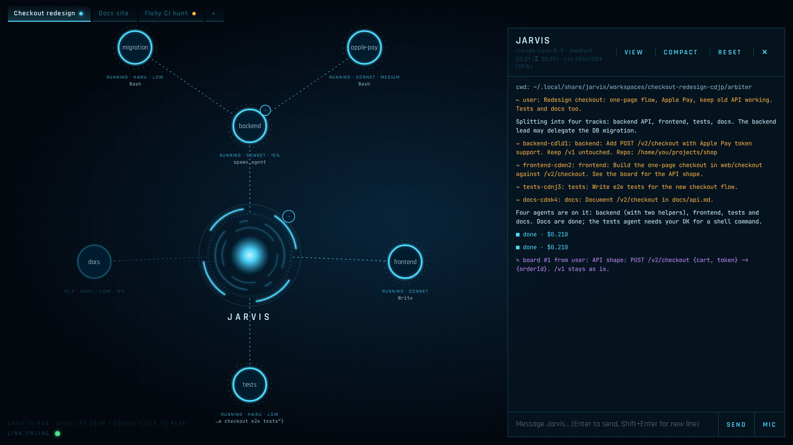
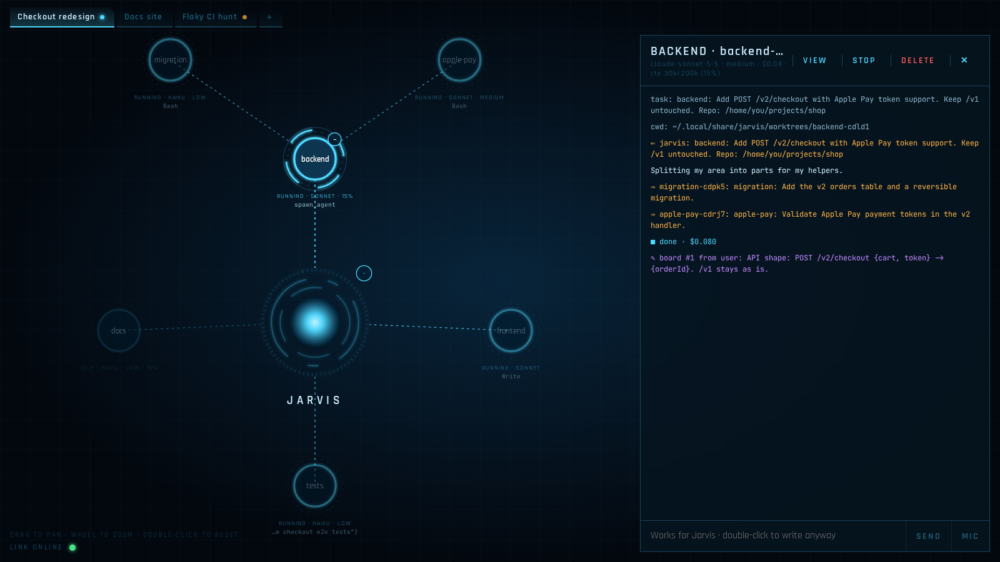
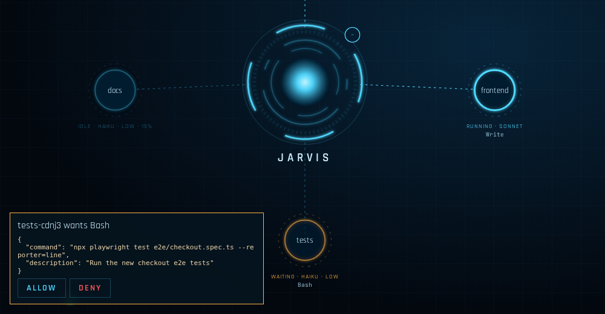
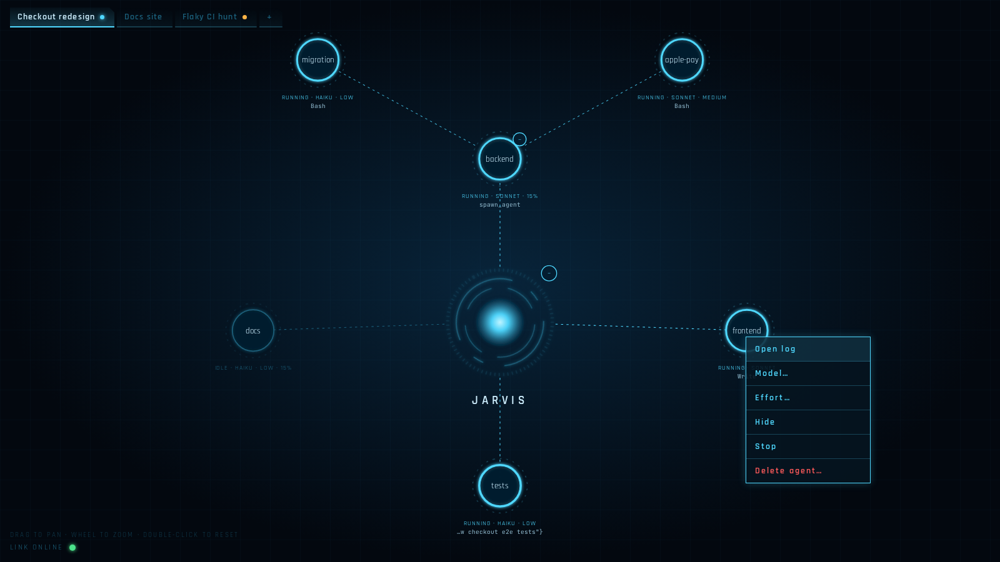
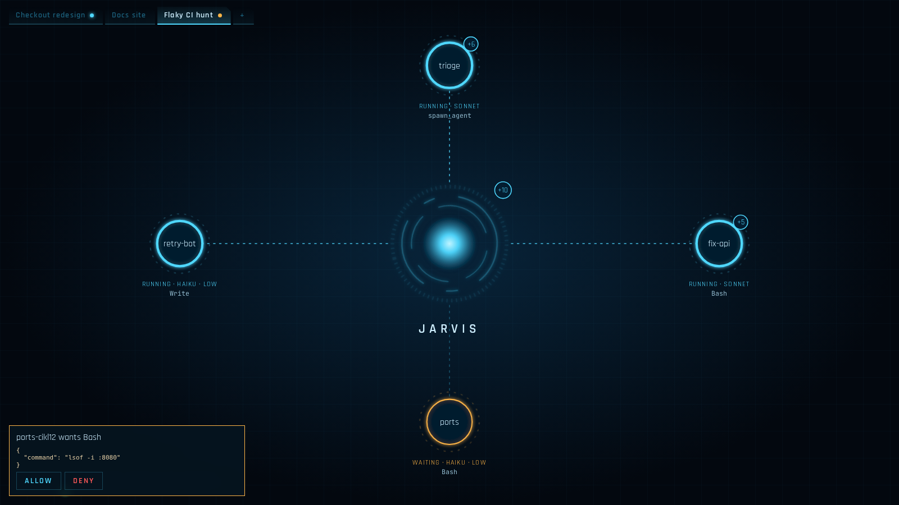
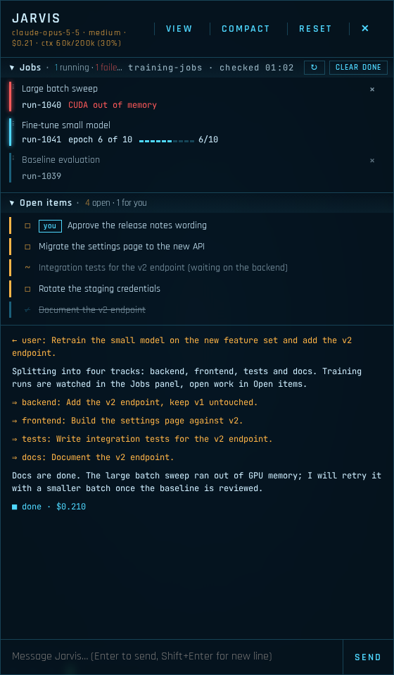
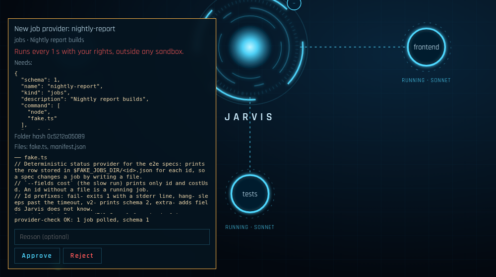

# Jarvis user guide

The details behind the [README](../README.md): what the screen shows, controls, voice input, safety, costs and every setting. For internals see [ARCHITECTURE.md](ARCHITECTURE.md).

## Contents

- [What you see](#what-you-see): map, log, approvals, controls, big teams, voice input, status dot, notes folder, panels and jobs, open items
- [Safety](#safety)
- [Costs](#costs)
- [Settings](#settings)

## What you see

### The map

Jarvis is in the center, agents around it. Each tab is a separate workspace: its own Jarvis, team and history. The tab bar spans the full width; the dot at the bottom left is the Claude health dot (below).

| Color | Meaning |
|-------|---------|
| Cyan, bright | Working right now |
| Dim | Idle, waiting for the next message |
| Amber | Waiting for your approval |
| Red | Something went wrong |
| Gray | Stopped |

### Log and chat

- Click a circle to open its log: task, messages, tool calls, cost per step.
- Give goals in Jarvis's chat. Other agents' inputs are locked; double-click one to write anyway.

### Approvals

- Agents run in Claude Code's `auto` mode. Only actions its classifier cannot decide show up as a card.
- Read the command, press ALLOW or DENY. The agent waits.

### Controls

- Drag a tab left or right to reorder workspaces; the order is kept across restarts.
- Jarvis in one workspace can message Jarvis in another (`tell_workspace`, e.g. a heads-up about a shared branch). Messages are urgent by default and wake an idle target; a reply to an urgent message is always urgent. With `urgent: false` an idle one is not woken: its tab shows a count of unread messages, and they arrive with its next turn. A wake happens only if the target is idle (a stopped one stays stopped; the reply says which targets were not woken).
- A workspace's Jarvis can start another workspace with a task (`create_workspace`). Use it when you ask a workspace to hand a separate task to a new one. The new workspace gets the same project (unless another is given), notes folder (with its own subfolder `workspaces/<id>/` in it) and Jarvis setup, and sees only the task text, so the task must be self-contained. The creating workspace keeps running. Refused while working on a message from another workspace, and after 3 creations until you write to it again.
- Right-click an agent, Jarvis or a tab: model, effort, stop, delete, hide, rename, archive.

### Big teams

- Every agent ends its report with a `VERDICT: verified`, `partial` or `failed` line; Jarvis routes on it. A small task goes straight to one agent, a large or unclear goal gets a planner agent first.
- A lead folds its helpers into a `+N` badge while none of them works.
- Only agents Jarvis starts as leads (for a large multi-part area) can hire helpers; other agents work alone. A lead shows as running until its helpers are done, then reports to Jarvis once (a restart in between loses that report).
- Jarvis hides agents that were idle over 10 minutes once it has more than 8. Right-click Jarvis for **Hide idle agents** or **Show all agents**.

### Voice input (optional)

Off by default. A mic button next to SEND turns speech into text with a local Whisper model (faster-whisper in a Python sidecar). Jarvis itself records the microphone through PipeWire, so the browser asks for no permission. Audio stays on your machine and is never stored (unless you set `JARVIS_VOICE_DEBUG_WAV`, see the env table); on release the transcript is sent at once to the agent that was selected when you started, like a voice message. Text already in the input box goes with it: one message, your draft first, a blank line, then the transcript, and the box is cleared like after SEND. If the recording is cancelled, transcription fails or the send fails, the draft stays in the box. Text you type after you released the button (while it transcribes) is not sent and stays in the box; the draft part that was sent with the transcript is cut from it, so the next SEND does not repeat it. With `JARVIS_VOICE_AUTOSEND=0` it lands in the input box at the caret instead and is never sent by itself. A failed send puts the text into that agent's draft.

To enable it:

1. Linux with PipeWire and `pw-record` (package `pipewire`, or `pipewire-bin` / `pipewire-utils`). Jarvis records the default input of your sound server: the one `wpctl status` marks with `*` under Sources.
2. Set up Python with `faster-whisper` (`voice/setup.sh` creates `voice/.venv` and fetches the models; Jarvis uses that venv by default), or point `JARVIS_VOICE_PYTHON` at a Python that already has it.
3. Start Jarvis with `JARVIS_VOICE=1` (`cpu` forces CPU). To have it on after every restart without passing the variable, put `JARVIS_VOICE=1` on a line in `$XDG_CONFIG_HOME/jarvis/env` (`~/.config/jarvis/env`). Jarvis reads that optional file of `KEY=value` lines at start, for any `JARVIS_*` variable. A variable set in the environment overrides the file; a missing file changes nothing. `JARVIS_ENV_FILE` points at another file.

If `pw-record`, Python or `faster-whisper` is missing, Jarvis starts as usual, logs one `voice disabled: ...` line (for example `voice disabled: pw-record not found`) to `server.log` and shows no mic button. The check runs after the server starts, so the mic button appears a moment later (reload the page if it is missing right after a start).

Push-to-talk: hold the mic button, or hold `Ctrl+Space` in the input box or `Alt+V` anywhere, and release to transcribe and send the text to the agent that was selected when you started (`JARVIS_VOICE_AUTOSEND=0` puts it into the input box instead). Voice follows the same guard as typing: for an agent that works for a lead the input is read-only, so recording does not start until you double-click the input to unlock it. While recording, a red strip replaces SEND: `● 0:07 release sends` (Esc, a tap or dragging away cancels; the hint is cut with an ellipsis in a narrow panel, the timer never; the typed draft keeps at least 28% of the row). To cancel, release within 0.4 s of the press (a tap), press `Esc`, or, with the mouse, drag the pointer more than about 60 px away from the button (it turns grey and struck through; move back to keep recording) and release there. A cancel sends and transcribes nothing; with autosend, switching to another window cancels too. While it transcribes the strip says `transcribing… Esc discards` and the button ignores presses; `Esc` then drops the text when it arrives (it is not inserted or sent; the transcription itself still runs to the end). The mic button is greyed out like SEND while the input is read-only. Recording stops by itself after 60 s (`JARVIS_VOICE_MAX_S`). If the server ends a recording on its own (it lost track of the page, or restarted), the button goes back to idle and a toast says `Recording stopped`. The button turns red and shows a level meter while it records. Recording starts when Jarvis has the first audio from `pw-record`, about a tenth of a second after the press, so wait for the red button before the first word. If `pw-record` cannot start, a toast says why. A muted microphone records silence and gives `No speech recognized`: check `wpctl status`.

The recorder never outlives its use: it stops on release, on `Esc`, after 60 s, when the page stops reporting for 4 s (tab closed, crash), and when Jarvis exits. Only the tab that started a recording can stop or cancel it.

The default model is `large-v3` (float16, beam 5): about 4 GB of VRAM at peak, loaded on the first recording and unloaded after 10 idle minutes. On CPU it falls back to `large-v3-turbo` (int8), which is slower than real time on a short clip. English and Russian are detected per recording. `JARVIS_VOICE_MODEL` picks another model.

### Claude health dot

The dot at the bottom left shows whether your Claude access works: green the last agent run succeeded, amber slow, rate limited or a degraded Claude API or Claude Code on the status page, red auth (including an invalid API key), network or server (5xx) failure or a partial outage there, dark red a major outage there, grey unknown (nothing has run yet; the status page alone never turns it green). Bad prompts, tool errors and aborted runs do not change it. With no run for 10 minutes and the page open, Jarvis sends one tiny Haiku request to check. Hover for your last outcome (age, latency, error type) and the Anthropic status page text with all open incidents (only the Claude API and Claude Code components color the dot, other incidents are info); click to open status.claude.com. It is global, not per workspace.

### Notes folder

- A workspace can point at a persistent markdown folder, shareable between workspaces. Set it in the **+** dialog or the tab's right-click menu.
- Jarvis reads it at the start of a goal and keeps it up to date. Other agents are only *told* to read it, and to edit it only when their task asks for it. This is a prompt rule, not enforced.
- Each workspace has its own folder `workspaces/<workspace id>/` in the notes folder, created by Jarvis when the workspace gets a notes folder (never overwritten). It holds `status.md` (current state, a `Summary:` line first), `open-items.md` and `journal/<date>.md`. Only that workspace's Jarvis writes them; other workspaces read them. Folders are named by id, so a rename changes nothing there.
- Archiving a workspace moves its notes folder `workspaces/<id>/` to `workspaces/_archive/<id>/` (the index skips it) and commits the move. Its open and parked items are not shown in the Open items panel any more and are not handed to other workspaces: the confirmation and the toast say how many stay in `_archive/<id>/open-items.md`. Restoring moves the folder back to `workspaces/<id>/` and brings the items back. A folder that already exists at the target is never overwritten (both stay, a warning is logged). Workspaces archived by an older version are moved once at the next start.
- `workspaces/index.md` is generated by Jarvis (one line per workspace: summary, open items, how many are for you). Do not edit it.
- Open items are one line each: `- [ ] 25-11-2026 text` open, `- [~] 25-11-2026 text (waiting on user)` or `(not verified)` parked, `- [x] text verified 25-11-2026: what, by which check` done. A `(you)` right after the date, as in `- [ ] 25-11-2026 (you) Decide the name`, marks what only you can do or decide.
- Workspaces that had a notes folder before this layout get their folder at the next start of their Jarvis session and one message asking it to copy its own entries from the shared `status.md` and `open-items.md`. Those shared files and the old `journal/` folder stay as they are; the server moves or deletes nothing.
- Jarvis commits the folder to git after each turn. Each workspace commits only the files its own agents changed (Jarvis and helpers); your own edits there stay uncommitted. Each commit has a short description of the change written by Jarvis, and ends with `Workspace: <name>`. Details: [docs/ARCHITECTURE.md](ARCHITECTURE.md).

### Panels and jobs

Panels are pinned blocks above Jarvis's chat. They show only while Jarvis (the center circle) is selected and at least one panel has something to show.

- **Jobs** lists long jobs: CI runs, training, deploys. A job is a row with a state edge (failed red, waiting amber, running cyan, done dim), its label, id (a link when the job source gives one), step, progress, time running and, when the job source has it, the cost as `$12.40 (as of 14:05)`. A field the job source does not return is not shown at all, never as a placeholder.
- Rows sort by severity: failed first, then stale, waiting and needing attention, then running, then done; the most recent change first. Drag a row to put it where you want; the order is kept per workspace and **Reset order** brings the sort back. A failed row stays highlighted even under your own order.
- A finished row stays until you press **×** on it or **Clear done**. **↻** checks now. Rows that Jarvis cannot refresh (job source failed, disabled or changed) are dimmed with a note.
- Each panel has a header with a summary (`2 running · 1 failed`), and a fold arrow. Folding and hiding are kept per workspace in your browser. Hide or show a panel in **VIEW**, group **Panels**. A Jobs panel with nothing running or failed starts folded.
- An open panel is as tall as its rows. Drag its bottom edge to set the height (from one row up, no upper limit); double-click the edge to go back to the row height. The height is kept per panel and workspace in your browser. Each panel scrolls its own rows with the mouse wheel while its header stays in view. If the panels together are taller than the window, the stack never scrolls: the panels you are not dragging shrink toward one row, and the chat always keeps room (about 160 px).
  In a wide panel, rows form one table: each column starts at the same x in every row. Drag the right edge of the name, job source, id or step column to set its width for all rows (from 40px up to 60% of the panel); double-click the edge to reset. These widths are kept the same way, also when you switch to another workspace and back.
- The tab shows a badge for Jobs: `✕2` failed, `⚠` stale, `◐1` waiting, `▶3` running. With nothing failed, stale, waiting or running there is no badge.
- **Who watches.** Jarvis puts a job on the panel with `watch_jobs` right after it starts the job, then Jarvis polls it with a job source every minute or so. Nothing asks a model: a poll costs no tokens. Jarvis gets one message per poll that lists every job that changed state, and a stopped Jarvis gets it with your next message. Cost and other slow numbers are fetched less often (default every 30 minutes).
- **Job sources** are small scripts that you approve once. When a job has no job source and someone keeps checking it by hand, and the workspace has a notes folder, Jarvis offers to build one (it asks once per kind of job and records your answer in `job-sources.md` in the notes folder). A new job source appears as an approval card with its manifest, files and test report; **Approve** stays off until the files are shown on the card, and pins those exact files, so a later change stops the job source until you approve again. Without a notes folder Jarvis cannot build job sources and tells you to set one. **JOB SOURCES** (top bar, shown once any job source or proposal exists, with the number of proposals waiting) lists all job sources, their state and **Approve** for a folder you placed by hand (press **Files** first: Approve stays off until the files are shown); **Details** on a job source row opens a read-only view: the screenshot if the job source has one (click for full size), folder, manifest (command, args, poll settings; env values shown as `••••`), file names, approval state on one line (approved with its date, changed since approval and needs re-approval, not approved); a job source can set `"screenshot": "screenshot.png"` in its manifest (a png, webp or jpg of at most 1 MB inside its folder, no symlink or `..`) and Jarvis shows it as a thumbnail in the Job sources list and in Details; a bad value is ignored with a warning in Details and does not affect the job source, and the picture file is hashed like any other file of the job source, so changing it after approval stops the job source until you approve again; the tab menu **Job sources…** picks which job sources one workspace may use. Unsaved ticks survive a refresh, and ticking every job source saves an empty list, which means all approved job sources. Contract, safety rules and how to write one: [JOB-SOURCES.md](JOB-SOURCES.md).
- A job source runs on your machine with your rights, outside the agent permission checks. Approve only what you read.
- Turn it all off with `JARVIS_JOBS=0` (see Settings).

### Open items

With a notes folder, the **Open items** panel shows `workspaces/<workspace id>/open-items.md` (the file Jarvis keeps, see Notes folder). The header reads `N open · M for you`. The panel is gone while the file has no items.

- Open and parked (`[~]`) items count as open. Items with `(you)` come first and carry a **you** badge; parked ones show their reason dimmed; done items are struck through.
- The panel is read-only. Tell Jarvis in chat that an item is done; it removes it from the file, and the panel follows within a second. Edit the file by hand and the panel follows too.
- Lines that do not parse are left untouched in the file, and not shown.
- After a context reset Jarvis gets the first 20 open items in its seed, so it does not raise them again.
- Turn it off with `JARVIS_OPEN_ITEMS=0` (see Settings).

### Code blocks

- Every fenced code block in the chat has a **Copy** button at its top right (shown on hover or keyboard focus, always on touch screens). One click copies the whole block.

### Clickable files

- An absolute path in a chat message (also inside `` `code` ``, not in fenced blocks or URLs) that ends in `png`, `jpg`, `jpeg`, `webp`, `gif`, `svg`, `pdf`, `txt`, `md`, `log`, `json`, `ts`, `tsx`, `js`, `mjs`, `css`, `html`, `yml`, `yaml`, `toml` or `py` is a link. A relative path (`src/server.ts`, `README.md`, with an optional `:123` or `:123:4` that is ignored) is a link only when it resolves to an existing file, looked up in this order: the workspace's project folder, its notes folder, the notes root, the agents' worktrees; the first match wins and no match stays plain text. A bare name such as `foo.ts` matches only at the top of one of those folders. A plain click opens the file in the system default program (`xdg-open`; `open` on macOS): image viewer, text editor, PDF reader. A brief note says "opened in system viewer"; an error shows as a message. The link keeps its address, so middle-click or ctrl-click still opens the file in a browser tab, served read-only by Jarvis (`GET /local-file?path=`). Jarvis runs on your machine, so the program opens there.
- Only files below these folders open: `/tmp`, `~/Pictures`, `~/Downloads`, `~/Documents`, `~/.local/share/jarvis` and `~/IdeaProjects`. `JARVIS_FILE_ROOTS` (colon-separated) replaces the list. Opening uses the same rules and the same file types as the browser tab: images, `pdf`, `txt`, `md`, `log`, `json`. Scripts, executables, `.desktop`, `.AppImage` and unknown types never open. `html` and `svg` files open in a browser tab (html as plain text, svg sandboxed), never in the system viewer. At most 10 opens per 10 seconds.
- Never served, whatever the folder: anything below a dot folder (`.ssh`, `.git`, `.config`, ...), names that look secret (`secret`, `password`, `token`, `credential`, `.env`, `.pem`, `.key`, ...), symlinks that leave the folders, directories and files over 20 MB. Jarvis answers 404 for all of these, so a denied file looks like a missing one.
- SVG opens in a sandbox: its scripts do not run.

## Safety

- **Your project folder is never edited directly** when it is a git repo. Each agent works in its own git worktree on branch `jarvis/<agent-id>`. You review and merge. When an agent is stopped or its workspace is archived, its worktree and branch are removed if the branch is merged into `main` (or has no commits) and the worktree has no uncommitted changes; anything else is kept and listed.
- **Nothing is lost silently.** Deleting an agent with unsaved changes asks you to commit or discard them. It also names the files no commit keeps, which can only be discarded: files your `.gitignore` ignores (`.env`, `node_modules`), and all files of an agent that works outside git. Archiving refuses while agents work, and commits unsaved work first. Ignored files move into the archive with the workspace and come back on restore; one the restored branch now has a file for stays parked, and deleting the agent names it. Jarvis never deletes agent branches.
- **Agents cannot run code through Jarvis's own git.** Jarvis takes the git dir from your repo, not from the worktree's `.git` file, which an agent could replace. Repos nested in a worktree are not looked into.
- **Archive, not delete.** Closing a workspace archives it (also the last one: zero workspaces is fine and shows the empty screen), and you can restore it with all conversations. Agents whose branch you have since merged and deleted come back without a workdir; delete them. If a branch is checked out somewhere else, the restore fails with that error and the workspace stays in the archive. Permanent delete works only in the archive and asks you to type the workspace name.
- **Local only.** The web UI listens on `127.0.0.1` and rejects requests from other websites.
- **Restarts are safe.** Every event is written to disk. After a restart the map, logs and costs return, and agents continue on the next message.

## Costs

- Every agent is a separate Claude session. Each panel shows its cost and **Σ**, the total with its helpers.
- The workspace tab shows the full spend of the workspace, including stopped agents and agents you deleted.
- Jarvis picks the cheapest fitting model (`haiku`, `sonnet`, `opus`). You can change it.
- Long context costs more. Press **COMPACT** to summarize. When a helper's context passes 200k tokens or its cost passes $10, its lead (or Jarvis) is told, and can restart it with a summary. Nothing is stopped automatically.
- Jarvis's own context is reset automatically. Past 150k tokens, at a calm moment (no agent of the workspace runs or waits), or past 200k tokens regardless, always after a quiet second following one of its results, the server first asks it to update its `status.md`, `open-items.md` and journal in its workspace folder of the notes folder (one save-notes turn; skipped without a notes folder), then ends the session and starts a fresh one in the same workspace. The fresh session gets a seed: the agent list, its last message and the messages it may not have handled. Both bounds are capped at 0.6 × the model's context window once that is known (so on a 200k window both act at 120k). A fresh session that starts large cannot reset again until it has grown 50k beyond its first turn. Workspace, agents, board and log are untouched; the log shows a compaction marked `reset`. The RESET button next to COMPACT in Jarvis's panel is a direct order: it resets whatever the size, and the save turn cannot stop it (Jarvis is told you ordered the reset and must not argue; if that turn fails or runs past 2 minutes, the session is replaced anyway). The confirmation depends on the notes folder: with one, Jarvis saves its state there first (editing shared project files carefully, as other workspaces may use the same folder); without one nothing is saved, only a short summary (agents, last message, pending messages) survives and the decisions of the chat are lost, so use COMPACT instead. The button is hidden while Jarvis works; a running turn is never interrupted. COMPACT is unchanged.

## Settings

All optional. Set as environment variables before `jarvis` or `npm start`:

| Variable | Default | What it does |
|----------|---------|--------------|
| `PORT` | `7777` | Web UI port |
| `JARVIS_AGENT_MODEL` | `sonnet` | Default model for new agents |
| `JARVIS_AGENT_EFFORT` | `medium` | Default agent effort (`low` ... `max`) |
| `JARVIS_LEAD_MAX_EFFORT` | `medium` | Top effort a lead may give its sub-agents; a lead also cannot give them a higher model than its own |
| `JARVIS_ARBITER_MODEL` | `sonnet` | Jarvis model |
| `JARVIS_ARBITER_EFFORT` | `medium` | Jarvis effort |
| `JARVIS_PERMISSION_MODE` | `auto` | `auto`, `acceptEdits`, `default`, ... |
| `JARVIS_PLUGINS` | `caveman@caveman,ponytail@ponytail,frontend-design@claude-plugins-official,code-simplifier@claude-plugins-official,code-review@claude-plugins-official,claude-md-management@claude-plugins-official` | Claude Code plugins agents load (comma-separated; empty = none; missing ones are skipped) |
| `JARVIS_STATUS_URL` | `https://status.claude.com/api/v2/summary.json` | Statuspage JSON behind the status dot (override only for tests) |
| `JARVIS_RESET_SOFT_TOKENS` | `150000` | Jarvis context size that triggers a reset at a calm moment; `0` turns off the soft bound |
| `JARVIS_RESET_HARD_TOKENS` | `200000` | Jarvis context size that triggers a reset at its next result; `0` turns off automatic reset entirely |
| `JARVIS_RESET_SAVE_TIMEOUT_MS` | `120000` | Longest the RESET button waits for Jarvis to save its notes before it resets anyway |
| `JARVIS_CLAUDE_PATH` | `claude` on `PATH` | Claude Code binary sessions run. Default is the first executable `claude` on `PATH` (the auto-updating install), picked up again at each session start. It falls back to the build bundled in the SDK package when none is found, when `claude --version` fails, or when it is older than the bundled one. `bundled` forces the bundled build (escape hatch); the choice is logged at startup |
| `JARVIS_PLAYWRIGHT` | `1` | Headless browser for each agent; `headed` shows windows; `0` turns it off |
| `JARVIS_JOBS` | `1` | `0` turns off the Jobs panel: no polling, no jobs tools or prompt text for Jarvis |
| `JARVIS_OPEN_CMD` | `xdg-open` (`open` on macOS) | Program that opens a clicked file; it gets the real path as its only argument (tests use a stub) |
| `JARVIS_FILE_ROOTS` | `/tmp`, `~/Pictures`, `~/Downloads`, `~/Documents`, `~/.local/share/jarvis`, `~/IdeaProjects` | Colon-separated folders whose files chat links may open (see Clickable files) |
| `JARVIS_OPEN_ITEMS` | `1` | `0` turns off the Open items panel and its prompt text |
| `JARVIS_JOB_SOURCES_DIR` | `$XDG_CONFIG_HOME/jarvis/job-sources` (`~/.config/...`) | Folder with job sources, one subfolder each |
| `JARVIS_JOBS_MIN_POLL_S` | unset | Tests only: lowers the minimum poll, slow-field interval and `timeoutS` (normally 15 s, 15 min and 5 s) to this many seconds |
| `JARVIS_VOICE` | unset (off) | `1` turns voice input on, `cpu` forces CPU. See Voice input |
| `JARVIS_VOICE_AUTOSEND` | `1` | On release the transcript is sent at once to the agent that was selected when recording started (like a Telegram voice message); a draft in the input box is sent with it, ahead of the transcript. `0` inserts it into the input box instead, without sending |
| `JARVIS_VOICE_MAX_S` | `60` | Seconds after which the server stops a recording by itself (the audio so far is still transcribed on release) |
| `JARVIS_VOICE_LEASE_S` | `4` | Seconds without a level poll from the page after which the server discards a recording and closes the microphone |
| `JARVIS_VOICE_MUTE_OUTPUT` | `1` | `0` keeps the speakers on while recording. By default Jarvis mutes the default output while it records (it looks up the sink's numeric id and node name once and mutes and unmutes that sink, so a headset reconnect or a changed default cannot leave it muted; if the lookup fails it mutes nothing and logs one line), so sound from speakers does not bleed into the microphone, and unmutes it when the last active recording ends for any reason (stop, cancel, error, lease, exit, SIGTERM/SIGINT/SIGHUP). Several Jarvis processes share the mute: the last one to finish unmutes. An output you had muted before stays muted; a mute you set yourself during a recording is undone when it ends. A failed unmute is retried every 2 s (5 times), at the next recording and at exit, and the last failure logs `voice: cannot unmute sink <id>`. Jarvis keeps a marker file `voice-muted` in its data folder while it holds the mute (if you delete it while recordings run, the first one to end unmutes); after a crash or SIGKILL the next start (also with `JARVIS_VOICE_MUTE_OUTPUT=0`) or the next recording unmutes exactly that sink (a headset that came back with a new id is found by its node name) and logs `voice: restored the output mute left by a previous run`. Known limit: if Jarvis is killed with SIGKILL and never started again, the output stays muted: `wpctl set-mute @DEFAULT_AUDIO_SINK@ 0`. Without `wpctl` it logs one line and does nothing |
| `JARVIS_VOICE_PYTHON` | `voice/.venv/bin/python` if it exists, else `python3` | Python with `faster-whisper` for the voice sidecar |
| `JARVIS_VOICE_MODEL` | `large-v3` | Whisper model of the sidecar |
| `JARVIS_VOICE_LANGS` | `en,ru` | Languages the sidecar picks from |
| `JARVIS_VOICE_IDLE_S` | `600` | Idle seconds before the sidecar exits and frees VRAM |
| `JARVIS_VOICE_TIMEOUT_S` | `120` | Seconds one recording may take to transcribe; then the sidecar is killed, the request fails and the next one restarts it |
| `JARVIS_VOICE_PROMPT` | unset | Extra Whisper initial-prompt terms, appended to the built-in list (comma-separated names and terms). The built-in list biases recognition toward English dev terms said in Russian speech: Jarvis, workspace, worktree, arbiter, agent, spawn, board, notes, Claude, Opus, Sonnet, git, commit, branch, rebase, merge, push, pull request, PR, main, diff, review, test, e2e, npm, TypeScript, Python, Docker, Kafka, API, CI, bug, fix, refactor, deploy (full text: `DEFAULT_PROMPT` in `voice/stt.py`). Keep it a plain list of terms, not a sentence: a result that equals or nearly equals the prompt, repeats its start, or repeats a run of two or more of its terms is dropped as an echo (a prompt under 4 words only when repeated whole) |
| `JARVIS_VOICE_VOCAB` | `$XDG_CONFIG_HOME/jarvis/voice-vocab.txt` (`~/.config/...`) | Vocabulary file for recognition: one word or phrase per line (UTF-8, Russian and English mixed), blank lines and `#` comment lines ignored. Its words go into the Whisper prompt after the built-in list and before `JARVIS_VOICE_PROMPT`. Whisper keeps about 224 prompt tokens, so words that do not fit are cut from the end of the file (logged once). Re-read when the file changes, at the next recording, no restart. Missing file: no change; an unreadable one is logged once and ignored. Jarvis never creates it; see `voice/voice-vocab.example.txt` |
| (vocabulary by chat) | | With voice on, tell the arbiter "add the word X to the voice dictionary" (or remove it, or list it): its `voice_vocab` tool edits the vocabulary file above. It creates the file and folder if missing, skips duplicates (case-insensitive), empty or `#` words, words over 80 characters, and anything past 8 KB in total, keeps comment lines, and warns when the Whisper prompt budget cuts the tail. Agents do not have the tool |
| `JARVIS_VOICE_PROMPT_DEFAULT` | `1` | `0` leaves the built-in term list out, so only `JARVIS_VOICE_PROMPT` is used; with both, no prompt at all |
| `JARVIS_VOICE_DEBUG_WAV` | unset (off) | Directory. **Deliberately writes your audio and its transcript to disk**: every recording overwrites `<dir>/last.wav` (16 kHz mono s16) and `<dir>/last.txt`. For diagnosing recognition quality; leave unset otherwise |

Data lives in `~/.local/share/jarvis/` (or `$XDG_DATA_HOME/jarvis`), never in this repo.
