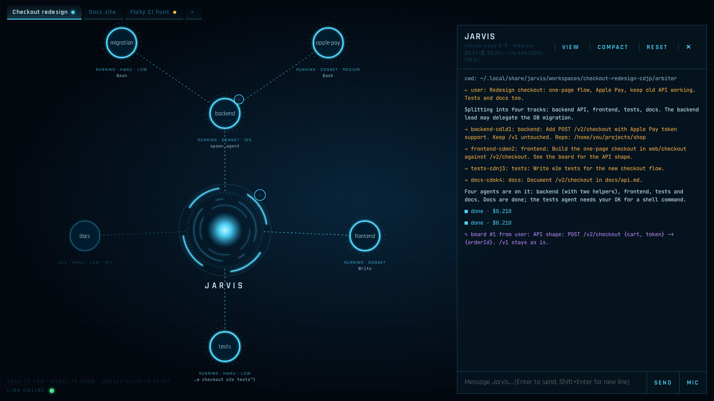
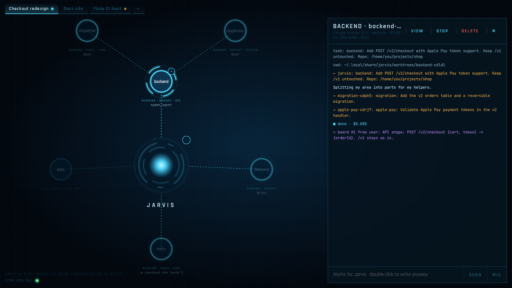
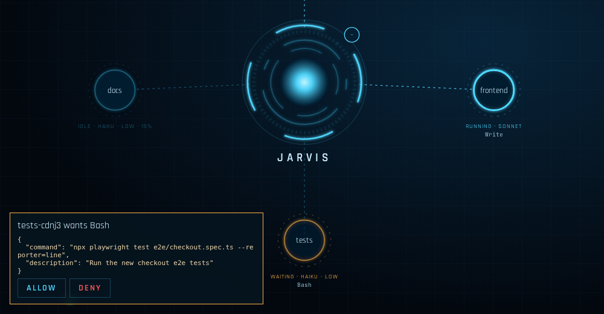
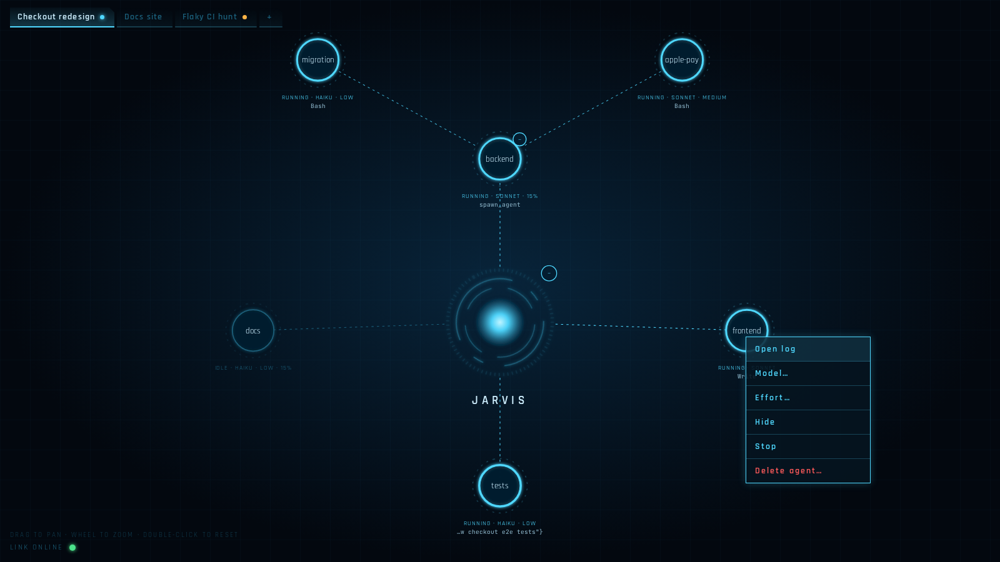
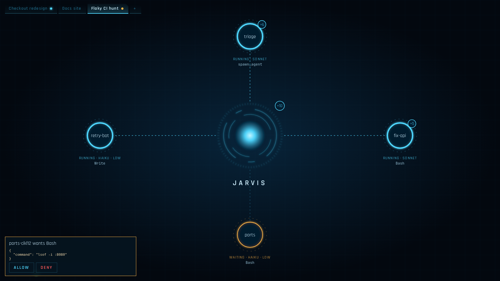
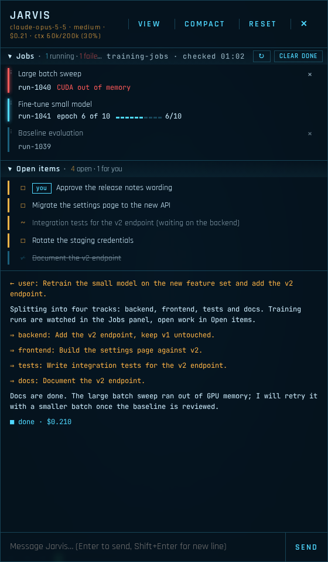
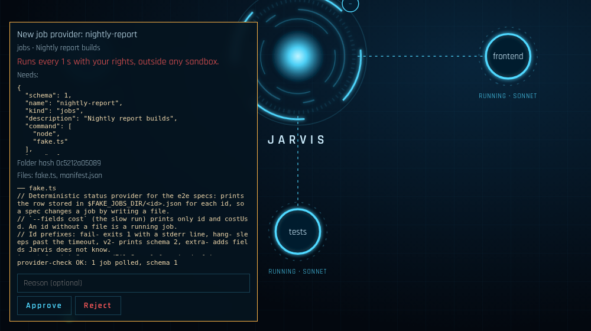

# Using Jarvis

The details behind the [README](../README.md): what the screen shows, controls, safety, costs and the settings. Topics with their own page: [voice input](VOICE.md) and [job sources](JOB-SOURCES.md). For internals see [ARCHITECTURE.md](ARCHITECTURE.md).

## Contents

- [What you see](#what-you-see): map, log, approvals, controls, big teams, voice input (short), connections, status dot, notes folder, panels and jobs, open items
- [Safety](#safety)
- [Costs](#costs)
- [Settings](#settings)

## What you see

### The map

Jarvis is in the center, agents around it. Each tab is a separate workspace: its own Jarvis, team and history. The tab bar spans the full width; the dot at the bottom left is the Claude health dot (below).

| Color | Meaning |
|-------|---------|
| Cyan, bright | Working right now |
| Dim | Idle, waiting for the next message |
| Amber | Waiting for your approval |
| Red | Something went wrong |
| Gray | Stopped |

### Log and chat

- Click a circle to open its log: task, messages, tool calls, cost per step.
- Give goals in Jarvis's chat. Other agents' inputs are locked; double-click one to write anyway.

### Approvals

- Agents run in Claude Code's `auto` mode. Only actions its classifier cannot decide show up as a card.
- Read the command, press ALLOW or DENY. The agent waits.

### Controls

- Drag a tab left or right to reorder workspaces; the order is kept across restarts.
- Jarvis in one workspace can message Jarvis in another (`tell_workspace`, e.g. a heads-up about a shared branch). Messages are urgent by default and wake an idle target; a reply to an urgent message is always urgent. With `urgent: false` an idle one is not woken: its tab shows a count of unread messages, and they arrive with its next turn. A wake happens only if the target is idle (a stopped one stays stopped; the reply says which targets were not woken).
- A workspace's Jarvis can start another workspace with a task (`create_workspace`). Use it when you ask a workspace to hand a separate task to a new one. The new workspace gets the same project (unless another is given), notes folder (with its own subfolder `workspaces/<id>/` in it) and Jarvis setup, and sees only the task text, so the task must be self-contained. The creating workspace keeps running. Refused while working on a message from another workspace, and after 3 creations until you write to it again.
- Right-click an agent, Jarvis or a tab: model, effort, stop, delete, hide, rename, archive.

### Big teams

- Every agent ends its report with a `VERDICT: verified`, `partial` or `failed` line; Jarvis routes on it. A small task goes straight to one agent, a large or unclear goal gets a planner agent first.
- A lead folds its helpers into a `+N` badge while none of them works.
- Only agents Jarvis starts as leads (for a large multi-part area) can hire helpers; other agents work alone. A lead shows as running until its helpers are done, then reports to Jarvis once (a restart in between loses that report).
- Jarvis hides agents that were idle over 10 minutes once it has more than 8. Right-click Jarvis for **Hide idle agents** or **Show all agents**.

### Voice input (optional)

Off by default. A mic button next to SEND turns speech into text with a local Whisper model; hold it (or `Ctrl+Space` in the input box, or `Alt+V`), speak and release to send. Setup, controls, the vocabulary and every setting are in [VOICE.md](VOICE.md).

### Connections

**CONNECTIONS** (top bar) lists how agents reach an LLM: **Anthropic login** (built in, the default) and gateways you add, for example a company LiteLLM. **ADD CONNECTION** asks for a name, the base URL of the gateway (a trailing `/` or `/v1` is removed), the API key and the model name the gateway serves for each of haiku, sonnet and opus. **TEST CONNECTION** saves the form and sends a 1-token request to the gateway; the result shows below the form. **SET AS DEFAULT** makes workspaces without their own choice use it; after a confirmation their agents stop and start new sessions without their earlier conversation. Changing the base URL of a connection in use asks the same. The API key is required. On edit, an empty key field keeps the stored key. Claude Code officially supports only Claude-named models through a gateway; other names may work, with no guarantee.

The New workspace form has a **Connection** dropdown; the label `via <name>` at the bottom left shows the connection of the open workspace and opens the same choice as the tab menu entry `Connection…`. Changing it stops all agents of the workspace and starts new sessions without their earlier conversation (the files stay); Jarvis never continues a conversation under another provider. A connection that a workspace uses cannot be deleted. Keys are stored in `~/.config/jarvis/connections.json` (readable only by you) and are never sent to the browser again; the list shows only the last 4 characters. A connection that only archived workspaces name can be deleted (restoring such a workspace makes it follow the default).

With a gateway as default, the health dot checks the gateway; its tooltip still shows the status.claude.com level, which does not matter for workspaces that use the gateway.

### Claude health dot

The dot at the bottom left shows whether your Claude access works: green the last agent run succeeded, amber slow, rate limited or a degraded Claude API or Claude Code on the status page, red auth (including an invalid API key), network or server (5xx) failure or a partial outage there, dark red a major outage there, grey unknown (nothing has run yet; the status page alone never turns it green). Bad prompts, tool errors and aborted runs do not change it. With no run for 10 minutes and the page open, Jarvis sends one tiny Haiku request to check. Hover for your last outcome (age, latency, error type) and the Anthropic status page text with all open incidents (only the Claude API and Claude Code components color the dot, other incidents are info); click to open status.claude.com. It is global, not per workspace.

### Notes folder

A workspace can point at a persistent markdown folder, shareable between workspaces. Set it in the **+** dialog or the tab's right-click menu (`Notes folder…`). Jarvis keeps it up to date and commits it to git after each turn. Layout, open items, commits, archiving and everything else: [NOTES.md](NOTES.md).

### Panels and jobs

Panels are pinned blocks above Jarvis's chat. They show only while Jarvis (the center circle) is selected and at least one panel has something to show.

- **Jobs** lists long jobs: CI runs, training, deploys. A job is a row with a state edge (failed red, waiting amber, running cyan, done dim), its label, id (a link when the job source gives one), step, progress, time running and, when the job source has it, the cost as `$12.40 (as of 14:05)`. A field the job source does not return is not shown at all, never as a placeholder.
- Rows sort by severity: failed first, then stale, waiting and needing attention, then running, then done; the most recent change first. Drag a row to put it where you want; the order is kept per workspace and **Reset order** brings the sort back. A failed row stays highlighted even under your own order.
- A finished row stays until you press **×** on it or **Clear done**. **↻** checks now. Rows that Jarvis cannot refresh (job source failed, disabled or changed) are dimmed with a note.
- Each panel has a header with a summary (`2 running · 1 failed`), and a fold arrow. Folding and hiding are kept per workspace in your browser. Hide or show a panel in **VIEW**, group **Panels**. A Jobs panel with nothing running or failed starts folded.
- An open panel is as tall as its rows. Drag its bottom edge to set the height (from one row up, no upper limit); double-click the edge to go back to the row height. The height is kept per panel and workspace in your browser. Each panel scrolls its own rows with the mouse wheel while its header stays in view. If the panels together are taller than the window, the stack never scrolls: the panels you are not dragging shrink toward one row, and the chat always keeps room (about 160 px).
  In a wide panel, rows form one table: each column starts at the same x in every row. Drag the right edge of the name, job source, id or step column to set its width for all rows (from 40px up to 60% of the panel); double-click the edge to reset. These widths are kept the same way, also when you switch to another workspace and back.
- The tab shows a badge for Jobs: `✕2` failed, `⚠` stale, `◐1` waiting, `▶3` running. With nothing failed, stale, waiting or running there is no badge.
- **Job source tabs.** With several job sources the panel has one tab per job source, with failed and running counts; a tab lights up when its jobs changed since you last opened it. Drag a tab, or press Alt+Left or Alt+Right on it, to reorder the tabs; the order is kept per workspace and new job sources join at the end. Right-click a tab (or press Delete, or the context-menu key) to close it: that only hides the tab, the job source is still polled and its jobs stay watched. The `+` at the right end of the tab bar lists the approved job sources without a tab and opens one again (an empty tab when it has no jobs here); an amber dot on the `+` means a hidden job source changed. With nothing left to add the `+` is greyed out and its hint says to ask the agent to create a job source. The last open tab cannot be closed.
- **Who watches.** Jarvis puts a job on the panel with `watch_jobs` right after it starts the job, then Jarvis polls it with a job source every minute or so. Nothing asks a model: a poll costs no tokens. Jarvis gets one batched message per poll that lists every job that changed state, and a stopped Jarvis gets it with your next message. Cost and other slow numbers are fetched less often (default every 30 minutes).
- **Job sources** are small scripts that you approve once. When a job has no job source and someone keeps checking it by hand, and the workspace has a notes folder, Jarvis offers to build one (it asks once per kind of job and records your answer in `job-sources.md` in the notes folder). A new job source appears as an approval card with its manifest, files and test report; **Approve** stays off until the files are shown on the card, and pins those exact files, so a later change stops the job source until you approve again. Without a notes folder Jarvis cannot build job sources and tells you to set one. **JOB SOURCES** (top bar, shown once any job source or proposal exists, with the number of proposals waiting) lists all job sources, their state and **Approve** for a folder you placed by hand (press **Files** first: Approve stays off until the files are shown); **Details** on a job source row opens a read-only view: the screenshot if the job source has one (click for full size), folder, manifest (command, args, poll settings; env values shown as `••••`), file names, approval state on one line (approved with its date, changed since approval and needs re-approval, not approved); a job source can set `"screenshot": "screenshot.png"` in its manifest (a png, webp or jpg of at most 1 MB inside its folder, no symlink or `..`) and Jarvis shows it as a thumbnail in the Job sources list and in Details; a bad value is ignored with a warning in Details and does not affect the job source, and the picture file is hashed like any other file of the job source, so changing it after approval stops the job source until you approve again; the tab menu **Job sources…** picks which job sources one workspace may use. Unsaved ticks survive a refresh, and ticking every job source saves an empty list, which means all approved job sources. Contract, safety rules and how to write one: [JOB-SOURCES.md](JOB-SOURCES.md).
- A job source runs on your machine with your rights, outside the agent permission checks. Approve only what you read.
- Turn it all off with `JARVIS_JOBS=0` (see Settings).

### Open items

With a notes folder, the read-only **Open items** panel shows the workspace's `open-items.md` above the chat. Tell Jarvis in chat that an item is done and it edits the file. Details: [NOTES.md](NOTES.md#open-items). Turn it off with `JARVIS_OPEN_ITEMS=0` (see Settings).

### Code blocks

- Every fenced code block in the chat has a **Copy** button at its top right (shown on hover or keyboard focus, always on touch screens). One click copies the whole block.

### Clickable files

- An absolute path in a chat message (also inside `` `code` ``, not in fenced blocks or URLs) that ends in `png`, `jpg`, `jpeg`, `webp`, `gif`, `svg`, `pdf`, `txt`, `md`, `log`, `json`, `ts`, `tsx`, `js`, `mjs`, `css`, `html`, `yml`, `yaml`, `toml` or `py` is a link. A relative path (`src/server.ts`, `README.md`, with an optional `:123` or `:123:4` that is ignored) is a link only when it resolves to an existing file, looked up in this order: the workspace's project folder, its notes folder, the notes root, the agents' worktrees; the first match wins and no match stays plain text. A bare name such as `foo.ts` matches only at the top of one of those folders. A plain click opens the file in the system default program (`xdg-open`; `open` on macOS): image viewer, text editor, PDF reader. A brief note says "opened in system viewer"; an error shows as a message. The link keeps its address, so middle-click or ctrl-click still opens the file in a browser tab, served read-only by Jarvis (`GET /local-file?path=`). Jarvis runs on your machine, so the program opens there.
- Only files below these folders open: `/tmp`, `~/Pictures`, `~/Downloads`, `~/Documents`, `~/.local/share/jarvis` and `~/IdeaProjects`. `JARVIS_FILE_ROOTS` (colon-separated) replaces the list. Opening uses the same rules and the same file types as the browser tab: images, `pdf`, `txt`, `md`, `log`, `json`. Scripts, executables, `.desktop`, `.AppImage` and unknown types never open. `html` and `svg` files open in a browser tab (html as plain text, svg sandboxed), never in the system viewer. At most 10 opens per 10 seconds.
- Never served, whatever the folder: anything below a dot folder (`.ssh`, `.git`, `.config`, ...), names that look secret (`secret`, `password`, `token`, `credential`, `.env`, `.pem`, `.key`, ...), symlinks that leave the folders, directories and files over 20 MB. Jarvis answers 404 for all of these, so a denied file looks like a missing one.
- SVG opens in a sandbox: its scripts do not run.

## Safety

- **Your project folder is never edited directly** when it is a git repo. Each agent works in its own git worktree on branch `jarvis/<agent-id>`. You review and merge. When an agent is stopped or its workspace is archived, its worktree and branch are removed if the branch is merged into `main` (or has no commits) and the worktree has no uncommitted changes; anything else is kept and listed.
- **Nothing is lost silently.** Deleting an agent with unsaved changes asks you to commit or discard them. It also names the files no commit keeps, which can only be discarded: files your `.gitignore` ignores (`.env`, `node_modules`), and all files of an agent that works outside git. Archiving refuses while agents work, and commits unsaved work first. Ignored files move into the archive with the workspace and come back on restore; one the restored branch now has a file for stays parked, and deleting the agent names it. Jarvis never deletes agent branches.
- **Agents cannot run code through Jarvis's own git.** Jarvis takes the git dir from your repo, not from the worktree's `.git` file, which an agent could replace. Repos nested in a worktree are not looked into.
- **Archive, not delete.** Closing a workspace archives it (also the last one: zero workspaces is fine and shows the empty screen), and you can restore it with all conversations. Agents whose branch you have since merged and deleted come back without a workdir; delete them. If a branch is checked out somewhere else, the restore fails with that error and the workspace stays in the archive. Permanent delete works only in the archive and asks you to type the workspace name.
- **Local only.** The web UI listens on `127.0.0.1` and rejects requests from other websites.
- **Restarts are safe.** Every event is written to disk. After a restart the map, logs and costs return, and agents continue on the next message.

## Costs

- Every agent is a separate Claude session. Each panel shows its cost and **Σ**, the total with its helpers.
- The workspace tab shows the full spend of the workspace, including stopped agents and agents you deleted.
- Jarvis picks the cheapest fitting model (`haiku`, `sonnet`, `opus`). You can change it.
- Long context costs more. Press **COMPACT** to summarize. When a helper's context passes 200k tokens or its cost passes $10, its lead (or Jarvis) is told, and can restart it with a summary. Nothing is stopped automatically.
- Jarvis's own context is reset automatically. Past 150k tokens, at a calm moment (no agent of the workspace runs or waits), or past 200k tokens regardless, always after a quiet second following one of its results, the server first asks it to update its `status.md`, `open-items.md` and journal in its workspace folder of the notes folder (one save-notes turn; skipped without a notes folder), then ends the session and starts a fresh one in the same workspace. The fresh session gets a seed: the agent list, its last message and the messages it may not have handled. Both bounds are capped at 0.6 × the model's context window once that is known (so on a 200k window both act at 120k). A fresh session that starts large cannot reset again until it has grown 50k beyond its first turn. Workspace, agents, board and log are untouched; the log shows a compaction marked `reset`. The RESET button next to COMPACT in Jarvis's panel is a direct order: it resets whatever the size, and the save turn cannot stop it (Jarvis is told you ordered the reset and must not argue; if that turn fails or runs past 2 minutes, the session is replaced anyway). The confirmation depends on the notes folder: with one, Jarvis saves its state there first (editing shared project files carefully, as other workspaces may use the same folder); without one nothing is saved, only a short summary (agents, last message, pending messages) survives and the decisions of the chat are lost, so use COMPACT instead. The button is hidden while Jarvis works; a running turn is never interrupted. COMPACT is unchanged.

## Settings

All optional. Set as environment variables before `jarvis` or `npm start`:

| Variable | Default | What it does |
|----------|---------|--------------|
| `PORT` | `7777` | Web UI port |
| `JARVIS_AGENT_MODEL` | `sonnet` | Default model for new agents |
| `JARVIS_AGENT_EFFORT` | `medium` | Default agent effort (`low` ... `max`) |
| `JARVIS_LEAD_MAX_EFFORT` | `medium` | Top effort a lead may give its sub-agents; a lead also cannot give them a higher model than its own |
| `JARVIS_ARBITER_MODEL` | `sonnet` | Jarvis model |
| `JARVIS_ARBITER_EFFORT` | `medium` | Jarvis effort |
| `JARVIS_PERMISSION_MODE` | `auto` | `auto`, `acceptEdits`, `default`, ... |
| `JARVIS_PLUGINS` | `caveman@caveman,ponytail@ponytail,frontend-design@claude-plugins-official,code-simplifier@claude-plugins-official,code-review@claude-plugins-official,claude-md-management@claude-plugins-official` | Claude Code plugins agents load (comma-separated; empty = none; missing ones are skipped) |
| `JARVIS_STATUS_URL` | `https://status.claude.com/api/v2/summary.json` | Statuspage JSON behind the status dot (override only for tests) |
| `JARVIS_RESET_SOFT_TOKENS` | `150000` | Jarvis context size that triggers a reset at a calm moment; `0` turns off the soft bound |
| `JARVIS_RESET_HARD_TOKENS` | `200000` | Jarvis context size that triggers a reset at its next result; `0` turns off automatic reset entirely |
| `JARVIS_RESET_SAVE_TIMEOUT_MS` | `120000` | Longest the RESET button waits for Jarvis to save its notes before it resets anyway |
| `JARVIS_CLAUDE_PATH` | `claude` on `PATH` | Claude Code binary sessions run. Default is the first executable `claude` on `PATH` (the auto-updating install), picked up again at each session start. It falls back to the build bundled in the SDK package when none is found, when `claude --version` fails, or when it is older than the bundled one. `bundled` forces the bundled build (escape hatch); the choice is logged at startup |
| `JARVIS_PLAYWRIGHT` | `1` | Headless browser for each agent; `headed` shows windows; `0` turns it off |
| `JARVIS_JOBS` | `1` | `0` turns off the Jobs panel: no polling, no jobs tools or prompt text for Jarvis |
| `JARVIS_OPEN_CMD` | `xdg-open` (`open` on macOS) | Program that opens a clicked file; it gets the real path as its only argument (tests use a stub) |
| `JARVIS_FILE_ROOTS` | `/tmp`, `~/Pictures`, `~/Downloads`, `~/Documents`, `~/.local/share/jarvis`, `~/IdeaProjects` | Colon-separated folders whose files chat links may open (see Clickable files) |
| `JARVIS_OPEN_ITEMS` | `1` | `0` turns off the Open items panel and its prompt text |
| `JARVIS_JOB_SOURCES_DIR` | `$XDG_CONFIG_HOME/jarvis/job-sources` (`~/.config/...`) | Folder with job sources, one subfolder each |
| `JARVIS_JOBS_MIN_POLL_S` | unset | Tests only: lowers the minimum poll, slow-field interval and `timeoutS` (normally 15 s, 15 min and 5 s) to this many seconds |
| `JARVIS_TELEGRAM` | unset (off) | `1` starts the Telegram bridge with Jarvis; off by default. Other values and the env file: [TELEGRAM.md](TELEGRAM.md#start-with-jarvis) |
| `JARVIS_VOICE`, `JARVIS_VOICE_*` | unset (off) | Voice input (`1`, or `cpu` for CPU mode; off by default) and its tuning. All variables are in [VOICE.md](VOICE.md#configuration) |

Data lives in `~/.local/share/jarvis/` (or `$XDG_DATA_HOME/jarvis`), never in this repo.
